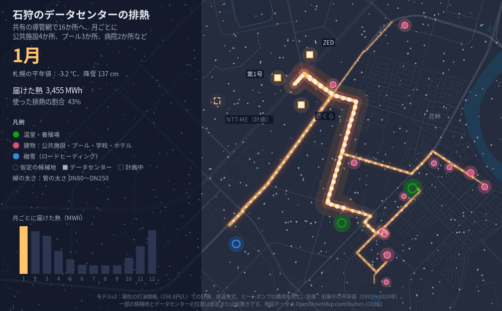
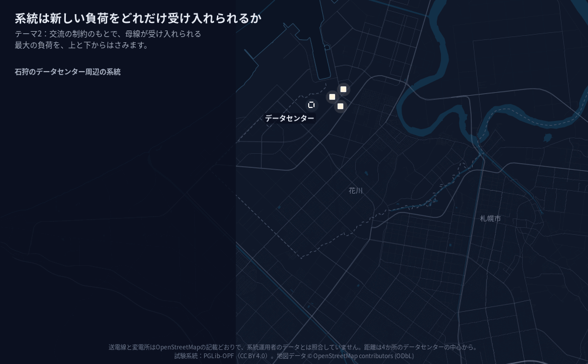
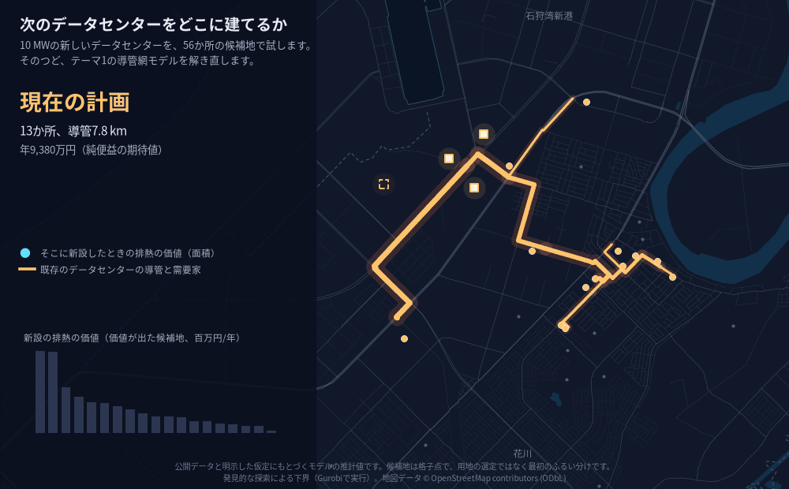
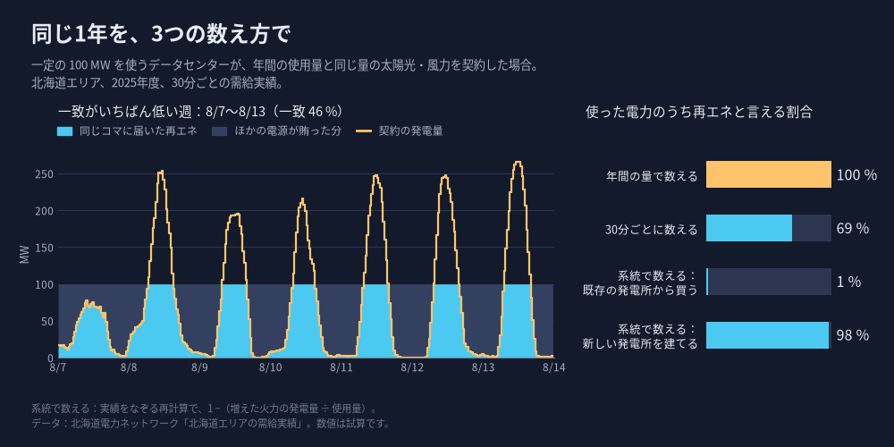
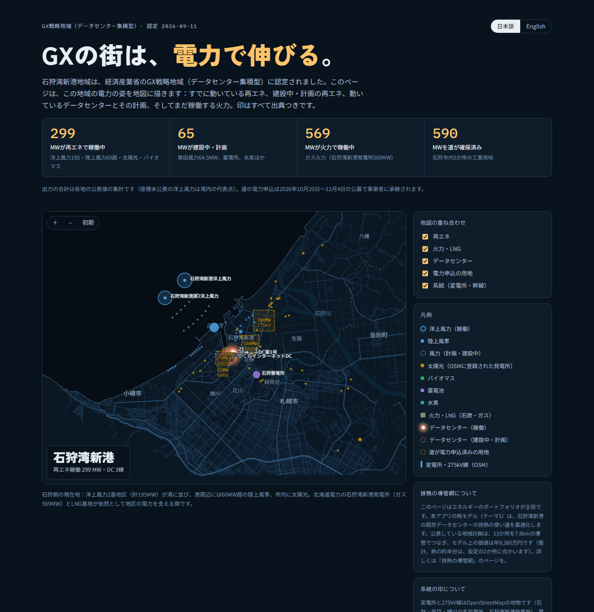
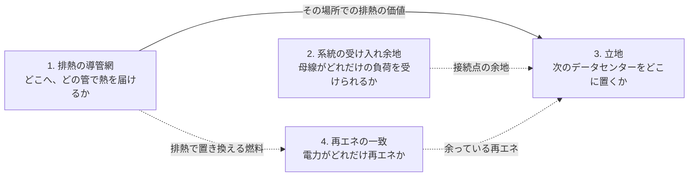
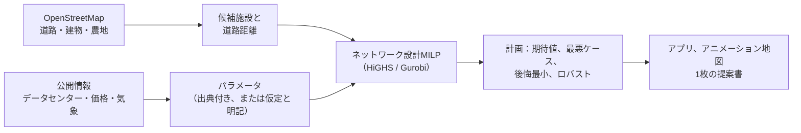
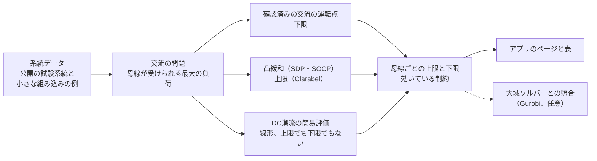
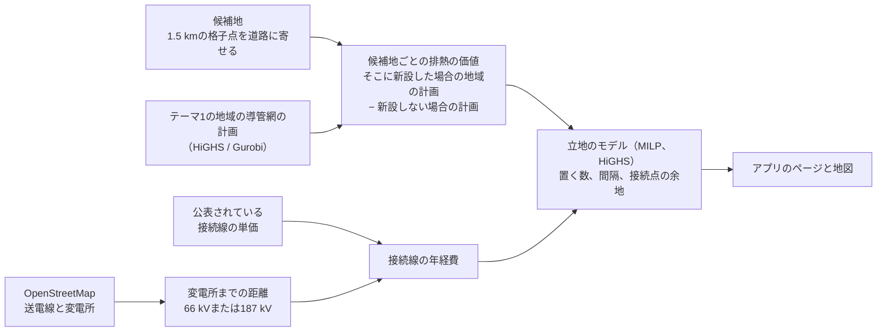
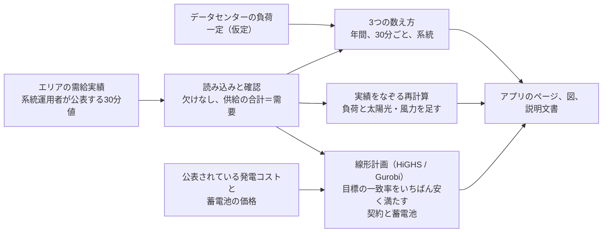

# Team Data Center

**北海道・石狩のデータセンターの最適化。** 排熱をどこへ届けるか。電力系統は新しい負荷をどれだけ受け入れられるか。次のデータセンターをどこに建てるか。その電力は、30分ごとに見てどれだけ再エネか。

[English](README.md)



*改良版モデル（v2）で、今の灯油価格（156.8円/L [11]）・ヒートポンプ費込みの計画です。1本の共同の導管網で、石狩湾新港の2つのデータセンターの排熱を19か所（公共施設、プール、学校、ホテル、病院、陸上養殖、温室の新設候補、道路融雪）に届けます。線の太さは管の太さ、明るさと粒の速さは月ごとの流量を表し、雪の多い月には雪が降ります。下の棒グラフは月ごとに届けた熱です。施設とデータセンターの位置には、仮定や仮置きのものが含まれます（[データと出典](#データと出典)）。地図データ © OpenStreetMap contributors（ODbL）。*

## このプロジェクトについて

[Hack × Hokkaido Build Week 2026](https://www.hackhokkaido.com/) で始めたプロジェクトです。このイベントは、2026年11月23〜27日に札幌で開かれたAIのビルドウィーク [1] で、海外のエンジニアと北海道の人たちが、オープンデータを使って北海道の課題の試作品を作ります。応募するリポジトリは、MITライセンスで公開することになっています。

私たちは、アイデアスターターの **「Warm Ishikari」** を選びました。データセンターの排熱の熱源と使い手（温室・陸上養殖・融雪・浴場）を地図に載せ、使える熱・距離・節約額を見積もります。そのうえで、見込みのあるペアごとに1枚の提案書を作ります。どの数字にも出典を付けるか、仮定と明記します。私たちはこれを最適化の問題として扱い、4つの研究テーマに広げました。イベントの後も研究を続ける予定です。

## なぜ重要か

- **データセンターが集まりつつある。** 石狩湾新港には複数のデータセンターがあります [6–10]。そのひとつ、石狩再エネデータセンター第1号は、2026年8月1日に再エネ100%で稼働を始めました [2, 4, 5]。国の「ワット・ビット連携」（2025年）は、大規模なデータセンター集積地を電源の近くに置くための基準を示しています [14]。
- **排熱を捨てる隣で、燃料を燃やしている。** 空冷のサーバーの排熱（25〜40℃程度 [16, 17]）は、ほとんどが捨てられています。一方、近くの温室・プール・浴場・融雪では灯油を燃やしています。北海道の灯油価格は、2026年11月16日の国の調査で156.8円/Lです [11]。
- **海外では再利用が義務になっている。** EUでは、1MWを超えるデータセンターに、費用便益分析で不可能と示されない限り排熱の利用を求めています [13]。日本では同様の決まりは見つかりませんでした [14]。

## 4つの研究テーマ

| | 問い | 方法 | 状況 |
|---|---|---|---|
| 1. 排熱の導管網 | どの施設を、どのデータセンターに、どの道路沿いに、どの太さの管でつなぐか | 月別の熱収支つきのネットワーク設計MILP（確率計画版・ロバスト版） [23–26, 31–36] | モデルv1・v2、アプリ、アニメーション地図 |
| 2. 系統の受け入れ余地 | データセンターとヒートポンプの負荷を、系統のどこにどれだけ受け入れられるか | 交流最適潮流の凸緩和（SDP/SOCP）による上限の保証と、実行可能な解 [37–47, 59–64] | 手法とアプリのページ。公開の試験系統で検証 |
| 3. 立地 | 次のデータセンターをどこに建てるか | テーマ1と2の結果を使う施設配置問題 [48–52] | 最初のふるい分け：候補地ごとの排熱の価値、系統までの距離、アプリのページ |
| 4. 再エネの一致 | データセンターの電力は、使った30分ごとに見てどれだけ再エネか。系統では何が変わるか | エリアの30分ごとの需給実績での集計と、いちばん安い契約と蓄電池を求める線形計画 [66–71] | 最初の版：需給実績2年度分、アプリのページ |

## これまでの結果（テーマ1）

> **数値はすべてモデルによる推計値です。** 公開データと明示した仮定にもとづくもので、実測値や見積りではありません。候補地・需要・データセンターの位置の一部は仮定で、主な計画が届ける熱の約半分は仮定の2施設向けです（「この結果が何に支えられているか」、注意点、[docs/data-sources.md](docs/data-sources.md) を参照）。

数字はすべて年間の正味の便益（百万円）です。便益は「置き換えた灯油の価値 − ヒートポンプの電気代 − 導管とヒートポンプの投資の年額」で（導管費 [15]、ヒートポンプ費 [16]、灯油価格 [11]、月別需要は気象庁の平年値 [12]）、4つのシナリオの平均をとっています。シナリオは、IT負荷が低い・高いと、灯油が115円/L・156.8円/Lの組み合わせです。候補は50か所です。OpenStreetMapの施設タグからの40か所に、名前のある公共施設・ホテル・工場の10か所を加えました。施設の種類ごとの需要は仮定です。

### 共同の導管網は、ペアごとの組み合わせに勝つ

各施設をデータセンターと1対1で組む方法（アイデアスターターの「順位付きの相手5件」）は、大きな2つのデータセンターでは、最適化した共同の導管網の **49〜72%** しか稼げません。小さなZEDでは77〜86%です。

| データセンター | 導管の温度方式 | 最適化した導管網 | ペア上位5件 | ペアの割合 |
|---|---|---|---|---|
| 第1号 | 低温方式 | 91.3（13か所、8.7km） | 65.3（3か所、5.1km） | 72% |
| さくら | 低温方式 | 85.7（13か所、8.7km） | 58.4（2か所、3.4km） | 68% |
| ZED | 低温方式 | 58.2（3か所、2.8km） | 50.0（3か所、4.1km） | 86% |
| 第1号 | 集中方式 | 80.6（15か所、8.2km） | 40.4（4か所、6.8km） | 50% |
| さくら | 集中方式 | 75.4（13か所、7.1km） | 37.2（2か所、3.4km） | 49% |
| ZED | 集中方式 | 39.9（3か所、2.8km） | 30.8（4か所、5.6km） | 77% |

差が生まれる理由は3つあります。

1. **管が重複しない。** 第1号（低温方式）では、共同の導管網は8.7kmの管で13か所に届きます。ペア上位は5.1kmで3か所です。
2. **単独では赤字の施設も、枝管なら黒字になる。** 第1号から2.8km離れたプールは、専用管を引くと年に約850万円の赤字です。ヒートポンプの費用を引いた熱の価値は年に約860万円なので、枝管が約1.4kmより短ければ黒字になります。
3. **太い管ほど、熱あたりの費用が安い。** 運ぶ熱1MWあたりで比べると、DN250の管1mの費用はDN80の約7分の1です（費用の直線は [15]）。

### 順位付きの相手から、1枚の提案書へ

アプリは、アイデアスターターのデモの流れをそのまま残しています。データセンターを選ぶと、地域全体の計画への貢献が大きい順に相手が5件並び、どの相手についても1枚の提案書を開けます（ページ *Warm Ishikari Proposals*。データは `scripts/export_proposals.py` で作成）。提案書に載せているのは次の4つです。
- 道路地図上の専用管と、周りの共有導管
- 月ごとに届く熱
- その相手が共有ネットワークにもたらす価値
- 双方が得をする熱の価格の範囲

続く計算表では、すべての数字に「出典」「仮定」「計算」の印を付けています。印のない数字が残っていないことは、テストで確かめています。

- **第1号の最良の相手は養殖場**（仮定の候補地）です。2.5 kmのDN150の導管で年5,000 MWhを届け、灯油を年606 kL置き換え、6.3年で回収できます。地域全体の計画では、年8,240万円の価値をもたらします。
- **双方が得をする価格。** 導管を供給側が持つとすると、熱の価格が1 MWhあたり5,280円から16,483円のあいだなら、双方が得をします。利益を半分ずつ分けると10,881円/MWhで、灯油でつくる熱（156.8円/L）の19,018円/MWhより安くなります。この範囲は、そのペアが単独で採算がとれるときにだけ存在します（[数式](docs/formulations/heat-model.md#11-a-heat-price-for-a-pair)）。
- **共有してはじめて採算がとれる相手もいます。** 第1号の上位5件のうち、病院とホテルは専用管だと年1,660万円と780万円の赤字です。共有ネットワークの中では、それぞれ年980万円と860万円の価値をもたらします。

### ロバスト計画は、不確かなデータセンターに頼らない

- **名目どおりの場合の計画（低温方式、灯油115円/L）。** すべてのデータセンターが名目どおりのIT負荷で動く前提だと、最適な計画は年6,600万円です。5か所を小さなZEDから、道路融雪を計画中のNTT-MEから供給します。
- **崩れる場合。** ZEDが公表値から計算した平均負荷（0.9MW、石狩市の計画 [6]）だと3,230万円に下がります。NTT-MEも建たなければ赤字（−70万円）です。
- **ロバスト計画。** 同時に低負荷になるデータセンターを最大1か所までとした計画で、列・制約生成法で解きます [31, 33]。同じ5か所を第1号から供給し、**どの場合でも5,970万円**を確保します。代償は名目の便益の9.7%です。
- **集中方式。** 名目どおりの場合の計画は12か所をZEDにつなぎ、ZEDが低負荷だと赤字（−140万円）になります。ロバスト計画は代償1.8%で3,730万円を確保します。

### 不確実性を考えて計画する価値（探索の条件で変わる）

低温方式では、2段階の確率計画の期待値は9,380万円で、この値は正確に再現します。平均のシナリオだけで作った計画を同じシナリオで評価した値は、探索に使う候補区間で変わり、追加の候補区間ありで8,940万円、なしで6,510万円です。したがって確率計画の価値は **年440万〜2,870万円** です。以前の7,900万円（価値1,480万円）は、別の探索の結果でした（[詳細](docs/formulations/heat.md)）。

### ヒートポンプの費用まで含めると、低温方式が勝つ

30℃程度の低温の導管網で、ヒートポンプを各施設に置く方式です。陸上養殖と道路融雪は、熱をそのまま使います。この方式の確率計画の期待値は **9,380万円** で、60℃の導管網と集中ヒートポンプの方式（**8,150万円**）を上回ります。今の灯油価格では、低温方式の計画は10.7kmの管で16か所に届き、年1億4,030万円になります（上のアニメーションの計画です）。

### CO₂：計画は補助なしで採算がとれ、炭素価格より補助のほうが計画を大きく動かす

上の確率計画（13か所、7.8km）は、各施設のヒートポンプが北海道電力の標準メニューの電気（0.526 kg/kWh [54]）で動く場合、**年に約3,900トンのCO₂** を減らします。2030年度の国の水準（0.25 kg/kWh [55]）なら4,300トン、再エネ電力なら4,600トンです。灯油の排出量は1Lあたり2.50 kgです [53]。この計画は、減らしながら利益が出ます（1トンあたり約24,000円の得）。炭素価格がなくても成り立ちます。

次に、2つのシナリオで計画を最適化し直しました。減らしたCO₂に価格を付ける場合と、設備費を補助する場合です。

| 政策（シナリオ） | 施設数 | 導管（km） | CO₂削減（t/年） | 投資額（億円） | 事業の純便益 | 政策のお金を除いた純便益 | 追加の削減1トンの費用（円/t） |
|---|---|---|---|---|---|---|---|
| なし | 13 | 7.8 | 3,927 | 23.0 | 93.8 | 93.8 | — |
| 炭素価格 1,700円/t | 13 | 7.8 | 3,927 | 23.0 | 100.5 | 93.8 | — |
| 炭素価格 4,300円/t | 14 | 9.8 | 4,874 | 32.8 | 111.3 | 90.4 | 3,600 |
| 炭素価格 10,000円/t | 16 | 10.7 | 5,198 | 36.6 | 139.6 | 87.6 | 4,800 |
| 炭素価格 20,000円/t | 19 | 11.9 | 5,725 | 43.0 | 195.6 | 81.1 | 7,100 |
| 補助率 1/3 | 19 | 11.9 | 5,725 | 43.0 | 160.6 | 81.1 | 7,100 |
| 補助率 1/2 | 30 | 24.2 | 7,922 | 79.0 | 227.4 | 9.8 | 21,000 |
| 補助率 2/3 | 33 | 27.8 | 8,107 | 84.2 | 301.0 | −7.6 | 24,200 |

- **炭素価格では、計画はゆっくりとしか変わりません。** 1,700円と4,300円は、国の排出量取引制度の2026年度の参考価格（下限と上限）です [56]。下限では何も変わらず、上限で1か所増えます。20,000円でも19か所で、CO₂削減は46%増にとどまります。
- **補助のほうが、計画を大きく動かします。** 設備費の半分を補助すると、24kmの導管で30か所に届き、CO₂削減は2倍になります。1/2は、データセンターの排熱供給設備を対象に挙げている環境省の事業の補助率です [57]。2/3は、脱炭素先行地域（石狩市も選定）の交付金の原則の交付率で [58]、33か所に届きます。
- **追加の削減には費用がかかります。** 政策なしの計画に、採算のとれる施設はすべて入っています。追加の1トンあたりの費用は、炭素価格の場合で3,600〜7,100円、大きな補助の場合で21,000〜24,000円です。補助率2/3では、補助を除くと導管網全体として費用をまかなえません（−7.6）。
- **提案書とアプリ。** 各提案書の計算表に、3通りの電気でのCO₂削減量、1トンあたりの費用、補助率1/3・1/2・2/3での回収年数を載せています。アプリの *Warm Ishikari* ページでは、2つの政策をスライダーで試せます。

表についての注意：
- CO₂は、ヒートポンプが北海道電力の標準メニューの電気で動く場合です。「追加の削減1トンの費用」は、政策なしの計画より減った純便益を、増えたCO₂削減量で割った値です。
- 炭素価格と補助率はシナリオです。実際の制度が個別の事業にどう適用されるかを示すものではありません。
- 表は、Gurobiで見つけた最良の計画です（政策ごとに300秒、上界とのギャップは4〜11%）。HiGHSだけで求めた計画は、これらから3.4%以内で、全体の傾向も同じです。ただし4,300円/tでは13か所のままになります。
- どの政策にも同じ候補区間を与え、見つかったすべての計画をすべての政策のもとで評価しています。計画の違いが、探索のばらつきではなく政策によるものになるようにするためです（[方法](docs/formulations/heat-model.md#12-co2-and-policy-scenarios)、[2つの表](docs/formulations/heat.md)、いずれも英語）。

### 実際の気象：50年分の日別観測

上の4つのシナリオは、IT負荷と灯油価格だけが違い、熱の需要は同じです。`experiments/weather_years` は気象を加えます。札幌の気象庁の日別値 [12] の1976〜2025年の各年を1つのシナリオとし、需要家の種類ごとの日別の重みで月ごとの需要に直します。平年値と比べると、暖房度日の指数は0.913（2023年）から1.142（1984年）、降雪量の指数は0.504（1989年）から1.456（2000年）の幅があります。

- **公表した計画は、実際の気象でも崩れません。** 日別のデータを使わずに作った計画が、IT高負荷・灯油156.8円/Lのもとで、50年の期待値で年1億3,350万円、最も悪い年でも1億820万円です。届けられない需要の割合は、平均の年の70.7 %から最も悪い年の72.4 %に増えるだけです（その大半は、計画がつながない施設の分です）。
- **異なるシナリオの組で作った計画は、まだ公平に比べられません。** いまの定式化では、各施設の接続管の太さは、シナリオの組の最も厳しい月に合わせて決まります。そのため、気象年の幅が広い組では、狭い組なら許される計画が除かれます。平均的な気象年向けの計画は評価で1億4,970万円となり、50年のモデルの上界1億3,440万円を超えます。つまりそのモデルの外にある計画で、この差は計画の結果ではありません。
- **接続管の太さを、決定変数にできるようになりました。** `--decided` を付けると、気象年の実験は各施設の接続管の太さをモデルに選ばせます。異なるシナリオの組の計画を、1つのモデルの中で扱えます。上の公表した結果は、これまでどおり接続管の太さを固定したモデルによるものです。

実行：`uv run python experiments/weather_years/run.py ambient both --bound`（接続管の太さを決定変数にするには `--decided` を追加）。アプリの「気象年で試す」ページで、結果を見たり、選んだ1年について導管網を最適化し直したりできます。ここでの計画は、どれも最適性が保証されていません（カーネル探索のギャップは11〜19 %）。表・方法・注意点：[docs/formulations/heat.md](docs/formulations/heat.md) の *Weather years* の節（英語）。

### この結果が何に支えられているか

公表中の計画（年9,380万円、13か所、7.8 km）を、入力を1つずつ、公表されている値の範囲の端まで動かして計算し直しました。各入力の出典と読み方は [docs/input-evidence.ja.md](docs/input-evidence.ja.md) にあります。計算は `experiments/input_sensitivity` と `experiments/heat_loss_check` です。

| 入力 | モデルの値 | 動かした値 | 純便益（百万円/年） |
|---|---|---|---|
| 仮定の施設（陸上養殖・道路融雪・温室の新設候補） | 含める | すべて外す | 11.4 |
| 陸上養殖の熱需要（仮定の施設） | 年5,000 MWh | 年1,000 MWh（道内で確認できた規模） | 27.9〜32.4 |
| すべての年間の熱需要 | 仮定のとおり | 0.7倍／1.3倍 | 28.4〜51.5／144.8 |
| 導管費 | 2019年の見積もり | 2025年度の物価（1.22倍） | 72.7〜76.6 |
| 割引率 | 3 % | 4 %／1 % | 78.3〜79.0／約122 |
| 灯油1 Lから得られる熱 | 8.2 kWh | 8.7 kWh／7.6 kWh | 80.7／115.0 |
| ヒートポンプの電気代 | 25円/kWh | 30〜34円/kWh | 87.4〜82.4 |
| データセンターが使う電力 | 公表または仮定のIT負荷を通年 | その半分 | 80.4 |
| 導管の熱損失（低温ループ） | 2 % | 3.7〜4.5 % | 92.0 |

- **熱の半分は、仮定の2施設に届けています。** 計画が届ける熱の33 %は陸上養殖、16 %は道路融雪の1区域向けで、どちらもいまは存在しません。仮定の施設を外すと、いまある施設だけで見つかった最良の計画は年1,140万円（13か所、6.0 km）です。
- **価値を支えているのは、低い温度で足りる需要家です。** 養殖と道路融雪は22〜25 ℃で足り、30 ℃のループの熱をそのまま使えます。既存の建物は45〜60 ℃が必要で、1件ごとにヒートポンプとその電気代がかかります。
- **費用は2019年の価格です。** 建設工事費は2019年度から2025年度に約22 %上がりました。導管費をいまの物価に直すと、計画の価値は約2割下がり、計画し直すと10か所・4.3 kmに縮みます。
- **熱損失の影響は、ここでは小さめです。** 排熱が余っているからです。公表されている放熱係数と札幌の地温で計算すると、計画の導管そのものの損失は届ける熱の2.7〜4.5 %で、モデルの仮定は一律2 %です。

「a〜b」は、導管をそのままにした場合と、動かした入力のもとで計画し直した場合の幅です。

### 注意点

- **最適性。** 計画は、HiGHSを使い、LPで候補を絞るカーネル探索で求めています。
  - *標準の候補区間：* Gurobi 14.0（任意で使える）が、期待値モデルの最適性を71秒（低温方式）と255秒（集中方式）で証明しました。カーネル探索の計画は、その最適値から0.2%と0.8%以内でした。HiGHSだけでは、300秒後のギャップは18%と26%です。
  - *各施設から全データセンターへの直結の区間まで含めた場合：* 600秒でのギャップは、Gurobiが1.5%と3.9%、HiGHSが38%と36%です。
  - 代表値の計画は、各データセンター単独の計画から得た直結の区間も加えて解いています。
  - 比較の再現：`uv run python experiments/solver_compare/run.py`
- **データセンターの位置。** 2か所はおおよその位置、1か所は仮置きです。
- **モデルの粗さ。** 熱の収支は月単位で、熱損失は一律の割合です。距離に応じた損失はこれから入れます。

数理モデルの完全な解説（すべての係数と数値例つき、英語）は [docs/formulations/heat-model.md](docs/formulations/heat-model.md) に、結果は [docs/formulations/heat.md](docs/formulations/heat.md) にあります。

## これまでの結果（テーマ2）

> **公開の試験系統での結果です。北海道の系統についての結果ではありません。** 北海道の系統の公開モデルは見つかりませんでした。数字が示すのは、手法で何が分かるかと、簡易な評価がどれだけずれるかです。



*地図は、データセンター周辺の送電線と変電所です（OpenStreetMapの記載どおりで、系統運用者のデータとは照合していません）。66 kV・187 kV・275 kVの順に表示し、距離は4か所のデータセンターの中心から測っています。石狩のモデルが表すべき系統ですが、そのモデルはまだありません。棒グラフは、IEEE 118母線の試験系統の1母線での結果です。DC潮流による簡易評価は1,040 MWですが、受け入れ余地は579〜593 MWの間にあります。*

ある母線の受け入れ余地とは、電圧・線路・位相角・発電機の制約を守ったまま、交流の系統がその母線で受け入れられる追加負荷（力率0.95）の最大値です。発電機は自由に出力を変えられるとします。これを上下からはさみます。
- **上限：** 凸緩和（弦グラフ分解を使う半正定値計画、または二次錐計画）[39, 40, 59–61]。どの運転点もこれを超えられません。
- **下限：** 内点法 [62] で求めた交流の運転点。別の計算で、電力の収支とすべての制約が成り立つことを確かめます。

PGLib-OPF [45] の6つの系統の全母線、合計558母線で計算しました。

| 系統 | 母線数 | 上限と下限の差が1%未満 | DC簡易評価が上限を超える | DC値÷交流値（中央値） | 効いている制約：熱容量／電圧／発電機 |
|---|---|---|---|---|---|
| case14_ieee | 14 | 14 | 14 | 3.12 | 0 / 14 / 0 |
| case30_ieee | 30 | 27 | 30 | 2.24 | 26 / 3 / 1 |
| case39_epri | 39 | 6 | 14 | 1.06 | 0 / 0 / 39 |
| case57_ieee | 57 | 1 | 57 | 4.53 | 0 / 57 / 0 |
| case118_ieee | 118 | 50 | 96 | 1.14 | 57 / 53 / 8 |
| case300_ieee | 300 | 223 | 297 | 3.19 | 7 / 291 / 2 |

- **すべての母線で、確認済みの交流の運転点が見つかりました**（558母線中558）。どの母線にも下限があります。
- **DC潮流による簡易評価は、ほとんどの母線で受け入れ余地を過大に見積もります。** 損失・無効電力・電圧制約を無視する通常の簡易モデルは、558母線中508母線で、保証つきの上限を超えました。458母線では10%以上超えています。2026年の米テキサスの合成系統の研究も、同じ傾向を報告しています [47]。
- **半分以上の母線で、上限と下限がほぼ一致します。** 差が1%未満の母線が321、0.1%未満が130です。電圧制約が効く系統では差が残り、57母線系統では中央値で28%です。
- **効いている制約は系統によって違います。** 電圧が418母線、線路の熱容量が90母線、発電機の制約が50母線です。
- **既存の負荷が軽いと、余地は数倍になります。** 30母線系統の母線5は、与えられた負荷のままで12 MW、負荷が80%なら64 MW、60%なら114 MWです。需要の高い時間に抑制できる負荷なら、常時つなぐ負荷よりずっと大きくできます。
- **設備の停止も効きます。** 線路が1本止まった場合、同じ母線は負荷70%で20 MWです。止まっていなければ89 MWです。

アプリの「系統の受け入れ余地」ページでは、母線を1つ選ぶと、上限と下限、効いている制約、系統の図が出ます。定式化、すべての表、検討の限界は [docs/formulations/grid.md](docs/formulations/grid.md)（英語）にあります。

**注意点：** 発電機が自由に出力を変えるという、系統にとって最も有利な場合です。実際の系統運用のルールでは、余地はこれより小さくなります。1つの運用状態だけを見ており、安定度の制約は入れていません。上限の保証は、錐計画ソルバーの許容誤差の範囲内です。交流の解法は局所的なので、上限と一致しないかぎり、下限が最良とは限りません。

## これまでの結果（テーマ3）

> **最初のふるい分けで、用地の選定ではありません。** 候補地は格子点です。用途地域・土地・通信回線・災害リスクは見ていません。北海道の系統モデルがまだないので、系統は「距離」としてだけ入っています。



*56か所の候補地のそれぞれに、10 MWの新しいデータセンターを置いて試します。円の面積が、その排熱の価値です。続いて上位3か所の導管網を示します。水色の導管と需要家は新設のデータセンターから、橙色は既存のデータセンターから熱を受けます。最後は、1位の候補地から最寄りの66 kVの変電所への接続です。*

石狩市内の56か所の候補地（1.5km間隔の格子点を近くの道路に寄せたもの）のそれぞれについて、そこに10MWの新しいデータセンターがあるとして、テーマ1の導管網モデルを解き直しました。今の地域の計画より増える純便益が、そのデータセンターの排熱の価値です。最寄りの変電所までの距離は、OpenStreetMapから測りました。

| 候補地 | 付近 | 排熱の価値（百万円/年） | 新設から熱が届く施設 | 66kVの変電所まで | 187kVの変電所まで |
|---|---|---|---|---|---|
| g07 | 新港西一丁目 | 45.2 | 10 | 1.4 km | 5.2 km |
| g08 | 花川北四条一丁目 | 44.9 | 16 | 1.7 km | 5.5 km |
| g09 | 花川北七条三丁目 | 25.2 | 14 | 1.8 km | 4.8 km |
| g38 | 弁天町 | 19.9 | 2 | 8.2 km | 8.3 km |

- **排熱に価値が出るのは、56か所のうち19か所です。** 最も高い場所で年4,520万円で、今の地域の計画全体（9,380万円）の半分近くにあたります。
- **効くのは、熱の需要家に近いことです。** 上位の場所は、既存のデータセンターから市街地の側へ1〜2km寄ったところです。港そのものでは熱はすでに余っています（地域の計画は、既存のデータセンターが出せる熱の約15%しか使っていません）。そこにもう1つ置いても価値は増えません。
- **系統への接続には、排熱の価値と同じくらいの費用がかかります。** 公表されている標準的な単価は、66・77 kV級の鉄塔2回線の架空線で1 kmあたり1.4〜6.7億円です [65]。その中央の値で計算すると、最良の場所は、1.4 km先の66 kVの変電所につなげば4,520万円のうち1,530万円が残り、ほかに価値が残るのは1か所だけです。5.2 km先の187 kVにつなぐ必要があれば、どの候補地でも排熱の価値は接続線の費用に届きません。
- **2か所目の新設で上乗せされる排熱の価値は、1か所目の約3分の1です**（年1,660万円）。これは、その接続線の費用より小さい額です。

アプリの「立地」ページでは、地図を見ながら、新設の数・接続する電圧階級・接続線の費用を変えて、立地のモデルを解けます。値は、発見的な探索で1か所ずつ求めた下限です。表はGurobiで求めた値で、HiGHSだけでも上位4か所はほぼ同じ値（差は1.0以内）になり、ほかの17か所では低くなります。定式化・方法・限界は [docs/formulations/siting.md](docs/formulations/siting.md)（英語）にあります。

## これまでの結果（テーマ4）

> **公表された実績からの試算です。** 北海道エリアの30分ごとの需給実績2年度分と、一定の負荷、そして実績をなぞる簡単な再計算によります。電力系統の運用を解いた結果ではありません。



*一定の100 MWを使うデータセンターが、年間の使用量と同じ量の太陽光・風力を、北海道エリア全体と同じ発電の形で契約した場合。左：2025年度で一致がいちばん低かった週。右：使った電力のうち再エネと言える割合を、3つの数え方で比べたもの。*

データセンターは、1年間に使った量と同じ量の再エネを買えば、「再エネで動いている」と言えます。北海道電力ネットワークは、エリアの需給実績を30分ごとに公表しています [66]。この実績から集計した抑制量は、国が公表しているエリアの値と一致します [67]。2024年度と2025年度（各17,520コマ）について、一定の100 MW（年876 GWh）を使うデータセンターの同じ1年を、3つの数え方で数えました。

| 数え方 | 2024年度 | 2025年度 |
|---|---|---|
| 年間の量で数える：契約した再エネの量 ÷ 使用量 | 100 % | 100 % |
| 30分ごとに数える：使ったコマに発電されていた分（エリアの太陽光・風力の構成比） | 68.4 % | 68.9 % |
| — 太陽光だけ／風力だけ／最良の構成（風力が約8割） | 40.6／72.4／75.6 % | 40.6／72.8／76.6 % |
| 系統で数える（既存の発電所から買う）：増える火力の発電量 ÷ 使用量 | 99.9 % | 98.9 % |
| 系統で数える（同じ量の発電所を新しく建てる）：火力の発電量の増減 ÷ 使用量 | +0.2〜+0.8 % | +1.6〜+2.4 % |

- **「年間で100 %」は、30分ごとに数えると約3分の2です。** 残りはほかの電源が賄い、同じ量の再エネは別の時間にほかの需要家へ回ります。
- **どの手段も、効き方は鈍っていきます。** 契約量を2倍にすると84〜85 %です。蓄電池は4時間分で80〜81 %、まる1日分でも88〜89 %で、風の弱い日が続く分は電池では埋まりません。1日の仕事の2割を動かすと75〜76 %になりますが、設備を25 %余分に持ち、平均の利用率は80 %に下がります。
- **最後の数%がいちばん高くつきます。** 公表されている発電コストと蓄電池の価格 [70, 71] で計算すると、一致率90 %をいちばん安く満たす契約と蓄電池は、使用1 kWhあたり約20円（年間使用量の1.1倍の契約と、負荷の約9時間分の蓄電池）、100 %では36〜38円です。蓄電池なしで90 %にするには、年間使用量の2倍を超える契約が必要です。
- **既存の発電所から買うだけでは、系統では何も変わりません。** 発電所が増えなければ、データセンターが使う電力の99 %以上を火力が賄います。100 MWの負荷が使えたはずの、抑制されていた太陽光・風力は、使用量の0.1 %（2024年度）と1.1 %（2025年度）でした。
- **いまは、30分ごとの一致より、新しく建てるかどうかが効きます。** 契約によって同じ年間量の太陽光・風力が新しく建つなら、火力の増加は使用量の0.2〜2.4 %にとどまります。契約の再エネが余る時間には、火力が全体のために出力を下げるからです。太陽光・風力がいまの2〜3倍になると、この再計算ではその8〜28 %が抑制され、30分ごとの一致が契約の効果を左右し始めます。
- **両方が増える場合。** 太陽光・風力がいまの2倍になっても、一定で動く需要が約660〜680 MW増えると、火力の発電量はいまと同じに戻ります。1.5倍なら約340〜350 MWです。

ほかの投資がどう変わるかまで解いた研究では、年間の量で合わせる調達は系統の排出をほとんど変えず、時間ごとに合わせる調達は費用は高いが排出を減らす、とされています [68, 69]。ここでの再計算は、ほかをすべて実績のままにしているので、その効果は表せません。

アプリの「再エネの一致」のページでは、負荷、契約、蓄電池、1日の中で動かせる仕事の割合を変えられます。目標の一致率をいちばん安く満たす契約と蓄電池を、線形計画で求めることもできます（費用の入力は [70, 71] による）。定式化、入力の根拠、限界は [docs/formulations/matching.md](docs/formulations/matching.md) にあります。

## GXオーバーレイ



*石狩湾新港地域は経済産業省のGX戦略地域（データセンター集積型、2026年9月11日認定）です。このページは、その地域の電力を地図に描きます：すでに動いている再エネ（湾内の洋上風力195MW、周辺の陸上風車60MW超、太陽光）、建設中・計画の再エネ（厚田風力64.5MW、蓄電所）、稼働中・計画のデータセンター、道が電力申込済みの5つの用地（合計590MW）、そしてまだ稼働する火力。再エネの出力はTSH GX事業情報（tsh-gxpf.jp）と事業者のプレスリリース、発電所の形状はOpenStreetMapによる。位置が公表されていない施設は、GSIの地区点や湾内の代表点に置き、その旨を表に書いています。地図データ © OpenStreetMap contributors（ODbL）。*

アプリの「GXオーバーレイ」のページは `uv run python scripts/export_gx_zone.py` で描画します。出典と数値は [docs/data-sources.md](docs/data-sources.md)、[docs/gx-zone-portfolio.md](docs/gx-zone-portfolio.md) にあります。

## 仕組み

テーマごとに、使うデータ・モデル・出力が違います。最初の図は4つのテーマのつながり、そのあとの図はテーマ1つずつの流れです。



実線：いまのコードにあるつながり。テーマ1が出す「その場所での排熱の価値」で、テーマ3が候補地を順位づけます。点線：これから入れるつながり。テーマ2の受け入れ余地は、地域の系統モデルができれば、接続点の余地としてテーマ3に入ります。テーマ4は、再エネがどこで、いつ余るかを示せます。また、排熱で置き換える燃料を、データセンターが使う電力と並べて見られるようにします。

### テーマ1：排熱の導管網



**モデルの要点**（関連研究 [23–26]、ロバスト最適化の手法 [31–36]）
- **網：** 候補の区間は、データセンターと施設を結ぶ道路沿いの経路です。0-1変数で、区間を開設して管の太さを選び、施設をつなぎ、それぞれをどれか1つのデータセンターに割り当てます。
- **熱の経路：** 強い多品種流の定式化で、各施設の熱をそのデータセンターから運びます。
- **月ごとの収支：** 届ける熱は、施設の需要と各データセンターの排熱で上限が決まります。
- **目的：** 熱の価値から年額の費用を引いた値を最大にします。
- **不確実性への対応：**
  - 確率計画版は、どのシナリオでも同じ導管網を使います。
  - ロバスト版には3つあります。最悪ケースを最大にするもの、最大後悔を最小にするもの、IT負荷のバジェット型不確実性集合に対して守るものです。

### テーマ2：系統の受け入れ余地



- **問題：** 交流の潮流方程式と、電圧・線路・発電機の制約のもとで、1つの母線に足せる負荷を最大にします [37–44]。
- **上限と下限：** 内点法で運転点を探し、別の計算で成り立つことを確かめます。その量までは受け入れられます。半正定値計画と2次錐計画による緩和は、どの運転点も超えられない値を与えます。両者が一致すれば、値が確定します。
- **範囲：** 公開の試験系統での結果で、北海道の系統ではありません。この地域の系統モデルはまだありません。

### テーマ3：立地



- **排熱の価値：** 候補地ごとに、テーマ1の導管網モデルを「そこに新しいデータセンターがある場合」で解き直します。いまの計画との差が、その排熱の価値です。
- **系統への接続：** 公開の地図にあるいちばん近い変電所までの距離に、公表されている単価を掛けて、年額に直します。
- **選び方：** 小さな立地のモデルで、排熱の価値から接続費を引いた値が大きい場所を選びます。場所どうしの間隔を保ち、接続点ごとの負荷に上限を置けます [48–52]。

### テーマ4：再エネの一致



- **数え方：** 契約した再エネは、エリア全体の太陽光・風力と同じ形で、買った量に合わせて発電すると置きます。年間：買った量 ÷ 使った量。30分ごと：同じ30分に発電されていた分。
- **系統での数え方：** 公表されたコマをなぞる再計算です。足した負荷は、抑制されていた分をまず使い、残りは火力が賄います。足した太陽光・風力は、火力を下限まで下げ、それでも余れば抑制されます。
- **いちばん安い組み合わせ：** 1年分の17,520コマについて、目標の一致率を満たす太陽光・風力の量と蓄電池を、線形計画で選びます [68–71]。

## 使い方

```bash
uv sync
uv run python scripts/fetch_data.py --area ishikari    # OpenStreetMapの地図データを data/cache に取得（コミットしない）
uv run python scripts/export_heat_story.py             # 地図ページ用の下地とデータ
uv run python scripts/export_proposals.py              # データセンターごとの相手の順位と提案書（数分）
uv run python scripts/export_siting.py                 # テーマ3：候補地ごとの、新しいデータセンターの排熱の価値（15分）
uv run python -m dcopt.matching.records 2024 2025      # テーマ4：エリアの30分ごとの需給実績を data/cache に取得（コミットしない）
uv run streamlit run app/streamlit_app.py              # デモアプリ
uv run pytest                                          # テスト（地図データが必要なものは、データがなければスキップ）
```

**実験**
- v1とv2の比較：`uv run python experiments/heat_v2_compare/run.py`
- ロバスト計画の掃引：`uv run python experiments/heat_ccg/run.py ambient`
- 炭素価格と補助率のシナリオ：`uv run python experiments/heat_policy/run.py`
- テーマ2、6つの試験系統の全母線（PGLib-OPFをダウンロードします）：`uv run python experiments/grid_hosting/run.py --workers 8`
- テーマ4、数値と図：`uv run python scripts/export_matching.py --portfolio` と `uv run python scripts/render_matching_figure.py --lang ja`
- 気象年、札幌の50年分の気象：`uv run python experiments/weather_years/run.py ambient both --bound`（`--decided` で接続管の太さを決定変数に）
- 入力を公表値の範囲の端に動かす：`uv run python experiments/input_sensitivity/run.py --workers 6`（約10分）
- 計画の導管そのものの熱損失：`uv run python scripts/export_heat_network_v2.py` のあと `uv run python experiments/heat_loss_check/run.py`
- テーマ1の全体モデルでのHiGHSとGurobiの比較：`uv run python experiments/solver_compare/run.py`（Gurobiは任意。なければ `--solvers highs`）
- テーマ2、大域ソルバーによる照合（Gurobiは任意）：`uv run --extra gurobi python experiments/grid_global/run.py --download`

**アプリ**（`uv run streamlit run app/streamlit_app.py`。各ページに必要なデータは [app/README.md](app/README.md)、英語）
- サイドバーの言語の切り替え（日本語 / English）が、すべてのページに効きます。選んだ言語はURL（`?lang=`）に残ります。
- 8つのページ：「排熱の導管網」（Warm Ishikari：1つのデータセンターのモデルv1。仮定はすべて変えられ、ライブ・シミュレーションもここにあります）、「アニメーション」（Warm Ishikari Map）、「提案書」（Warm Ishikari Proposals）、「気象年で試す」、「系統の受け入れ余地」、「立地」、「再エネの一致」、「GXオーバーレイ」。

**ライブ・シミュレーション（アプリのWarm Ishikariページ）**
- もしもの条件を、日本語でも英語でも文章で入力できます（「電気料金を2倍にして」/ "double the electricity price"）。LLM（carbonforge-flash、OpenAI互換、`CF_API_KEY` で利用。接続先は `CARBONFORGE_BASE_URL`、モデルは `LLM_MODEL` で変更できます）がそれをページの設定値に当てはめ、決定的なモデルが計算し直し、LLMが結果を説明します。LLMは数値を計算しません。入力を選び、出力を説明するだけです。
- 任意：既定のサービスの代わりに、OpenAI互換のゲートウェイ OrcaRouter も使えます。`ORCAROUTER_API_KEY` を設定します（両方の鍵があるときは `LLM_PROVIDER=orcarouter` も）。既定のモデルは `orcarouter/fusion-flash` で、モデルは `LLM_MODEL`、接続先は `ORCAROUTER_BASE_URL` で変えられます。鍵が何もなければこの欄は使えないままで、ページのほかの部分はこれまでどおり動きます。
- 仮定のスライダーはフォームにまとめてあり、「再計算」を押すまで計算しません。解いた計画は `data/cache/warm_ishikari_plans/` に保存され（コミットしません。別の場所にするには `DCOPT_PLAN_CACHE`）、一度解いた条件はすぐに表示されます。モデルのコード（`v1.py`）を変えると、保存した計画は使われなくなります。画面の説明に、計算時間、MIPギャップ、保存済みの結果かどうかが表示されます。

**計画をグラフとして見る（任意）**
- `uv run python scripts/export_plan_graph.py` は、`scripts/export_heat_network_v2.py` の計画を、分岐点・導管・データセンター・需要家のグラフにして、3つの問いに答えます。データセンターから各需要家までの経路、ある導管が止まると供給を失う需要家、多くの需要家が共有する導管です。4つの表とCypherのスクリプトを `out/plan_graph/` に書き出します。ここまではNetworkXだけで動き、ほかに何も要りません。
- Neo4jのデータベースがあれば（`uv sync --extra graph` のあと、`NEO4J_URI`、`NEO4J_USERNAME`、`NEO4J_PASSWORD` を設定）、`--neo4j` で同じグラフを読み込み、同じ問いをCypherで尋ねて、答えが一致するかを確かめます。アプリもほかのスクリプトも、Neo4jなしで動きます。

**アニメーションの作り直し方**
1. 地図とテーマ1の計画：`uv run python scripts/export_heat_story.py` と `uv run python scripts/export_heat_network_v2.py`
2. テーマ1：`uv run python scripts/render_readme_animation.py --plan current --lang ja`
3. テーマ2：`uv run python scripts/render_theme_animations.py --theme grid --lang ja`（全母線の集計は、`experiments/grid_hosting/run.py` を実行してあれば表示されます）
4. テーマ3：`uv run python scripts/export_siting.py`（出力がすでにあれば `--networks-only`）のあと、`uv run python scripts/render_theme_animations.py --theme siting --lang ja`

日本語版にはNoto Sans CJK JPなどの日本語フォントが必要です。英語版は `--lang ja` を外します。印刷用には、`render_theme_animations.py --stills` で、アニメーションが止まる各コマもPNGで書き出せます（`--scale 3` で3倍の大きさ）。`--bare` を付けると、それらのコマを説明の枠のない地図だけで描きます。

## 構成

```
src/dcopt/heat      テーマ1：モデルv1（v1.py）、v2（network.py）、提案書（proposal.py）、気象年（weather.py）、ライブ・シミュレーションの設定値（whatif.py）、導管の熱損失（loss.py）、計画のグラフ（plangraph.py）
src/dcopt/grid      テーマ2：系統データ（cases.py）、緩和と交流の問題に共通の持ち上げモデル（lifted.py）、緩和（relax.py）、交流の運転点（ac.py）、上限と下限（hosting.py）
src/dcopt/siting    テーマ3：候補地（candidates.py）、排熱の価値（heat_value.py）、系統までの距離（gridmap.py）、立地のモデル（model.py）
src/dcopt/matching  テーマ4：需給実績（records.py）、数え方（score.py）、実績をなぞる再計算（system.py）、いちばん安い組み合わせ（portfolio.py）
src/dcopt/common    共通：道路網（geo.py）、配色（style.py）、データの登録とチェックサム（provenance.py）、LLMの接続（llm.py）、入力の公表値の範囲（evidence.py）、並列の計算（workers.py）
app/                Streamlitのアプリ
web/heat_story/     アニメーション地図のページ
scripts/            データ取得、書き出し、図
experiments/        再現できる実験（結果は results/ に保存し、コミットしない）
docs/               定式化、データの出典、図
data/curated/       自分たちでまとめた小さな表（各値に出典付き）
tests/              合成データでの単体テストとアプリのテスト
```

## データと出典

- **数字の出典：** すべての数字に出典を付けるか、仮定と明記しています。仮定については、公表されている値の範囲と、それで結果がどれだけ動くかを [docs/input-evidence.ja.md](docs/input-evidence.ja.md) にまとめました。URL付きの一覧は [docs/data-sources.md](docs/data-sources.md) にあります。対象は、石狩のデータセンター、価格、導管とヒートポンプの費用、気象の平年値、先行事例です。
- **データの管理：** すべてのデータセットを登録し、SHA-256で固定し、テストで確認しています。各データの保存場所、利用条件、加工の方法、計算の正しさを保つテスト、結果をコードとデータまでさかのぼる方法は [docs/data-accountability.md](docs/data-accountability.md)（英語）にまとめています。
- **地図データ：** OpenStreetMapのデータ（© OpenStreetMap contributors、ODbL [18]）は、スクリプトで `data/raw/` と `data/cache/` に取得し、コミットしません。アニメーションはOpenStreetMapのデータから作った画像で、その旨を明記しています。
- **電力系統の試験データ：** テーマ2では PGLib-OPF [45]（CC BY 4.0）を使います。系統のファイルはコードが `data/cache/pglib/` にダウンロードし、コミットしません。組み込みの小さな系統は、このプロジェクトで作った説明用のデータです。
- **エリアの需給実績：** テーマ4では、北海道電力ネットワークが公表している30分ごとの需給実績 [66] を使います。月ごとのファイルはコードが `data/cache/hepco_area/` にダウンロードし、コミットしません。値は変えずに使っています。
- **気象データ：** 札幌の1976〜2025年の気象庁の日別値 [12] を `data/jma/` に含めています。MITライセンスではなく、気象庁の利用規約（公共データ利用規約 第1.0版：出典の記載と加工の明記）に従います。詳しくは `data/jma/README.md` を参照してください。
- **北海道の先行事例：** データセンター排熱による融雪の検討 [19]、美唄の雪冷房データセンターとウナギ養殖 [20, 21]、データセンター排熱を使う浴場の構想 [22]。
- **仮定の施設：** 陸上養殖、温室の新設候補、道路融雪の区域は仮定で、白抜きの印で描いています。
- **データセンターの位置：** 第1号とZEDはおおよその位置です。NTT-MEの用地は公表されていません。

## ソルバー

すべてオープンソースのソルバーで動きます。Gurobiは任意で、どの機能にも必須ではありません。入っていれば（`DCOPT_SOLVER=gurobi`）、同じモデルをより速く解け、いちばん大きいモデルでは最適性の証明まで得られます。

大きく現実的なモデルで結果を検証するには、この水準のソルバーが必要になることがあります。オープンソースのソルバーだけでは、テーマ1のモデル全体は300秒後も18〜26 %のギャップが残り、得られた計画に最適性の証明が付きません。また、テーマ2の大域的な照合には、このコードの中にオープンソースの代替がありません。

| テーマ | Gurobiなし（既定） | Gurobiあり（任意） |
|---|---|---|
| 1. 排熱の導管網 | HiGHSと、LPを手がかりにした核探索。得られる計画は最適値の0.2〜0.8 %以内。ただしHiGHSだけでは、モデル全体で300秒後に18〜26 %のギャップが残る | モデル全体の最適性を、71秒（低温ループ）と255秒（集中方式）で証明 |
| 2. 系統の受け入れ余地 | SDP・SOCPの緩和はClarabel [64]、交流の運転点は自前の内点法 | 非凸の交流問題を大域的に解き、上限と下限を照合（`experiments/grid_global`） |
| 3. 立地 | HiGHS（候補地ごとの排熱の価値と、立地のモデル） | 上位4か所は同じ値。56か所のうち17か所で、より良い計画が見つかる |
| 4. 再エネの一致 | HiGHS：1年分の線形計画を26〜44秒 | 同じ結果を2〜4秒 |

- **両方のソルバーで確認：** テスト全体は、HiGHSでも `DCOPT_SOLVER=gurobi` でも通ります。どちらのソルバーでも、出力される地域の計画は同じです（年9,380万円、13か所、同じ導管）。隣り合う2つのデータセンターが同じ費用で供給できる施設では、ソルバーによって割り当てが変わることがあり、データセンターごとの相手の一覧が数件違うことがあります。

## 次の研究課題

- 管の太さの定式化を強化し（カット平面、Benders）、最適性を保証する [23, 26]
- 網の形・温度方式・ヒートポンプの置き場所を、道路網の規模で同時に最適化する
- 管の長さ・太さ・温度・流量に応じた熱損失を入れる
- 共同の幹線の費用を公平に分ける（シャープレイ値と最小コアの比較） [27, 28]
- どの計画中のデータセンターが建つかが不確かなときの、2段階ロバスト設計 [32–35]
- 石狩の系統モデルを作る（北海道電力ネットワークが公表している187kV以上のデータ、電気学会の標準モデル、OpenStreetMapのいずれか）
- 電圧制約が効く場合の、より強い緩和 [42, 63]。出力を抑制できる接続としての、柔軟なデータセンター負荷 [50, 51]
- 系統の受け入れ余地を制約に入れ、候補のデータセンターを導管網モデルの中で選び、土地・災害・通信の情報を重ねた立地 [29, 30, 48–52]
- 再エネの一致を、実測のデータセンターの負荷曲線と発電所ごとの発電の形で計算する。実績をなぞる再計算を、エリアの需給運用のモデルに置き換える。需給実績の燃料別の内訳から、時間ごとの排出係数を求める [66]

## 参考文献

事実とパラメータの出典 [1–22]、関連文献：排熱の導管網とデータセンター排熱の利用 [23–30]、ロバスト最適化 [31–36]、系統の受け入れ余地 [37–47]、立地と柔軟な負荷 [48–52]、CO₂の排出係数と政策の出典 [53–58]、テーマ2の手法とソルバー [59–64]、系統接続の費用 [65]、再エネの一致：需給実績と公表されている抑制量 [66, 67]、電力調達に関する研究 [68, 69]、費用 [70, 71]。

1. Hack × Hokkaido Build Week 2026, AI build week in Sapporo, 23–27 November 2026. https://www.hackhokkaido.com/ (accessed 2026-11-24).
2. Broadband Tower (2025-11-28). Press release on Ishikari Renewable Energy Data Center No. 1 (in Japanese). https://www.bbtower.co.jp/ir/pr/docs/20251128_ishikari_release.pdf
3. PR TIMES (2026-04-22). Ishikari Renewable Energy Data Center No. 1: site in 石狩市新港中央1丁目 (in Japanese). https://prtimes.jp/main/html/rd/p/000000693.000006953.html
4. Impress Cloud Watch (2026-04-01). Ishikari Renewable Energy Data Center No. 1: 15,000 kVA receiving, at least 10 MW from August 2026, 1,140 racks (in Japanese). https://cloud.watch.impress.co.jp/docs/news/2097920.html
5. TV Tokyo Plus (2026-10-07). Service start on 1 August 2026 on 100 % renewable power (in Japanese). https://www.tv-tokyo.co.jp/plus/external-pr/entry/269543.html
6. 石狩市・東急不動産 (2025). 脱炭素先行地域 計画提案書「再エネの地産地活・脱炭素で地域をリデザイン」, revised 2025-07-04 (Ishikari City and Tokyu Land, decarbonization-leading-area plan). https://www.city.ishikari.hokkaido.jp/_res/projects/default_project/_page_/001/002/422/senko20250704.pdf
7. Sakura Internet. Ishikari Data Center (in Japanese). https://www.sakura.ad.jp/corporate/corp/datacenter/ ; Impress Cloud Watch (2015-09-30). https://cloud.watch.impress.co.jp/docs/news/723209.html
8. 日本建設業連合会 (2012). さくらインターネット石狩データセンター, building case sheet (in Japanese). https://nikkenren.com/kenchiku/sb/pdf/223/12-024.pdf
9. Impress Cloud Watch (2024). KCCS zero-emission data center Ishikari (in Japanese). https://cloud.watch.impress.co.jp/docs/news/1627835.html ; Ministry of the Environment. https://www.env.go.jp/content/900514282.pdf
10. Impress Cloud Watch (2025-10-23). NTT-ME container data centers in Ishikari (in Japanese). https://cloud.watch.impress.co.jp/docs/news/2057156.html
11. 資源エネルギー庁 (2026). 石油製品価格調査, survey of 2026-11-16 (Agency for Natural Resources and Energy, petroleum product prices). https://www.enecho.meti.go.jp/statistics/petroleum_and_lpgas/pl007/xlsx/261118.xlsx
12. 気象庁. 平年値（1991〜2020年）札幌 (Japan Meteorological Agency, climate normals, Sapporo). https://www.data.jma.go.jp/obd/stats/etrn/view/nml_sfc_ym.php?prec_no=14&block_no=47412 ; 同 日別値 (daily observations, same station): https://www.data.jma.go.jp/obd/stats/etrn/view/daily_s1.php?prec_no=14&block_no=47412
13. European Union (2023). Directive (EU) 2023/1791 on energy efficiency, Articles 12 and 26. https://eur-lex.europa.eu/eli/dir/2023/1791/oj
14. 総務省・経済産業省 (2025). ワット・ビット連携官民懇談会 取りまとめ1.0 (MIC and METI, public-private council on watt-bit coordination, summary 1.0). https://www.soumu.go.jp/main_content/001014454.pdf
15. Tachibana, M. (2023). Doctoral thesis, Yokohama National University: cost of small district-heating networks (values read from charts). https://ynu.repo.nii.ac.jp/record/12712/files/tachibana_masaya-thesis.pdf
16. Dansk Fjernvarme (2022). Inspirationskatalog for store varmepumper: Odense data-center heat pumps (COP, cost). https://danskfjernvarme.dk/media/eqbhcqlv/inspirationskatalog-for-store-varmepumper-2022.pdf
17. Berenschot (2020). Analyse restwarmte uit datacenters Hollands Kroon (waste heat from data centers). https://www.berenschot.nl/media/xtmabnee/cases-berenschot_-_analyse_restwarmte_uit_datacenters_hollands_kroon_-_eindrapport_1.pdf
18. OpenStreetMap contributors. Map data under the Open Database License (ODbL 1.0). https://www.openstreetmap.org/copyright
19. 堤拓哉・月館司・下ノ薗慧 (2019). 積雪寒冷条件を踏まえたデータセンターの設計に関する基礎的検討. 北海道立総合研究機構 調査研究報告 No.396 (design of data centers in snowy cold regions). https://www.hro.or.jp/upload/22910/396.pdf
20. 本間弘達 (2020). 雪冷熱エネルギーを利用したデータセンター. 電気設備学会誌 40(5), 296–299 (a data center using snow cold energy, Bibai). https://www.jstage.jst.go.jp/article/ieiej/40/5/40_296/_pdf/-char/ja
21. 北海道新聞 (2024-07-11). 雪うなぎ: eel farming with data-center heat in Bibai (in Japanese). https://www.hokkaido-np.co.jp/movies/detail/6357590939112/
22. 大沢飛智 (2026). データセンターと地域の新たな共生モデル —排熱利用型温浴施設「ビットの湯」—. Hokkaido University GX center poster. https://hu-gxc.eng.hokudai.ac.jp/wp-content/uploads/2026/03/gxc2025_excellence_16-osawa.pdf
23. Ljubić, I., Weiskircher, R., Pferschy, U., Klau, G.W., Mutzel, P., Fischetti, M. (2006). An Algorithmic Framework for the Exact Solution of the Prize-Collecting Steiner Tree Problem. *Mathematical Programming*, 105, 427–449. https://doi.org/10.1007/s10107-005-0660-x
24. Kuper, L., Metzger, M., Stursberg, P., Niessen, S. (2025). Computationally efficient topology design of district heating networks by price-collecting Steiner trees. *Energy*, 333, 137223. https://doi.org/10.1016/j.energy.2025.137223
25. Bordin, C., Gordini, A., Vigo, D. (2016). An optimization approach for district heating strategic network design. *European Journal of Operational Research*, 252(1), 296-307. https://doi.org/10.1016/j.ejor.2015.12.049
26. Lambert, J., Ceruti, A., Spliethoff, H. (2024). Benchmark of mixed-integer linear programming formulations for district heating network design. *Energy*, 308, 132885. https://doi.org/10.1016/j.energy.2024.132885
27. Megiddo, N. (1978). Cost allocation for steiner trees. *Networks*, 8(1), 1-6. https://doi.org/10.1002/net.3230080104
28. Caprara, A., Letchford, A.N. (2010). New techniques for cost sharing in combinatorial optimization games. *Mathematical Programming*, 124(1-2), 93-118. https://doi.org/10.1007/s10107-010-0357-7
29. Huang, P., Copertaro, B., Zhang, X., Shen, J., Löfgren, I., Rönnelid, M., et al. (2020). A review of data centers as prosumers in district energy systems: Renewable energy integration and waste heat reuse for district heating. *Applied Energy*, 258, 114109. https://doi.org/10.1016/j.apenergy.2019.114109
30. Wahlroos, M., Pärssinen, M., Manner, J., Syri, S. (2017). Utilizing data center waste heat in district heating – Impacts on energy efficiency and prospects for low-temperature district heating networks. *Energy*, 140, 1228-1238. https://doi.org/10.1016/j.energy.2017.08.078
31. Bertsimas, D., Sim, M. (2004). The Price of Robustness. *Operations Research*, 52(1), 35-53. https://doi.org/10.1287/opre.1030.0065
32. Ben-Tal, A., Goryashko, A., Guslitzer, E., Nemirovski, A. (2004). Adjustable robust solutions of uncertain linear programs. *Mathematical Programming*, 99(2), 351-376. https://doi.org/10.1007/s10107-003-0454-y
33. Zeng, B., Zhao, L. (2013). Solving two-stage robust optimization problems using a column-and-constraint generation method. *Operations Research Letters*, 41(5), 457-461. https://doi.org/10.1016/j.orl.2013.05.003
34. Atamtürk, A., Zhang, M. (2007). Two-Stage Robust Network Flow and Design Under Demand Uncertainty. *Operations Research*, 55(4), 662-673. https://doi.org/10.1287/opre.1070.0428
35. Majewski, D.E., Lampe, M., Voll, P., Bardow, A. (2017). TRusT: A Two-stage Robustness Trade-off approach for the design of decentralized energy supply systems. *Energy*, 118, 590-599. https://doi.org/10.1016/j.energy.2016.10.065
36. Aissi, H., Bazgan, C., Vanderpooten, D. (2009). Min–max and min–max regret versions of combinatorial optimization problems: A survey. *European Journal of Operational Research*, 197(2), 427-438. https://doi.org/10.1016/j.ejor.2008.09.012
37. Molzahn, D.K., Hiskens, I.A. (2019). A Survey of Relaxations and Approximations of the Power Flow Equations. *Foundations and Trends in Electric Energy Systems*, 4(1-2), 1-221. https://doi.org/10.1561/3100000012
38. Bai, X., Wei, H., Fujisawa, K., Wang, Y. (2008). Semidefinite programming for optimal power flow problems. *International Journal of Electrical Power & Energy Systems*, 30(6-7), 383-392. https://doi.org/10.1016/j.ijepes.2007.12.003
39. Lavaei, J., Low, S.H. (2012). Zero Duality Gap in Optimal Power Flow Problem. *IEEE Transactions on Power Systems*, 27(1), 92-107. https://doi.org/10.1109/TPWRS.2011.2160974
40. Jabr, R. (2006). Radial Distribution Load Flow Using Conic Programming. *IEEE Transactions on Power Systems*, 21(3), 1458-1459. https://doi.org/10.1109/TPWRS.2006.879234
41. Farivar, M., Low, S.H. (2013). Branch Flow Model: Relaxations and Convexification—Part I. *IEEE Transactions on Power Systems*, 28(3), 2554-2564. https://doi.org/10.1109/TPWRS.2013.2255317
42. Coffrin, C., Hijazi, H.L., Van Hentenryck, P. (2016). The QC Relaxation: A Theoretical and Computational Study on Optimal Power Flow. *IEEE Transactions on Power Systems*, 31(4), 3008-3018. https://doi.org/10.1109/TPWRS.2015.2463111
43. Kocuk, B., Dey, S.S., Sun, X.A. (2016). Strong SOCP Relaxations for the Optimal Power Flow Problem. *Operations Research*, 64(6), 1177-1196. https://doi.org/10.1287/opre.2016.1489
44. Molzahn, D. K., Lesieutre, B. C., DeMarco, C. L. (2013). A Sufficient Condition for Power Flow Insolvability With Applications to Voltage Stability Margins. *IEEE Transactions on Power Systems*, 28(3), 2592–2601. https://doi.org/10.1109/TPWRS.2012.2233765
45. Sogol Babaeinejadsarookolaee, Adam Birchfield, Richard D. Christie, Carleton Coffrin, Christopher DeMarco, Ruisheng Diao, et al. (2019). The Power Grid Library for Benchmarking AC Optimal Power Flow Algorithms. arXiv:1908.02788. https://arxiv.org/abs/1908.02788
46. Coffrin, C., Bent, R., Sundar, K., Ng, Y., Lubin, M. (2018). PowerModels. JL: An Open-Source Framework for Exploring Power Flow Formulations. *2018 Power Systems Computation Conference (PSCC)*. https://doi.org/10.23919/PSCC.2018.8442948
47. Haoxiang Wan, Jesus Silva-Rodriguez, Jonghwan Kwon, Xingpeng Li (2026). AC Assessment of DC Power Flow Screening for Data Center Hosting Capacity and Siting. arXiv:2611.19602 (preprint, not peer reviewed). https://arxiv.org/abs/2611.19602
48. Goiri, I., Le, K., Guitart, J., Torres, J., Bianchini, R. (2011). Intelligent Placement of Datacenters for Internet Services. *2011 31st International Conference on Distributed Computing Systems*. https://doi.org/10.1109/ICDCS.2011.19
49. Covas, M.T., Silva, C.A., Dias, L.C. (2013). Multicriteria decision analysis for sustainable data centers location. *International Transactions in Operational Research*, 20(3), 269–299. https://doi.org/10.1111/j.1475-3995.2012.00874.x
50. Kim, K., Yang, F., Zavala, V.M., Chien, A.A. (2017). Data Centers as Dispatchable Loads to Harness Stranded Power. *IEEE Transactions on Sustainable Energy*, 8(1), 208-218. https://doi.org/10.1109/TSTE.2016.2593607
51. Norris, T. H., Profeta, T., Patino-Echeverri, D., Cowie-Haskell, A. (2025). Rethinking Load Growth: Assessing the Potential for Integration of Large Flexible Loads in US Power Systems. Nicholas Institute, Duke University, NI R 25-01. https://nicholasinstitute.duke.edu/publications/rethinking-load-growth (figures as cited in the lead author's testimony of 2025-03-05)
52. Onodera, H., Shiraki, H., Matsuhashi, K. (2026). Strategic data center siting can mitigate trade-offs between decarbonization and digitalization in Japan. *Cell Reports Sustainability*, 3(9), 100823. https://doi.org/10.1016/j.crsus.2026.100823
53. 環境省. 算定・報告・公表制度における算定方法・排出係数一覧 (Ministry of the Environment, list of calculation methods and emission factors): kerosene 2.50 t-CO₂/kL. https://policies.env.go.jp/earth/ghg-santeikohyo/files/calc/ichiran_2025r.pdf (accessed 2026-11-25).
54. 環境省・経済産業省 (2026). 電気事業者別排出係数（特定排出者の温室効果ガス排出量算定用）R6年度実績, published 2026-01-09 (emission factors by electricity retailer, FY2024 results): Hokkaido Electric Power. https://policies.env.go.jp/earth/ghg-santeikohyo/files/calc/r08_denki_coefficient_rev4.pdf
55. 日本政府 (2025). 地球温暖化対策計画 関連資料2, Cabinet decision of 2025-02-18 (Plan for Global Warming Countermeasures, annex 2): 0.25 kg-CO₂/kWh in FY2030. https://www.env.go.jp/content/000290553.pdf
56. 経済産業省 (2026). 告示第27号, 2026-03-30: 令和8年度の参考上限取引価格及び調整基準取引価格 (METI notification No. 27: reference prices of the emissions trading scheme for FY2026). https://www.meti.go.jp/policy/energy_environment/global_warming/torihikikakaku.pdf
57. 環境省 (2026). 地域共生を目指したデータセンター脱炭素化設備導入支援事業 (subsidy for decarbonization equipment at data centers, FY2025 supplementary budget): rate 1/2, waste-heat supply equipment eligible. https://www.env.go.jp/content/000356389.pdf
58. 環境省 (2026). 地域脱炭素推進交付金 事業概要, FY2026 (grant for regional decarbonization): as a rule 2/3 for decarbonization-leading areas. https://policies.env.go.jp/policy/roadmap/assets/grants/chiiki-datsutanso-kofukin-R8.pdf
59. Grone, R., Johnson, C.R., Sá, E.M., Wolkowicz, H. (1984). Positive definite completions of partial Hermitian matrices. *Linear Algebra and its Applications*, 58, 109–124. https://doi.org/10.1016/0024-3795(84)90207-6
60. Jabr, R.A. (2012). Exploiting Sparsity in SDP Relaxations of the OPF Problem. *IEEE Transactions on Power Systems*, 27(2), 1138–1139. https://doi.org/10.1109/TPWRS.2011.2170772
61. Molzahn, D.K., Holzer, J.T., Lesieutre, B.C., DeMarco, C.L. (2013). Implementation of a Large-Scale Optimal Power Flow Solver Based on Semidefinite Programming. *IEEE Transactions on Power Systems*, 28(4), 3987–3998. https://doi.org/10.1109/TPWRS.2013.2258044
62. Wang, H., Murillo-Sánchez, C.E., Zimmerman, R.D., Thomas, R.J. (2007). On Computational Issues of Market-Based Optimal Power Flow. *IEEE Transactions on Power Systems*, 22(3), 1185–1193. https://doi.org/10.1109/TPWRS.2007.901301
63. Coffrin, C., Hijazi, H.L., Van Hentenryck, P. (2017). Strengthening the SDP Relaxation of AC Power Flows With Convex Envelopes, Bound Tightening, and Valid Inequalities. *IEEE Transactions on Power Systems*, 32(5), 3549–3558. https://doi.org/10.1109/TPWRS.2016.2634586
64. Goulart, P.J., Chen, Y. (2026). Clarabel: An interior-point solver for conic programs with quadratic objectives. *Mathematical Programming Computation*, 18(4), 1279–1361. https://doi.org/10.1007/s12532-026-00320-7
65. 電力広域的運営推進機関 (2026). 送変電設備の標準的な単価の見直しについて（第11回 計画評価及び検証小委員会 資料1、2026-03-10公表の標準的な単価、土地代を除く）. https://www.occto.or.jp/assets/iinkai/kouikikeitouseibi_hyouka/11/hyouka_11_01_01.pdf
66. 北海道電力ネットワーク. 北海道エリアの需給実績（2024年4月以降は30分値、送電端、速報値）. https://www.hepco.co.jp/network/con_service/public_document/supply_demand_results/index.html （2026-11-26 閲覧）.
67. 資源エネルギー庁 (2026-08-06). 再生可能エネルギー出力制御の長期見通し等について（第12回 次世代電力系統ワーキンググループ 資料1-1）. https://www.meti.go.jp/shingikai/enecho/denryoku_gas/saisei_kano/smart_power_grid_wg/pdf/012_01_01.pdf
68. Xu, Q., Ricks, W., Manocha, A., Patankar, N., Jenkins, J.D. (2024). System-level impacts of voluntary carbon-free electricity procurement strategies. *Joule*, 8(2), 374–400. https://doi.org/10.1016/j.joule.2023.12.007
69. Riepin, I., Brown, T. (2024). On the means, costs, and system-level impacts of 24/7 carbon-free energy procurement. *Energy Strategy Reviews*, 54, 101488. https://doi.org/10.1016/j.esr.2024.101488
70. 発電コスト検証ワーキンググループ (2025-02-06). 発電コスト検証に関するとりまとめ（2023年の新設：事業用太陽光10.9円/kWh、陸上風力16.3円/kWh、政策経費を含む）. https://www.enecho.meti.go.jp/committee/council/basic_policy_subcommittee/mitoshi/cost_wg/pdf/cost_wg_20250206_01.pdf
71. 経済産業省 (2025-03-07). 2024年度 定置用蓄電システム普及拡大検討会の結果とりまとめ（補助事業での系統用蓄電システム価格は平均5.4万円/kWh）. https://www.meti.go.jp/shingikai/energy_environment/storage_system/pdf/20250307_1.pdf

## メンバー

Adam Curnow, Junko, Koki Umebachi, Lia Vergou, Noriyuki Sugita, Paul Binder, Seiko Yamaguchi

## ライセンスと引用

コードはMITライセンスです（[LICENSE](LICENSE)）。外部のデータは、それぞれのライセンスに従います。引用の方法は [CITATION.cff](CITATION.cff) を見てください。
