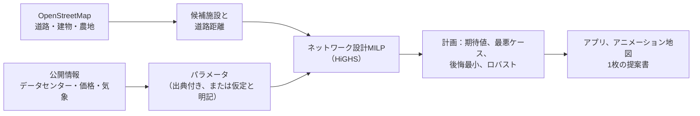

# Team Data Center

**北海道・石狩のデータセンターの最適化。** 排熱をどこへ届けるか。電力系統は新しい負荷をどれだけ受け入れられるか。次のデータセンターをどこに建てるか。

[English](README.md)


*改良版モデル（v2）で、今の灯油価格（156.8円/L [11]）・ヒートポンプ費込みの計画です。1本の共同の導管網で、石狩湾新港の2つのデータセンターの排熱を19か所（公共施設、プール、学校、ホテル、病院、陸上養殖、温室の新設候補、道路融雪）に届けます。線の太さは管の太さ、明るさと粒の速さは月ごとの流量を表し、雪の多い月には雪が降ります。下の棒グラフは月ごとに届けた熱です。施設とデータセンターの位置には、仮定や仮置きのものが含まれます（[データと出典](#データと出典)）。地図データ © OpenStreetMap contributors（ODbL）。*

## このプロジェクトについて

[Hack × Hokkaido Build Week 2026](https://www.hackhokkaido.com/) で始めたプロジェクトです。このイベントは、2026年11月23〜27日に札幌で開かれたAIのビルドウィーク [1] で、海外のエンジニアと北海道の人たちが、オープンデータを使って北海道の課題の試作品を作ります。応募するリポジトリは、MITライセンスで公開することになっています。

私たちは、アイデアスターターの **「Warm Ishikari」** を選びました。データセンターの排熱の熱源と使い手（温室・陸上養殖・融雪・浴場）を地図に載せ、使える熱・距離・節約額を見積もります。そのうえで、見込みのあるペアごとに1枚の提案書を作ります。どの数字にも出典を付けるか、仮定と明記します。私たちはこれを最適化の問題として扱い、3つの研究テーマに広げました。イベントの後も研究を続ける予定です。

## なぜ重要か

- **データセンターが集まりつつある。** 石狩湾新港には複数のデータセンターがあります [6–10]。そのひとつ、石狩再エネデータセンター第1号は、2026年8月1日に再エネ100%で稼働を始めました [2, 4, 5]。国の「ワット・ビット連携」（2025年）は、大規模なデータセンター集積地を電源の近くに置くための基準を示しています [14]。
- **排熱を捨てる隣で、燃料を燃やしている。** 空冷のサーバーの排熱（25〜40℃程度 [16, 17]）は、ほとんどが捨てられています。一方、近くの温室・プール・浴場・融雪では灯油を燃やしています。北海道の灯油価格は、2026年11月16日の国の調査で156.8円/Lです [11]。
- **海外では再利用が義務になっている。** EUでは、1MWを超えるデータセンターに、費用便益分析で不可能と示されない限り排熱の利用を求めています [13]。日本では同様の決まりは見つかりませんでした [14]。

## 3つの研究テーマ

| | 問い | 方法 | 状況 |
|---|---|---|---|
| 1. 排熱の導管網 | どの施設を、どのデータセンターに、どの道路沿いに、どの太さの管でつなぐか | 月別の熱収支つきのネットワーク設計MILP（確率計画版・ロバスト版） [23–26, 31–36] | モデルv1・v2、アプリ、アニメーション地図 |
| 2. 系統の受け入れ余地 | データセンターとヒートポンプの負荷を、系統のどこにどれだけ受け入れられるか | 交流最適潮流の凸緩和（SDP/SOCP）による上限の保証と、実行可能な解 [37–47] | 予定 |
| 3. 立地 | 次のデータセンターをどこに建てるか | テーマ1と2の結果を使う施設配置問題 [48–52] | 予定 |

## これまでの結果（テーマ1）

数字はすべて年間の正味の便益（百万円）です。便益は「置き換えた灯油の価値 − ヒートポンプの電気代 − 導管とヒートポンプの投資の年額」で（導管費 [15]、ヒートポンプ費 [16]、灯油価格 [11]、月別需要は気象庁の平年値 [12]）、4つのシナリオの平均をとっています。シナリオは、IT負荷が低い・高いと、灯油が115円/L・156.8円/Lの組み合わせです。候補は50か所です。OpenStreetMapの施設タグからの40か所に、名前のある公共施設・ホテル・工場の10か所を加えました。施設の種類ごとの需要は仮定です。

### 共同の導管網は、ペアごとの組み合わせに勝つ

各施設をデータセンターと1対1で組む方法（アイデアスターターの「順位付きの相手5件」）は、大きな2つのデータセンターでは、最適化した共同の導管網の **49〜72%** しか稼げません。小さなZEDでは77〜86%です。

| データセンター | 導管の温度方式 | 最適化した導管網 | ペア上位5件 | ペアの割合 |
|---|---|---|---|---|
| 第1号 | 低温方式 | 91.3（13か所、8.7km） | 65.3（3か所、5.1km） | 72% |
| さくら | 低温方式 | 85.7（13か所、8.7km） | 58.4（2か所、3.4km） | 68% |
| ZED | 低温方式 | 58.2（3か所、2.8km） | 50.0（3か所、4.1km） | 86% |
| 第1号 | 集中方式 | 80.6（15か所、8.2km） | 40.4（4か所、6.8km） | 50% |
| さくら | 集中方式 | 75.4（13か所、7.1km） | 37.2（2か所、3.4km） | 49% |
| ZED | 集中方式 | 39.9（3か所、2.8km） | 30.8（4か所、5.6km） | 77% |

差が生まれる理由は3つあります。

1. **管が重複しない。** 第1号（低温方式）では、共同の導管網は8.7kmの管で13か所に届きます。ペア上位は5.1kmで3か所です。
2. **単独では赤字の施設も、枝管なら黒字になる。** 第1号から2.8km離れたプールは、専用管を引くと年に約850万円の赤字です。ヒートポンプの費用を引いた熱の価値は年に約860万円なので、枝管が約1.4kmより短ければ黒字になります。
3. **太い管ほど、熱あたりの費用が安い。** 運ぶ熱1MWあたりで比べると、DN250の管1mの費用はDN80の約7分の1です（費用の直線は [15]）。

### 順位付きの相手から、1枚の提案書へ

アプリは、アイデアスターターのデモの流れをそのまま残しています。データセンターを選ぶと、地域全体の計画への貢献が大きい順に相手が5件並び、どの相手についても1枚の提案書を開けます（ページ *Warm Ishikari Proposals*。データは `scripts/export_proposals.py` で作成）。提案書に載せているのは次の4つです。
- 道路地図上の専用管と、周りの共有導管
- 月ごとに届く熱
- その相手が共有ネットワークにもたらす価値
- 双方が得をする熱の価格の範囲

続く計算表では、すべての数字に「出典」「仮定」「計算」の印を付けています。印のない数字が残っていないことは、テストで確かめています。

- **第1号の最良の相手は養殖場**（仮定の候補地）です。2.5 kmのDN150の導管で年5,000 MWhを届け、灯油を年606 kL置き換え、6.3年で回収できます。地域全体の計画では、年8,240万円の価値をもたらします。
- **双方が得をする価格。** 導管を供給側が持つとすると、熱の価格が1 MWhあたり5,280円から16,483円のあいだなら、双方が得をします。利益を半分ずつ分けると10,881円/MWhで、灯油でつくる熱（156.8円/L）の19,018円/MWhより安くなります。この範囲は、そのペアが単独で採算がとれるときにだけ存在します（[数式](docs/formulations/heat-model.md#11-a-heat-price-for-a-pair)）。
- **共有してはじめて採算がとれる相手もいます。** 第1号の上位5件のうち、病院とホテルは専用管だと年1,660万円と780万円の赤字です。共有ネットワークの中では、それぞれ年980万円と860万円の価値をもたらします。

### ロバスト計画は、不確かなデータセンターに頼らない

- **名目どおりの場合の計画（低温方式、灯油115円/L）。** すべてのデータセンターが名目どおりのIT負荷で動く前提だと、最適な計画は年6,600万円です。5か所を小さなZEDから、道路融雪を計画中のNTT-MEから供給します。
- **崩れる場合。** ZEDが公表値から計算した平均負荷（0.9MW、石狩市の計画 [6]）だと3,230万円に下がります。NTT-MEも建たなければ赤字（−70万円）です。
- **ロバスト計画。** 同時に低負荷になるデータセンターを最大1か所までとした計画で、列・制約生成法で解きます [31, 33]。同じ5か所を第1号から供給し、**どの場合でも5,970万円**を確保します。代償は名目の便益の9.7%です。
- **集中方式。** 名目どおりの場合の計画は12か所をZEDにつなぎ、ZEDが低負荷だと赤字（−140万円）になります。ロバスト計画は代償1.8%で3,730万円を確保します。

### 不確実性を考えて計画する価値（探索の条件で変わる）

低温方式では、2段階の確率計画の期待値は9,380万円で、この値は正確に再現します。平均のシナリオだけで作った計画を同じシナリオで評価した値は、探索に使う候補区間で変わり、追加の候補区間ありで8,940万円、なしで6,510万円です。したがって確率計画の価値は **年440万〜2,870万円** です。以前の7,900万円（価値1,480万円）は、別の探索の結果でした（[詳細](docs/formulations/heat.md)）。

### ヒートポンプの費用まで含めると、低温方式が勝つ

30℃程度の低温の導管網で、ヒートポンプを各施設に置く方式です。陸上養殖と道路融雪は、熱をそのまま使います。この方式の確率計画の期待値は **9,380万円** で、60℃の導管網と集中ヒートポンプの方式（**8,150万円**）を上回ります。今の灯油価格では、低温方式の計画は10.7kmの管で16か所に届き、年1億4,030万円になります（上のアニメーションの計画です）。

### 注意点

- **最適性。** 計画は、HiGHSを使い、LPで候補を絞るカーネル探索で求めています。
  - *標準の候補区間：* Gurobi 14.0（任意で使える）が、期待値モデルの最適性を71秒（低温方式）と255秒（集中方式）で証明しました。カーネル探索の計画は、その最適値から0.2%と0.8%以内でした。HiGHSだけでは、300秒後のギャップは18%と26%です。
  - *各施設から全データセンターへの直結の区間まで含めた場合：* 600秒でのギャップは、Gurobiが1.5%と3.9%、HiGHSが38%と36%です。
  - 代表値の計画は、各データセンター単独の計画から得た直結の区間も加えて解いています。
  - 比較の再現：`uv run python experiments/solver_compare/run.py`
- **データセンターの位置。** 2か所はおおよその位置、1か所は仮置きです。
- **モデルの粗さ。** 熱の収支は月単位で、熱損失は一律の割合です。距離に応じた損失はこれから入れます。

数理モデルの完全な解説（すべての係数と数値例つき、英語）は [docs/formulations/heat-model.md](docs/formulations/heat-model.md) に、結果は [docs/formulations/heat.md](docs/formulations/heat.md) にあります。

## 仕組み



**モデルの要点**（関連研究 [23–26]、ロバスト最適化の手法 [31–36]）
- **網：** 候補の区間は、データセンターと施設を結ぶ道路沿いの経路です。0-1変数で、区間を開設して管の太さを選び、施設をつなぎ、それぞれをどれか1つのデータセンターに割り当てます。
- **熱の経路：** 強い多品種流の定式化で、各施設の熱をそのデータセンターから運びます。
- **月ごとの収支：** 届ける熱は、施設の需要と各データセンターの排熱で上限が決まります。
- **目的：** 熱の価値から年額の費用を引いた値を最大にします。
- **不確実性への対応：**
  - 確率計画版は、どのシナリオでも同じ導管網を使います。
  - ロバスト版には3つあります。最悪ケースを最大にするもの、最大後悔を最小にするもの、IT負荷のバジェット型不確実性集合に対して守るものです。

## 使い方

```bash
uv sync
uv run python scripts/fetch_data.py --area ishikari    # OpenStreetMapの地図データを data/cache に取得（コミットしない）
uv run python scripts/export_heat_story.py             # 地図ページ用の下地とデータ
uv run python scripts/export_proposals.py              # データセンターごとの相手の順位と提案書（数分）
uv run streamlit run app/streamlit_app.py              # デモアプリ
uv run pytest                                          # テスト（地図データが必要なものは、データがなければスキップ）
```

**実験**
- v1とv2の比較：`uv run python experiments/heat_v2_compare/run.py`
- ロバスト計画の掃引：`uv run python experiments/heat_ccg/run.py ambient`

**上のアニメーションの作り直し方**
1. `uv run python scripts/export_heat_network_v2.py`
2. `uv run python scripts/render_readme_animation.py --plan current --lang ja`（日本語版。Noto Sans CJK JPなどの日本語フォントが必要。英語版は `--lang ja` なし）

## 構成

```
src/dcopt/heat      テーマ1：モデルv1（v1.py）、v2（network.py）、提案書（proposal.py）
src/dcopt/grid      テーマ2
src/dcopt/siting    テーマ3
src/dcopt/common    共通：道路網、配色
app/                Streamlitのアプリ
web/heat_story/     アニメーション地図のページ
scripts/            データ取得、書き出し、図
experiments/        再現できる実験（結果は results/ に保存し、コミットしない）
docs/               定式化、データの出典、図
data/curated/       自分たちでまとめた小さな表（各値に出典付き）
tests/              合成データでの単体テストとアプリのテスト
```

## データと出典

- **数字の出典：** すべての数字に出典を付けるか、仮定と明記しています。URL付きの一覧は [docs/data-sources.md](docs/data-sources.md) にあります。対象は、石狩のデータセンター、価格、導管とヒートポンプの費用、気象の平年値、先行事例です。
- **地図データ：** OpenStreetMapのデータ（© OpenStreetMap contributors、ODbL [18]）は、スクリプトで `data/raw/` と `data/cache/` に取得し、コミットしません。アニメーションはOpenStreetMapのデータから作った画像で、その旨を明記しています。
- **気象データ：** 札幌の1976〜2025年の気象庁の日別値 [12] を `data/jma/` に含めています。MITライセンスではなく、気象庁の利用規約（公共データ利用規約 第1.0版：出典の記載と加工の明記）に従います。詳しくは `data/jma/README.md` を参照してください。
- **北海道の先行事例：** データセンター排熱による融雪の検討 [19]、美唄の雪冷房データセンターとウナギ養殖 [20, 21]、データセンター排熱を使う浴場の構想 [22]。
- **仮定の施設：** 陸上養殖、温室の新設候補、道路融雪の区域は仮定で、白抜きの印で描いています。
- **データセンターの位置：** 第1号とZEDはおおよその位置です。NTT-MEの用地は公表されていません。

## ソルバー

- **既定はオープンソース：** MILPはHiGHSで解きます。テーマ2の錐計画には、ClarabelかSCSを使う予定です。
- **Gurobi：** 入っていれば使えます（`DCOPT_SOLVER=gurobi`）。どの機能もGurobiを必須にはしていません。このモデルでは、HiGHSが同じ時間内に証明できない最適性を証明できます（注意点を参照）。

## 次の研究課題

- 管の太さの定式化を強化し（カット平面、Benders）、最適性を保証する [23, 26]
- 網の形・温度方式・ヒートポンプの置き場所を、道路網の規模で同時に最適化する
- 管の長さ・太さ・温度・流量に応じた熱損失を入れる
- 共同の幹線の費用を公平に分ける（シャープレイ値と最小コアの比較） [27, 28]
- どの計画中のデータセンターが建つかが不確かなときの、2段階ロバスト設計 [32–35]
- 出力を調整できるデータセンター負荷について、SDP/SOCP緩和で系統の受け入れ余地を保証する [37, 39, 42–47, 51]
- 排熱の利用・系統の余地・再エネ・通信・災害リスクを合わせた立地 [29, 30, 48–52]

## 参考文献

事実とパラメータの出典 [1–22]、関連文献：排熱の導管網とデータセンター排熱の利用 [23–30]、ロバスト最適化 [31–36]、系統の受け入れ余地 [37–47]、立地と柔軟な負荷 [48–52]。

1. Hack × Hokkaido Build Week 2026, AI build week in Sapporo, 23–27 November 2026. https://www.hackhokkaido.com/ (accessed 2026-11-24).
2. Broadband Tower (2025-11-28). Press release on Ishikari Renewable Energy Data Center No. 1 (in Japanese). https://www.bbtower.co.jp/ir/pr/docs/20251128_ishikari_release.pdf
3. PR TIMES (2026-04-22). Ishikari Renewable Energy Data Center No. 1: site in 石狩市新港中央1丁目 (in Japanese). https://prtimes.jp/main/html/rd/p/000000693.000006953.html
4. Impress Cloud Watch (2026-04-01). Ishikari Renewable Energy Data Center No. 1: 15,000 kVA receiving, at least 10 MW from August 2026, 1,140 racks (in Japanese). https://cloud.watch.impress.co.jp/docs/news/2097920.html
5. TV Tokyo Plus (2026-10-07). Service start on 1 August 2026 on 100 % renewable power (in Japanese). https://www.tv-tokyo.co.jp/plus/external-pr/entry/269543.html
6. 石狩市・東急不動産 (2025). 脱炭素先行地域 計画提案書「再エネの地産地活・脱炭素で地域をリデザイン」, revised 2025-07-04 (Ishikari City and Tokyu Land, decarbonization-leading-area plan). https://www.city.ishikari.hokkaido.jp/_res/projects/default_project/_page_/001/002/422/senko20250704.pdf
7. Sakura Internet. Ishikari Data Center (in Japanese). https://www.sakura.ad.jp/corporate/corp/datacenter/ ; Impress Cloud Watch (2015-09-30). https://cloud.watch.impress.co.jp/docs/news/723209.html
8. 日本建設業連合会 (2012). さくらインターネット石狩データセンター, building case sheet (in Japanese). https://nikkenren.com/kenchiku/sb/pdf/223/12-024.pdf
9. Impress Cloud Watch (2024). KCCS zero-emission data center Ishikari (in Japanese). https://cloud.watch.impress.co.jp/docs/news/1627835.html ; Ministry of the Environment. https://www.env.go.jp/content/900514282.pdf
10. Impress Cloud Watch (2025-10-23). NTT-ME container data centers in Ishikari (in Japanese). https://cloud.watch.impress.co.jp/docs/news/2057156.html
11. 資源エネルギー庁 (2026). 石油製品価格調査, survey of 2026-11-16 (Agency for Natural Resources and Energy, petroleum product prices). https://www.enecho.meti.go.jp/statistics/petroleum_and_lpgas/pl007/xlsx/261118.xlsx
12. 気象庁. 平年値（1991〜2020年）札幌 (Japan Meteorological Agency, climate normals, Sapporo). https://www.data.jma.go.jp/obd/stats/etrn/view/nml_sfc_ym.php?prec_no=14&block_no=47412
13. European Union (2023). Directive (EU) 2023/1791 on energy efficiency, Articles 12 and 26. https://eur-lex.europa.eu/eli/dir/2023/1791/oj
14. 総務省・経済産業省 (2025). ワット・ビット連携官民懇談会 取りまとめ1.0 (MIC and METI, public-private council on watt-bit coordination, summary 1.0). https://www.soumu.go.jp/main_content/001014454.pdf
15. Tachibana, M. (2023). Doctoral thesis, Yokohama National University: cost of small district-heating networks (values read from charts). https://ynu.repo.nii.ac.jp/record/12712/files/tachibana_masaya-thesis.pdf
16. Dansk Fjernvarme (2022). Inspirationskatalog for store varmepumper: Odense data-center heat pumps (COP, cost). https://danskfjernvarme.dk/media/eqbhcqlv/inspirationskatalog-for-store-varmepumper-2022.pdf
17. Berenschot (2020). Analyse restwarmte uit datacenters Hollands Kroon (waste heat from data centers). https://www.berenschot.nl/media/xtmabnee/cases-berenschot_-_analyse_restwarmte_uit_datacenters_hollands_kroon_-_eindrapport_1.pdf
18. OpenStreetMap contributors. Map data under the Open Database License (ODbL 1.0). https://www.openstreetmap.org/copyright
19. 堤拓哉・月館司・下ノ薗慧 (2019). 積雪寒冷条件を踏まえたデータセンターの設計に関する基礎的検討. 北海道立総合研究機構 調査研究報告 No.396 (design of data centers in snowy cold regions). https://www.hro.or.jp/upload/22910/396.pdf
20. 本間弘達 (2020). 雪冷熱エネルギーを利用したデータセンター. 電気設備学会誌 40(5), 296–299 (a data center using snow cold energy, Bibai). https://www.jstage.jst.go.jp/article/ieiej/40/5/40_296/_pdf/-char/ja
21. 北海道新聞 (2024-07-11). 雪うなぎ: eel farming with data-center heat in Bibai (in Japanese). https://www.hokkaido-np.co.jp/movies/detail/6357590939112/
22. 大沢飛智 (2026). データセンターと地域の新たな共生モデル —排熱利用型温浴施設「ビットの湯」—. Hokkaido University GX center poster. https://hu-gxc.eng.hokudai.ac.jp/wp-content/uploads/2026/03/gxc2025_excellence_16-osawa.pdf
23. Ljubić, I., Weiskircher, R., Pferschy, U., Klau, G.W., Mutzel, P., Fischetti, M. (2006). An Algorithmic Framework for the Exact Solution of the Prize-Collecting Steiner Tree Problem. *Mathematical Programming*, 105, 427–449. https://doi.org/10.1007/s10107-005-0660-x
24. Kuper, L., Metzger, M., Stursberg, P., Niessen, S. (2025). Computationally efficient topology design of district heating networks by price-collecting Steiner trees. *Energy*, 333, 137223. https://doi.org/10.1016/j.energy.2025.137223
25. Bordin, C., Gordini, A., Vigo, D. (2016). An optimization approach for district heating strategic network design. *European Journal of Operational Research*, 252(1), 296-307. https://doi.org/10.1016/j.ejor.2015.12.049
26. Lambert, J., Ceruti, A., Spliethoff, H. (2024). Benchmark of mixed-integer linear programming formulations for district heating network design. *Energy*, 308, 132885. https://doi.org/10.1016/j.energy.2024.132885
27. Megiddo, N. (1978). Cost allocation for steiner trees. *Networks*, 8(1), 1-6. https://doi.org/10.1002/net.3230080104
28. Caprara, A., Letchford, A.N. (2010). New techniques for cost sharing in combinatorial optimization games. *Mathematical Programming*, 124(1-2), 93-118. https://doi.org/10.1007/s10107-010-0357-7
29. Huang, P., Copertaro, B., Zhang, X., Shen, J., Löfgren, I., Rönnelid, M., et al. (2020). A review of data centers as prosumers in district energy systems: Renewable energy integration and waste heat reuse for district heating. *Applied Energy*, 258, 114109. https://doi.org/10.1016/j.apenergy.2019.114109
30. Wahlroos, M., Pärssinen, M., Manner, J., Syri, S. (2017). Utilizing data center waste heat in district heating – Impacts on energy efficiency and prospects for low-temperature district heating networks. *Energy*, 140, 1228-1238. https://doi.org/10.1016/j.energy.2017.08.078
31. Bertsimas, D., Sim, M. (2004). The Price of Robustness. *Operations Research*, 52(1), 35-53. https://doi.org/10.1287/opre.1030.0065
32. Ben-Tal, A., Goryashko, A., Guslitzer, E., Nemirovski, A. (2004). Adjustable robust solutions of uncertain linear programs. *Mathematical Programming*, 99(2), 351-376. https://doi.org/10.1007/s10107-003-0454-y
33. Zeng, B., Zhao, L. (2013). Solving two-stage robust optimization problems using a column-and-constraint generation method. *Operations Research Letters*, 41(5), 457-461. https://doi.org/10.1016/j.orl.2013.05.003
34. Atamtürk, A., Zhang, M. (2007). Two-Stage Robust Network Flow and Design Under Demand Uncertainty. *Operations Research*, 55(4), 662-673. https://doi.org/10.1287/opre.1070.0428
35. Majewski, D.E., Lampe, M., Voll, P., Bardow, A. (2017). TRusT: A Two-stage Robustness Trade-off approach for the design of decentralized energy supply systems. *Energy*, 118, 590-599. https://doi.org/10.1016/j.energy.2016.10.065
36. Aissi, H., Bazgan, C., Vanderpooten, D. (2009). Min–max and min–max regret versions of combinatorial optimization problems: A survey. *European Journal of Operational Research*, 197(2), 427-438. https://doi.org/10.1016/j.ejor.2008.09.012
37. Molzahn, D.K., Hiskens, I.A. (2019). A Survey of Relaxations and Approximations of the Power Flow Equations. *Foundations and Trends in Electric Energy Systems*, 4(1-2), 1-221. https://doi.org/10.1561/3100000012
38. Bai, X., Wei, H., Fujisawa, K., Wang, Y. (2008). Semidefinite programming for optimal power flow problems. *International Journal of Electrical Power & Energy Systems*, 30(6-7), 383-392. https://doi.org/10.1016/j.ijepes.2007.12.003
39. Lavaei, J., Low, S.H. (2012). Zero Duality Gap in Optimal Power Flow Problem. *IEEE Transactions on Power Systems*, 27(1), 92-107. https://doi.org/10.1109/TPWRS.2011.2160974
40. Jabr, R. (2006). Radial Distribution Load Flow Using Conic Programming. *IEEE Transactions on Power Systems*, 21(3), 1458-1459. https://doi.org/10.1109/TPWRS.2006.879234
41. Farivar, M., Low, S.H. (2013). Branch Flow Model: Relaxations and Convexification—Part I. *IEEE Transactions on Power Systems*, 28(3), 2554-2564. https://doi.org/10.1109/TPWRS.2013.2255317
42. Coffrin, C., Hijazi, H.L., Van Hentenryck, P. (2016). The QC Relaxation: A Theoretical and Computational Study on Optimal Power Flow. *IEEE Transactions on Power Systems*, 31(4), 3008-3018. https://doi.org/10.1109/TPWRS.2015.2463111
43. Kocuk, B., Dey, S.S., Sun, X.A. (2016). Strong SOCP Relaxations for the Optimal Power Flow Problem. *Operations Research*, 64(6), 1177-1196. https://doi.org/10.1287/opre.2016.1489
44. Molzahn, D. K., Lesieutre, B. C., DeMarco, C. L. (2013). A Sufficient Condition for Power Flow Insolvability With Applications to Voltage Stability Margins. *IEEE Transactions on Power Systems*, 28(3), 2592–2601. https://doi.org/10.1109/TPWRS.2012.2233765
45. Sogol Babaeinejadsarookolaee, Adam Birchfield, Richard D. Christie, Carleton Coffrin, Christopher DeMarco, Ruisheng Diao, et al. (2019). The Power Grid Library for Benchmarking AC Optimal Power Flow Algorithms. arXiv:1908.02788. https://arxiv.org/abs/1908.02788
46. Coffrin, C., Bent, R., Sundar, K., Ng, Y., Lubin, M. (2018). PowerModels. JL: An Open-Source Framework for Exploring Power Flow Formulations. *2018 Power Systems Computation Conference (PSCC)*. https://doi.org/10.23919/PSCC.2018.8442948
47. Haoxiang Wan, Jesus Silva-Rodriguez, Jonghwan Kwon, Xingpeng Li (2026). AC Assessment of DC Power Flow Screening for Data Center Hosting Capacity and Siting. arXiv:2611.19602 (preprint, not peer reviewed). https://arxiv.org/abs/2611.19602
48. Goiri, I., Le, K., Guitart, J., Torres, J., Bianchini, R. (2011). Intelligent Placement of Datacenters for Internet Services. *2011 31st International Conference on Distributed Computing Systems*. https://doi.org/10.1109/ICDCS.2011.19
49. Covas, M.T., Silva, C.A., Dias, L.C. (2013). Multicriteria decision analysis for sustainable data centers location. *International Transactions in Operational Research*, 20(3), 269–299. https://doi.org/10.1111/j.1475-3995.2012.00874.x
50. Kim, K., Yang, F., Zavala, V.M., Chien, A.A. (2017). Data Centers as Dispatchable Loads to Harness Stranded Power. *IEEE Transactions on Sustainable Energy*, 8(1), 208-218. https://doi.org/10.1109/TSTE.2016.2593607
51. Norris, T. H., Profeta, T., Patino-Echeverri, D., Cowie-Haskell, A. (2025). Rethinking Load Growth: Assessing the Potential for Integration of Large Flexible Loads in US Power Systems. Nicholas Institute, Duke University, NI R 25-01. https://nicholasinstitute.duke.edu/publications/rethinking-load-growth (figures as cited in the lead author's testimony of 2025-03-05)
52. Onodera, H., Shiraki, H., Matsuhashi, K. (2026). Strategic data center siting can mitigate trade-offs between decarbonization and digitalization in Japan. *Cell Reports Sustainability*, 3(9), 100823. https://doi.org/10.1016/j.crsus.2026.100823

## メンバー

Adam Curnow, Junko, Lia Vergou, Noriyuki Sugita, Paul Binder, Seiko Yamaguchi, Thomas Braam

## ライセンスと引用

コードはMITライセンスです（[LICENSE](LICENSE)）。外部のデータは、それぞれのライセンスに従います。引用の方法は [CITATION.cff](CITATION.cff) を見てください。
