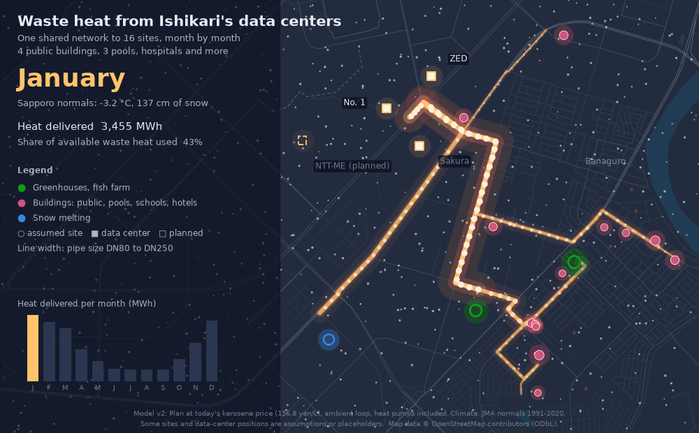
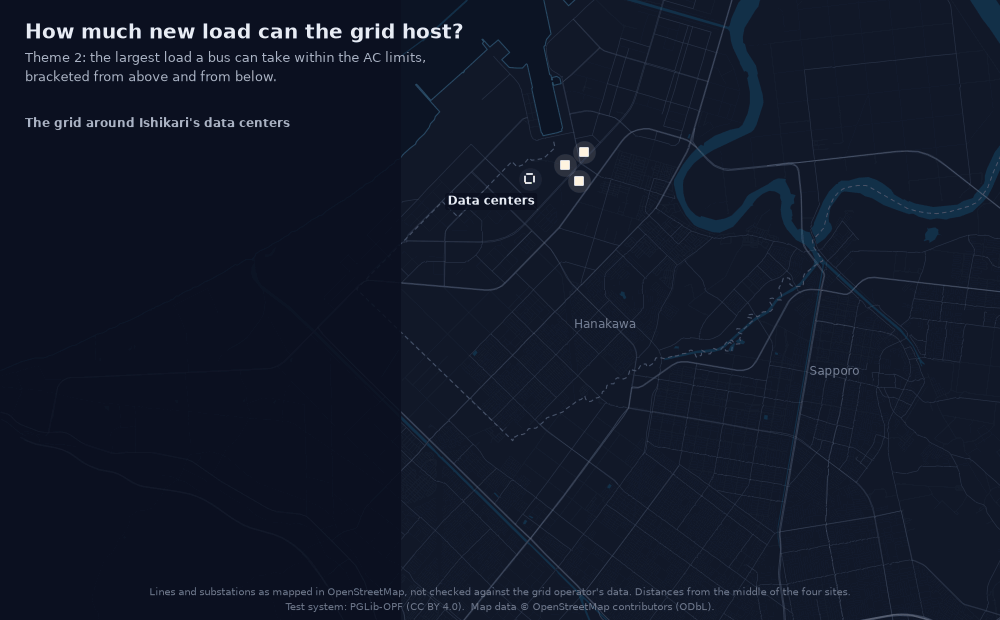
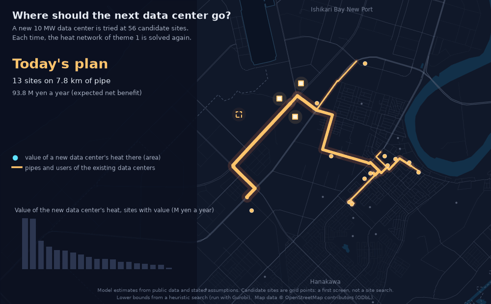
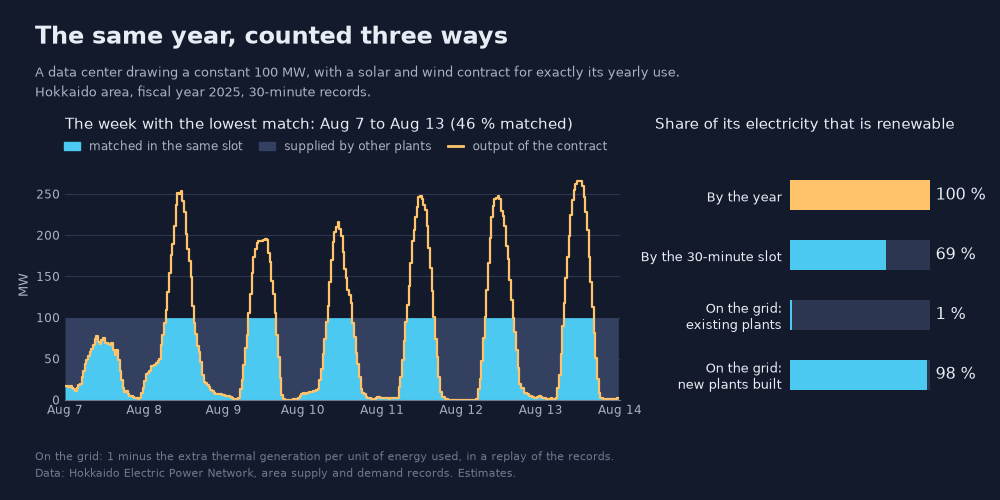
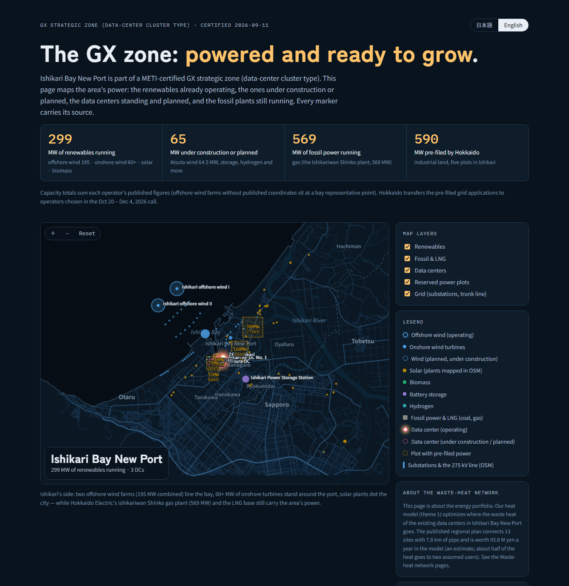
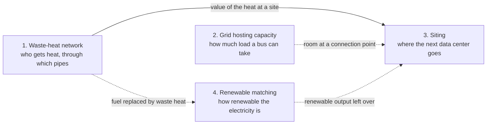
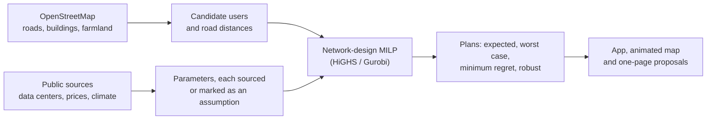
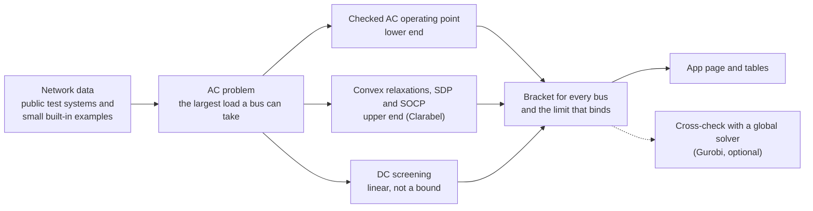
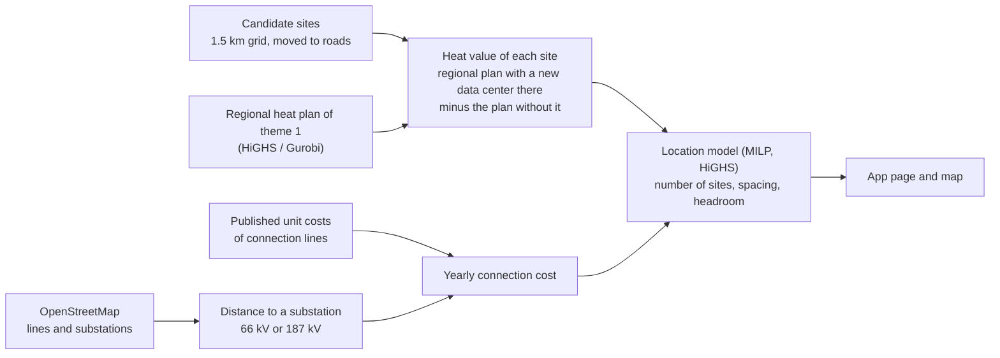
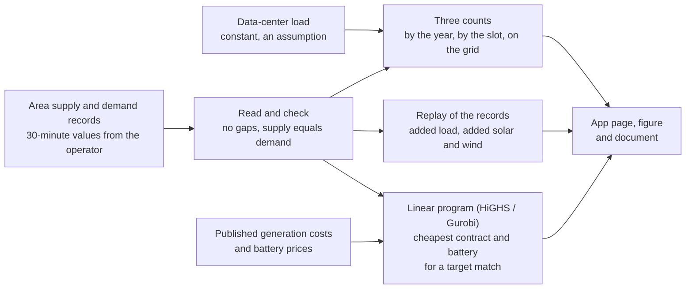

# Team Data Center

**Optimization for data centers in Ishikari, Hokkaido.** Where should their waste heat go to lower the winter heating bills of the buildings around them? How much new load can the power grid host? Where should the next data center be built? How much of their electricity is renewable, slot by slot?

[日本語版 / Japanese](README.ja.md)



*Model v2 at today's kerosene price (156.8 yen/L [11]), heat pumps included. One shared network carries waste heat from two data centers in the Ishikari Bay New Port to 19 sites: public buildings, pools, schools, hotels, hospitals, a fish farm, a new greenhouse site and road heating. Line width shows the pipe size; brightness and particle speed show each month's flow, and snow falls in the snowy months. The bars show the heat delivered each month. Several sites and data-center positions are assumptions or placeholders ([Data and sources](#data-and-sources)). Map data © OpenStreetMap contributors (ODbL).*

## About

This project started at [Hack × Hokkaido Build Week 2026](https://www.hackhokkaido.com/), an AI build week in Sapporo (23–27 November 2026) [1]. There, international engineers and people from Hokkaido build prototypes for Hokkaido's problems from open data. Entries are public repositories under the MIT license.

We took the idea starter **"Warm Ishikari"**: a matchmaker and calculator for data-center waste heat. It maps heat sources and possible users (greenhouses, aquaculture, snow melting, public baths) and estimates the heat available, the distance and the saving. It then drafts a one-page proposal for each promising pair, with every number either sourced or marked as an assumption. We treat the task as an optimization problem and extend it into four research themes. The team plans to continue the research after the event.

## Why it matters

- **Data centers are arriving.** Ishikari Bay New Port hosts several data centers [6–10]. One of them, Ishikari Renewable Energy Data Center No. 1, started service on 1 August 2026 on 100 % renewable power [2, 4, 5]. Japan's "watt-bit" policy (2025) sets criteria for siting large data-center clusters near power supply [14].
- **Their heat is wasted while fuel is burned next door.** The waste heat of air-cooled servers (about 25–40 °C [16, 17]) is mostly released. Meanwhile, nearby greenhouses, pools, baths and snow melting burn kerosene, which cost 156.8 yen/L in Hokkaido in the government survey of 16 November 2026 [11].
- **Rules elsewhere already require reuse.** In the EU, data centers above 1 MW must use their waste heat unless a cost-benefit analysis shows it is not feasible [13]. We found no such rule in Japan [14].

## Four research themes

| | Question | Method | Status |
|---|---|---|---|
| 1. Waste-heat networks | Which users connect to which data center, along which streets, with which pipes, and at what price for heat do the users and the network both gain? | Network-design MILP with monthly heat balances; stochastic and robust versions [23–26, 31–36] | Models v1 and v2, app and animated map |
| 2. Grid hosting capacity | How much data-center and heat-pump load can each grid location take? | AC optimal power flow with convex (SDP/SOCP) relaxations: certified upper bounds plus feasible points [37–47, 59–64] | Method and app page; checked on benchmark systems |
| 3. Siting | Where should the next data center go? | Facility location using the results of themes 1 and 2 [48–52] | First screen: heat value by site, distance to the grid, app page |
| 4. Renewable matching | How much of a data center's electricity is renewable in the 30 minutes it is used, and what changes on the grid? | Counting on the area's 30-minute supply and demand records; a linear program for the cheapest contract and battery [66–71] | First version: two fiscal years of records, app page |

## Results so far (theme 1)

> **All numbers are model estimates** from public data and stated assumptions, not measured values or quotations. Several sites, demands and data-center positions are assumptions, and about half of the heat in the headline plan goes to two assumed sites (see [What the result rests on](#what-the-result-rests-on), [Caveats](#caveats) and [docs/data-sources.md](docs/data-sources.md)).

All figures are annual net benefits in million yen, averaged over four scenarios: IT load low or high, crossed with kerosene at 115 or 156.8 yen/L. The net benefit is the value of the kerosene replaced, minus heat-pump electricity, minus the annualized cost of pipes and heat pumps. Pipe costs follow [15], heat-pump costs [16], kerosene prices [11], and monthly demand follows JMA climate normals [12]. There are 50 candidate sites: 40 from OpenStreetMap facility tags, plus 10 named public buildings, hotels and a factory. Demand per building type is an assumption.

### The aim: lower the winter heating bills

The aim of the heat network is to lower the winter heating bills of buildings that burn kerosene. **On today's facilities alone** (13 buildings, 6.0 km of pipe) the best plan the model found is worth 11.4 M yen a year. Its network needs at least 7,352 yen per MWh of heat, the same as 60.6 yen per litre of kerosene replaced, and the plan breaks even when the facilities pay about 125 yen per litre for kerosene: it earns 32.6 M yen a year at the retail price of 156.8 yen/L and loses 10.0 M yen at 115 yen/L. **The published plan, 93.8 M yen a year,** adds a fish farm and road heating that do not exist today. Such users take the loop's heat without a heat pump, lower the network's price for everyone, to 6,331 yen per MWh, and bring the break-even down to about 85 yen per litre. So the first things to find out are the price that large users pay for kerosene and whether such users can come to the port area. The window for each kind of facility, three steps of demand and what a business plan still needs: [docs/heat-business.md](docs/heat-business.md). Run: `uv run python scripts/export_heat_business.py` (a few minutes), then `uv run python scripts/heat_business.py`.

### A shared network beats pair-by-pair matching

Matching each user to a data center on its own (the "five ranked partners" of the idea starter) reaches only **49–72 %** of what an optimized shared network earns at the two large data centers, and 77–86 % at the small ZED.

| Data center | Network temperature | Optimized network | Top-5 pairs | Pairs reach |
|---|---|---|---|---|
| No. 1 | ambient loop | 91.3 (13 sites, 8.7 km) | 65.3 (3 sites, 5.1 km) | 72 % |
| Sakura | ambient loop | 85.7 (13 sites, 8.7 km) | 58.4 (2 sites, 3.4 km) | 68 % |
| ZED | ambient loop | 58.2 (3 sites, 2.8 km) | 50.0 (3 sites, 4.1 km) | 86 % |
| No. 1 | central heat pump | 80.6 (15 sites, 8.2 km) | 40.4 (4 sites, 6.8 km) | 50 % |
| Sakura | central heat pump | 75.4 (13 sites, 7.1 km) | 37.2 (2 sites, 3.4 km) | 49 % |
| ZED | central heat pump | 39.9 (3 sites, 2.8 km) | 30.8 (4 sites, 5.6 km) | 77 % |

Three effects explain the gap:

1. **No duplicated pipes.** At No. 1 (ambient loop) the network serves 13 sites with 8.7 km of pipe; the five best pairs serve 3 sites with 5.1 km.
2. **Users that lose money alone pay off on a branch.** A pool 2.8 km from data center No. 1 loses about 8.5 M yen a year with its own pipe. Its heat is worth about 8.6 M yen a year after heat-pump costs, so it pays off on any branch shorter than about 1.4 km.
3. **Large pipes are cheaper per unit of heat.** Per megawatt carried, a metre of DN250 pipe costs about one seventh of a metre of DN80 (cost line from [15]).

### From ranked partners to a one-page proposal

The app keeps the idea starter's demo flow. Pick a data center, see five partners ranked by what each adds to the regional plan, and open a one-page proposal for any of them (page *Warm Ishikari Proposals*; data from `scripts/export_proposals.py`). The proposal shows:
- the dedicated pipe on the street map, and the shared network around it;
- the heat delivered month by month;
- what the partner adds to the shared network;
- a range of heat prices at which both sides gain.

A calculation sheet follows. It marks every number as a published source, an assumption or a calculation, and a test checks that no number is left unmarked.

- **No. 1's best partner is the fish farm** (an assumed site). A DN150 pipe of 2.5 km delivers 5,000 MWh a year, replaces 606 kL of kerosene and pays back in 6.3 years. In the regional plan the farm adds 82.4 M yen a year.
- **A price that works for both sides.** Suppose the supplier owns the pipe. Then any heat price between 5,280 and 16,483 yen/MWh leaves both sides better off. Splitting the gain equally gives 10,881 yen/MWh, against 19,018 yen/MWh for heat from kerosene at 156.8 yen/L. Such a range exists exactly when the pair pays for itself ([formulas](docs/formulations/heat-model.md#11-a-heat-price-for-a-pair)).
- **Some partners pay only inside the network.** A hospital and a hotel among No. 1's five partners lose 16.6 M and 7.8 M yen a year with a dedicated pipe. In the shared network they add 9.8 M and 8.6 M yen a year.

### Robust planning avoids leaning on uncertain data centers

- **The nominal plan (ambient loop, kerosene 115 yen/L).** With every data center at its nominal IT load, the best plan earns 66.0. It serves five sites from the small ZED and road heating from the planned NTT-ME center.
- **What can go wrong.** At ZED's published average load (0.9 MW, from the city's plan [6]) the plan earns 32.3. If NTT-ME is not built either, it loses money (−0.7).
- **The robust plan** allows at most one data center at its low IT load and is solved by column-and-constraint generation [31, 33]. It serves the same five sites from No. 1 and keeps **59.7 in every case**, giving up 9.7 % of the nominal value.
- **Central heat pump.** The nominal plan hangs twelve sites on ZED and loses money if ZED runs low (−1.4). The robust plan keeps 37.3, at a price of 1.8 %.

### Planning for uncertainty: a positive value that depends on the search

With the ambient loop, the two-stage stochastic plan earns 93.8 in expectation, and this reproduces exactly. What a plan built for the average scenario earns on the same scenarios depends on the candidate links its search uses: 89.4 with the seeded links and 65.1 without them. The value of the stochastic solution is therefore **4.4 to 28.7 per year**. An earlier run reported 79.0 (a value of 14.8); it came from a different search draw ([details](docs/formulations/heat.md)).

### The low-temperature loop wins once heat pumps are paid for

The stochastic plan with an ambient loop earns **93.8** in expectation, against **81.5** for a central heat pump feeding a 60 °C network. The ambient loop runs at about 30 °C with heat pumps at the users, and the fish farm and the road heating take the heat directly. At today's kerosene price, the ambient plan connects 16 sites with 10.7 km of pipe and earns 140.3 per year; this is the plan in the animation above.

### Heat quality: the plan in exergy terms

Exergy is the part of energy that can do work [72, 73]. Electricity is all exergy, and heat is worth more the further its temperature is from the surroundings; the Carnot efficiency of the second law sets the limit [78]. Data-center waste heat is plentiful but "of low quality" [74]: at 30 °C, only 6.8 % of the 95.7 GWh on offer each year is exergy (11.0 % in January, 2.5 % in August). The model therefore treats heat by temperature and not only by quantity. Each kind of user has a supply temperature; users that need 27 °C or less take the heat directly; the others pay heat-pump electricity that follows from the temperature lift (COP at half the Carnot value). This is the match of low-quality supply to low-quality demand described for low-temperature district heating [75], where lower network temperatures are the direction of development [76, 77].

| The same 15,147 MWh a year (exergy 1,533 MWh) | High-grade input | Exergy efficiency |
|---|---|---|
| Kerosene boilers | 18,683 MWh of fuel exergy | 8.2 % |
| The published plan | 1,267 MWh of electricity, plus 1,172 MWh of waste-heat exergy | 62.9 % |

About half of the heat (49 %) goes to the two users that need no heat pump. Sent through the 60 °C network, the same deliveries would need 2.7 times the electricity; this is the exergy reading of the result above. The model does not represent steam or process heat above 60 °C, and 23 % of the heat goes to a hospital and two hotels whose whole demand is counted as heat that 60 °C water can supply. That is the first assumption to check on site.

What exergy is, the definitions, a worked example, the limits and the references: [docs/exergy.md](docs/exergy.md). Run: `uv run python scripts/exergy_balance.py`.

### Geothermal heat or ground heat instead?

A question that is often asked is whether heat from the ground would not serve better than waste heat. Hot geothermal water is better heat, since it needs no heat pump, but it has to be piped from where the geology has it, and how far heat can be carried is a matter of cost [79]. With the model's own pipe costs, a line that carries hot water to the plan's 13 users costs 2,704 M yen per 10 km and loses, per 10 km, 17 % of the heat it delivers. At 7.0 km the line alone costs as much as the plan's whole network, and what hot water saves on heat pumps pays for 4.3 km of it. The nearest hot resource that a source names, in the mountains south-west of Sapporo, lies about 26 to 30 km from the data centers in a straight line; a survey for a geothermal power station there was suspended in 2014, after tests on its survey wells gave less steam than assumed [80]. Shallow ground heat is under every building and needs no network, but the ground is at about 10 °C in Hokkaido [81], so every use needs a heat pump: for the plan's deliveries, 2.4 times the electricity of the loop.

Wells, exploration and ground loops are not costed, and a line large enough for a whole city, which costs far less per unit of heat, is not assessed. So this does not say which source is cheaper, and no source is better everywhere. The tables, the sources and the limits: [docs/ground-heat.md](docs/ground-heat.md). Run: `uv run python scripts/ground_heat.py`.

### CO₂: the plan pays for itself, and a subsidy moves it more than a carbon price

The stochastic plan above (13 sites, 7.8 km) avoids about **3,900 t of CO₂ a year** when the users' heat pumps run on Hokkaido Electric's standard power (0.526 kg/kWh [54]). It avoids 4,300 t at the national level for FY2030 (0.25 kg/kWh [55]) and 4,600 t on renewable power; kerosene emits 2.50 kg per litre [53]. These are the emissions of the kerosene replaced, less those of the heat pumps' electricity; a user's other emissions, such as those of a fish farm's feed or pumps, are not counted, so connecting does not make a user zero-emission. The plan earns money while it cuts, about 24,000 yen per tonne, so it needs no carbon price.

We then re-optimized the plan under two scenarios: a price on the CO₂ avoided, and a subsidy on the investment.

| Policy (scenario) | Sites | Pipe (km) | CO₂ avoided (t/yr) | Investment (100 M yen) | Net benefit to the project | Net benefit without policy money | Cost of the extra tonnes (yen/t) |
|---|---|---|---|---|---|---|---|
| none | 13 | 7.8 | 3,927 | 23.0 | 93.8 | 93.8 | — |
| carbon price 1,700 yen/t | 13 | 7.8 | 3,927 | 23.0 | 100.5 | 93.8 | — |
| carbon price 4,300 yen/t | 14 | 9.8 | 4,874 | 32.8 | 111.3 | 90.4 | 3,600 |
| carbon price 10,000 yen/t | 16 | 10.7 | 5,198 | 36.6 | 139.6 | 87.6 | 4,800 |
| carbon price 20,000 yen/t | 19 | 11.9 | 5,725 | 43.0 | 195.6 | 81.1 | 7,100 |
| subsidy of 1/3 | 19 | 11.9 | 5,725 | 43.0 | 160.6 | 81.1 | 7,100 |
| subsidy of 1/2 | 30 | 24.2 | 7,922 | 79.0 | 227.4 | 9.8 | 21,000 |
| subsidy of 2/3 | 33 | 27.8 | 8,107 | 84.2 | 301.0 | −7.6 | 24,200 |

- **A carbon price moves the plan slowly.** 1,700 and 4,300 yen per tonne are the lower and upper reference prices of Japan's emissions trading scheme for FY2026 [56]. The lower one changes nothing, and the upper one adds one site. Even 20,000 yen per tonne reaches only 19 sites and 46 % more CO₂ avoided.
- **A subsidy moves it much more.** With half of the investment subsidized, the plan reaches 30 sites on 24 km of pipe and avoids twice the CO₂. One half is the rate of a Ministry of the Environment programme that names waste-heat supply from data centers [57]. Two thirds, the usual rate of the grant for decarbonization-leading areas (Ishikari is one) [58], reaches 33 sites.
- **The extra tonnes cost real resources.** The no-policy plan already holds everything that pays. Each additional tonne costs 3,600 to 7,100 yen under a carbon price and 21,000 to 24,000 yen under the larger subsidies. With two thirds subsidized, the network as a whole no longer covers its cost without the subsidy (−7.6).
- **In the proposals and the app.** Each proposal's calculation sheet lists the CO₂ avoided under the three electricity scenarios, the cost of a tonne, and the payback at subsidy rates of 1/3, 1/2 and 2/3. The *Warm Ishikari* page has both policies as sliders.

Notes on the table:
- CO₂ is with heat pumps on Hokkaido Electric's standard power. *Cost of the extra tonnes* is the net benefit the no-policy plan gives up, divided by the extra CO₂ avoided.
- The carbon prices and subsidy rates are scenarios. They do not state how an actual scheme applies to a project.
- These are the best plans found, with Gurobi (gaps of 4–11 % to its bound after 300 s per policy). HiGHS alone finds plans within 3.4 % of them and the same picture, except that it keeps the 13-site plan at 4,300 yen/t.
- Every policy was given the same candidate links, and every plan found was evaluated under every policy, so the plans differ because of the policy and not because of the search ([method](docs/formulations/heat-model.md#12-co2-and-policy-scenarios), [both tables](docs/formulations/heat.md)).

### Real weather: 50 years of daily observations

The four scenarios above differ only in IT load and kerosene price; their heat demand is the same. `experiments/weather_years` adds the weather. Each year from 1976 to 2025 of JMA's daily observations for Sapporo [12] becomes one scenario, turned into monthly demand with daily weights for each kind of user. Against the climate normals, the heating-degree-day index runs from 0.913 (2023) to 1.142 (1984) and the snowfall index from 0.504 (1989) to 1.456 (2000).

- **The published plan holds up in real weather.** Built without any daily data, it earns 133.5 in expectation over the 50 years at the high IT load and 156.8 yen/L, and 108.2 in its worst year. The share of demand it leaves unserved grows only from 70.7 to 72.4 % between the average and the worst year (most of it is at sites the plan does not connect).
- **Plans built on different scenario sets cannot yet be compared fairly.** In the published formulation each user's connection is sized for the worst month of the scenario set, so a wider set of weather years excludes builds that a narrower set allows. The plan for the mean weather year evaluates to 149.7, above the 134.4 bound of the 50-year model: it lies outside that model, and the difference is not a planning result.
- **The connection size can now be a decision.** With `--decided` the weather-years run lets the model choose each user's connection pipe, so plans from different scenario sets live in one model. The published results above stay on the fixed connection sizes.

Run: `uv run python experiments/weather_years/run.py ambient both --bound` (add `--decided` for the connection-size decision). The app's *Weather years* page shows the results and re-optimizes the network for one chosen year. No plan here is certified optimal (kernel-search gaps of 11–19 %). Tables, method and caveats: [docs/formulations/heat.md](docs/formulations/heat.md), section *Weather years*.

### What the result rests on

The published plan (93.8 M yen a year, 13 sites, 7.8 km) was computed again with each input moved, one at a time, to the end of the range found in published sources. The sources and the reading of each input are in [docs/input-evidence.md](docs/input-evidence.md); the runs are `experiments/input_sensitivity` and `experiments/heat_loss_check`.

| Input | In the model | Changed to | Net benefit (M yen a year) |
|---|---|---|---|
| Assumed sites: fish farm, road heating, new greenhouse sites | included | all left out | 11.4 |
| Heat demand of the fish farm (an assumed site) | 5,000 MWh a year | 1,000 MWh a year, the scale documented in Hokkaido | 27.9 to 32.4 |
| All yearly heat demands | as assumed | 0.7 times / 1.3 times | 28.4 to 51.5 / 144.8 |
| Pipe cost | 2019 quotes | fiscal 2025 prices (1.22 times) | 72.7 to 76.6 |
| Discount rate | 3 % | 4 % / 1 % | 78.3 to 79.0 / about 122 |
| Heat from a litre of kerosene | 8.2 kWh | 8.7 kWh / 7.6 kWh | 80.7 / 115.0 |
| Electricity price for the heat pumps | 25 yen/kWh | 30 to 34 yen/kWh | 87.4 to 82.4 |
| Power drawn by the data centers | the stated IT load, all year | half of it | 80.4 |
| Network heat loss (ambient loop) | 2 % | 3.7 to 4.5 % | 92.0 |

- **Half of the heat goes to two assumed sites.** The fish farm takes 33 % of the heat the plan delivers and one road-heating area 16 %. Neither exists today. Without the assumed sites, the best plan found on the facilities that exist is worth 11.4 M yen a year (13 sites, 6.0 km).
- **Low-temperature users carry the value.** The fish farm and the road heating need 22 to 25 °C and take the heat of the 30 °C loop as it is. Existing buildings need 45 to 60 °C, so each of them needs a heat pump and its electricity.
- **Costs are in 2019 prices.** Construction costs rose about 22 % between fiscal 2019 and fiscal 2025; with pipes at today's prices the plan is worth about a fifth less, and a plan made again shrinks to 10 sites and 4.3 km.
- **The heat loss matters little here,** because waste heat is in surplus. Computed from published loss coefficients and Sapporo's ground temperature, the plan's own pipes lose 2.7 to 4.5 % of the heat delivered, against the flat 2 % in the model.

A range "a to b" spans the published pipes kept and the plan made again under the changed input.

### Caveats

- **Optimality.** The plans come from an LP-guided kernel search with HiGHS.
  - *Standard candidate links.* Gurobi 14.0, an optional backend, proves the optimum of the expected-value model in 71 s (ambient) and 255 s (central). The kernel-search plans are within 0.2 % and 0.8 % of that optimum. HiGHS alone ends at gaps of 18 % and 26 % after 300 s.
  - *Direct links from every user to every data center.* Gurobi reaches gaps of 1.5 % and 3.9 % within 600 s, and HiGHS 38 % and 36 %.
  - The headline plans also use direct links seeded from each data center's own plan.
  - To rerun the comparison: `uv run python experiments/solver_compare/run.py`.
- **Positions.** Two data-center positions are approximate and one is a placeholder.
- **Model scope.** The model balances energy month by month, and heat losses are a flat percentage. Distance-dependent losses are next.
- **Heat quality.** The model does not represent steam or process heat above 60 °C, thermal storage or pumping power ([docs/exergy.md](docs/exergy.md)).

Details: the full mathematical model, with every coefficient and worked numbers, is in [docs/formulations/heat-model.md](docs/formulations/heat-model.md); results are in [docs/formulations/heat.md](docs/formulations/heat.md); the exergy view is in [docs/exergy.md](docs/exergy.md); the comparison with geothermal heat and ground heat is in [docs/ground-heat.md](docs/ground-heat.md); the business view, with the price of heat each kind of facility can pay, is in [docs/heat-business.md](docs/heat-business.md).

## Results so far (theme 2)

> **These are results on public benchmark networks, not on the Hokkaido grid.** We found no public network model of Hokkaido. The numbers show what the method does, and how far a simpler screening can be off.



*The map shows the transmission lines and substations around the data centers as mapped in OpenStreetMap (not checked against the grid operator's data): 66 kV, 187 kV and 275 kV, with distances from the middle of the four data-center sites. This is the grid a model for Ishikari would have to represent; there is no such model yet. The bars are the bracket for one bus of the IEEE 118-bus test system: DC screening says 1,040 MW, while the capacity lies between 579 and 593 MW.*

For one bus of a network, the hosting capacity is the largest added load (power factor 0.95) that the AC network can serve within its voltage, branch, angle and generator limits, with all generators free to redispatch. We bracket it from both sides:
- **Upper bound.** A convex relaxation (semidefinite with chordal decomposition, or second-order cone) [39, 40, 59–61]. No operating point can host more.
- **Lower bound.** An AC operating point found by an interior-point method [62], then confirmed by a separate check of every balance and limit.

We ran every bus of six PGLib-OPF systems [45], 558 buses in all.

| System | Buses | Bracket closed within 1 % | DC screening above the upper bound | DC value / AC value, median | Limit that binds: thermal / voltage / generation |
|---|---|---|---|---|---|
| case14_ieee | 14 | 14 | 14 | 3.12 | 0 / 14 / 0 |
| case30_ieee | 30 | 27 | 30 | 2.24 | 26 / 3 / 1 |
| case39_epri | 39 | 6 | 14 | 1.06 | 0 / 0 / 39 |
| case57_ieee | 57 | 1 | 57 | 4.53 | 0 / 57 / 0 |
| case118_ieee | 118 | 50 | 96 | 1.14 | 57 / 53 / 8 |
| case300_ieee | 300 | 223 | 297 | 3.19 | 7 / 291 / 2 |

- **A checked AC operating point exists at every bus** (558 of 558), so every bus has a lower bound.
- **DC screening overstates the hostable load at most buses.** The usual screening model (no losses, no reactive power, no voltage limits) exceeds the certified upper bound at 508 of 558 buses, and by more than 10 % at 458. A 2026 study of a synthetic Texas grid reports the same direction [47].
- **The bracket closes at more than half of the buses.** The two bounds agree within 1 % at 321 of 558 buses, and within 0.1 % at 130. It stays wide where voltage limits bind: on the 57-bus system the median gap is 28 %.
- **Which limit binds depends on the system.** Voltage at 418 buses, thermal ratings at 90, generator limits at 50.
- **A lower existing load leaves several times more room.** On the 30-bus system, bus 5 takes 12 MW at the load of the case as given, 64 MW at 80 % of it and 114 MW at 60 %. A load that can be curtailed in the highest-demand hours could therefore be much larger than a firm one.
- **Outages matter.** With any single branch out, the same bus takes 20 MW at 70 % load, against 89 MW with the network intact.

The app's *Grid hosting capacity* page solves one bus at a time and shows the bracket, the binding limits and the network. Formulation, all tables and the limits of the study: [docs/formulations/grid.md](docs/formulations/grid.md).

**Caveats.** Generators redispatch freely, which is the best case for the network; an operator's own dispatch rules leave less room. One operating condition at a time, no stability limits. The upper bounds are certified up to the conic solver's tolerance. The AC method is local, so a lower bound need not be the best one unless the bracket is closed.

## Results so far (theme 3)

> **A first screen, not a site search.** The candidate sites are grid points. Zoning, land, fibre and hazards are not considered, and the grid enters as a distance, because there is no network model of the Hokkaido grid yet.



*A new 10 MW data center is tried at each of the 56 candidate sites; the area of a circle is the value of its waste heat. Then the networks of the three best sites: light-blue pipes and users are supplied by the new data center, amber ones by the existing data centers. Last, the connection of the best site to the nearest 66 kV substation.*

For each of 56 candidate sites in Ishikari (a 1.5 km grid, each point moved to the nearest road), the heat-network model of theme 1 is solved again with a new 10 MW data center there. The gain over today's regional plan is the value of that data center's waste heat. The distance to the nearest substation comes from OpenStreetMap.

| Site | Near | Heat value (M yen/yr) | Sites served from it | To a 66 kV substation | To a 187 kV substation |
|---|---|---|---|---|---|
| g07 | 新港西一丁目 | 45.2 | 10 | 1.4 km | 5.2 km |
| g08 | 花川北四条一丁目 | 44.9 | 16 | 1.7 km | 5.5 km |
| g09 | 花川北七条三丁目 | 25.2 | 14 | 1.8 km | 4.8 km |
| g38 | 弁天町 | 19.9 | 2 | 8.2 km | 8.3 km |

- **The heat has value at 19 of the 56 sites.** At the best one it is 45.2 M yen a year, almost half of what the whole regional plan earns today (93.8).
- **What counts is being nearer to the heat users.** The best sites are 1 to 2 km from the existing data centers, on the town side. At the port itself heat is already in surplus: the regional plan uses about 15 % of what the existing data centers could supply, so one more data center there adds nothing.
- **The grid connection costs as much as the heat is worth.** Published standard unit costs for a two-circuit tower line are 140 to 670 M yen/km in the 66/77 kV class [65]. At the middle of that range, the best site keeps 15.3 of its 45.2 if it connects at the 66 kV substation 1.4 km away, and only one other site keeps a positive net. If the connection has to be made at 187 kV, 5.2 km away, the heat value does not cover the line at any site.
- **A second new data center adds about a third of the heat value of the first** (16.6 on top), which is less than its own connection costs.

The app's *Siting* page shows the map and solves the location model for a chosen number of data centers, connection level and cost. The values are lower bounds from a heuristic search, computed one site at a time. They are from the run with Gurobi; HiGHS alone gives the same values at the four best sites (within 1.0) and lower ones at 17 others. Formulation, method and limits: [docs/formulations/siting.md](docs/formulations/siting.md).

## Results so far (theme 4)

> **Estimates from published records.** Two fiscal years of the area's 30-minute supply and demand records, a constant load, and a simple replay of the records. It is not an operating model of the power system.



*A data center drawing a constant 100 MW buys solar and wind energy equal to its yearly use, with the shape of the Hokkaido area's fleets. Left: the week of fiscal 2025 with the lowest match. Right: the share of its electricity that is renewable, counted in three ways.*

A data center can say that it runs on renewable electricity because, over a year, it bought as much renewable energy as it used. Hokkaido Electric Power Network publishes the area's supply and demand for every 30-minute slot [66]. The curtailment summed from these records equals the figures the government publishes for the area [67]. On fiscal years 2024 and 2025 (17,520 slots each), the same year is counted in three ways for a constant load of 100 MW (876 GWh a year):

| Way of counting | FY2024 | FY2025 |
|---|---|---|
| By the year: renewable energy contracted / energy used | 100 % | 100 % |
| By the 30-minute slot: the part generated in the slot it was used (the area's solar and wind mix) | 68.4 % | 68.9 % |
| — solar only / wind only / best mix (about 80 % wind) | 40.6 / 72.4 / 75.6 % | 40.6 / 72.8 / 76.6 % |
| On the grid, buying from existing plants: extra thermal generation / energy used | 99.9 % | 98.9 % |
| On the grid, building new plants of the same volume: change in thermal generation / energy used | +0.2 to +0.8 % | +1.6 to +2.4 % |

- **"100 % by the year" is about two thirds by the slot.** The rest is supplied by other plants, and the same amount of contracted energy goes to other users at other times.
- **Every lever has diminishing returns.** Twice the volume gives 84 to 85 %. A battery of four hours gives 80 to 81 % and a full day 88 to 89 %: days of weak wind in a row are beyond a battery. Moving a fifth of each day's work, with a quarter more equipment, gives 75 to 76 %, and the equipment is then used 80 % of the time.
- **The last percent costs most.** With published generation costs and battery prices [70, 71], the cheapest contract and battery for a 90 % match cost about 20 yen per kWh used (1.1 times the yearly volume and a battery of about nine hours of the load), and for a 100 % match 36 to 38 yen. Without a battery, 90 % takes more than twice the yearly volume.
- **Buying from existing plants changes nothing on the grid.** With no new plant, thermal plants cover 99 % or more of what the data center uses. The curtailed solar and wind output that a 100 MW load could have used was 0.1 % of its use in FY2024 and 1.1 % in FY2025.
- **Today, new plants matter more than the slot match.** If the contract causes solar and wind of the same yearly volume to be built, thermal generation rises by only 0.2 to 2.4 % of what the data center uses, because thermal plants turn down for everyone when the contract has a surplus. With two to three times today's solar and wind, 8 to 28 % of their output would be curtailed in this replay, and the slot match starts to decide what a contract achieves.
- **Growth on both sides.** Twice today's solar and wind makes room for about 660 to 680 MW of round-the-clock load before thermal generation is back at today's level; one and a half times, for about 340 to 350 MW.

Studies that model how other investment responds find that matching by the year changes a system's emissions little, while matching by the hour lowers them at a higher cost [68, 69]. The replay here keeps everything else as recorded and cannot show that response.

The app's *Renewable matching* page lets you set the load, the contract, a battery and the share of work that can move within the day, and solves a linear program for the cheapest contract and battery that reach a target match (prices from [70, 71]). Formulation, inputs and limits: [docs/formulations/matching.md](docs/formulations/matching.md).

## The GX overlay



*Ishikari Bay New Port is part of a METI-certified GX strategic zone (data-center cluster type, 2026-09-11). The page maps the area's power: the renewables already operating (195 MW of offshore wind in the bay, 60+ MW of onshore turbines, named solar plants), the ones under construction or planned (the 64.5 MW Atsuta wind farm, battery storage), the data centers standing and planned, the five plots where Hokkaido has pre-filed 590 MW of grid power — and the fossil plants still running. Renewable capacity comes from the TSH GX Information Platform (tsh-gxpf.jp) and operator press releases; plant geometry comes from OpenStreetMap. Nothing is drawn at an invented location — unpublished sites sit at GSI district points or bay representative points and say so. Map data © OpenStreetMap contributors (ODbL).*

The app's *GX overlay* page renders this from `uv run python scripts/export_gx_zone.py`. Sources and values: [docs/data-sources.md](docs/data-sources.md), [docs/gx-zone-portfolio.md](docs/gx-zone-portfolio.md).

## How it works

Each theme has its own data, model and output. The first diagram shows how the four connect; the others show one theme each.



Solid arrow: in the code today. The heat value that theme 1 gives for a site is what theme 3 ranks sites by. Dotted arrows: planned links. The hosting capacity of theme 2 becomes the room at a connection point once there is a network model of the area; theme 4 can tell where and when renewable output is left over, and can set the fuel that waste heat replaces next to the electricity a data center uses.

### Theme 1: waste-heat network



**The model in one paragraph** (related work: [23–26]; robust methods: [31–36]).
- *Network.* Candidate links follow streets between data centers and users. Binary variables open a link with a pipe size, connect a user, and assign it to one data center.
- *Routing.* A strong multi-commodity flow formulation routes each user's heat from its data center.
- *Monthly balances.* Deliveries are limited by each user's demand and by each data center's waste heat.
- *Objective.* Maximize the value of the heat minus annualized costs.
- *Uncertainty.* The stochastic version shares one build across scenarios. The robust versions maximize the worst case, minimize the largest regret, or protect against a budgeted uncertainty set on IT loads.

### Theme 2: grid hosting capacity



- *Problem.* Maximize the load added at one bus subject to the AC power-flow equations and the limits on voltages, lines and generators [37–44].
- *Bracket.* An interior-point method finds an operating point and a separate routine checks it: that much can be hosted. Semidefinite and second-order cone relaxations give a value no operating point can exceed. When the two meet, the answer is exact.
- *Scope.* Public test systems, not the Hokkaido grid: there is no network model of this area yet.

### Theme 3: siting



- *Heat value.* For each candidate site the heat-network model of theme 1 is solved again with a new data center there; the gain over today's plan is the value of its waste heat.
- *Grid connection.* The distance to the nearest substation on the public map, times a published unit cost, as a yearly amount.
- *Choice.* A small location model picks the sites with the best heat value minus connection cost, keeps them apart, and can cap the load per connection point [48–52].

### Theme 4: renewable matching



- *Counting.* The contract delivers the area's solar and wind shape scaled to the volume bought. By the year: energy bought over energy used. By the slot: the part generated in the same 30 minutes.
- *On the grid.* A replay of the published slots: an added load first uses output that was being curtailed and thermal plants cover the rest; added solar and wind first turn thermal plants down to a floor and are curtailed beyond it.
- *Cheapest portfolio.* A linear program over the 17,520 slots of a year chooses the solar and wind volumes and the battery for a target share of matched energy [68–71].

## Quick start

```bash
uv sync
uv run python scripts/fetch_data.py --area ishikari    # map data from OpenStreetMap into data/cache (not committed)
uv run python scripts/export_heat_story.py             # base map and data for the animated map page
uv run python scripts/export_gx_zone.py                # the GX overlay page: power plants, data centers and pre-filed plots
uv run python scripts/export_proposals.py              # ranked partners and proposals per data center (a few minutes)
uv run python scripts/export_siting.py                 # theme 3: heat value of a new data center at every candidate site (15 minutes)
uv run python -m dcopt.matching.records 2024 2025      # theme 4: the area's 30-minute records into data/cache (not committed)
uv run streamlit run app/streamlit_app.py              # the demo app
uv run pytest                                          # tests; those that need map data skip without it
```

The map data comes from OpenStreetMap through two public services: place names are looked up at
`nominatim.openstreetmap.org`, and features are downloaded from an Overpass server. The default Overpass server
is the public mirror `https://maps.mail.ru/osm/tools/overpass/api` (the main instance is often at capacity). To
use another one, set `OVERPASS_URL`, for example `OVERPASS_URL=https://overpass-api.de/api`; every script that
downloads map data reads it.

**Experiments**
- Model v1 against v2: `uv run python experiments/heat_v2_compare/run.py`
- Robust sweep: `uv run python experiments/heat_ccg/run.py ambient`
- Carbon price and subsidy scenarios: `uv run python experiments/heat_policy/run.py`
- Model v1 solved by default and with the optional warm start, on fixed slider moves: `uv run python experiments/heat_warmstart/run.py`
- Theme 2, every bus of six benchmark systems (downloads PGLib-OPF): `uv run python experiments/grid_hosting/run.py --workers 8`
- Theme 4, the numbers and the figure: `uv run python scripts/export_matching.py --portfolio` and `uv run python scripts/render_matching_figure.py`
- Weather years, 50 years of Sapporo weather: `uv run python experiments/weather_years/run.py ambient both --bound` (`--decided` makes the connection size a decision)
- Inputs moved to the ends of their published ranges: `uv run python experiments/input_sensitivity/run.py --workers 6` (about ten minutes)
- Heat loss of the plans' own pipes: `uv run python scripts/export_heat_network_v2.py`, then `uv run python experiments/heat_loss_check/run.py`
- HiGHS against Gurobi on the full theme-1 model: `uv run python experiments/solver_compare/run.py` (Gurobi is optional; without it, `--solvers highs`)
- Theme 2, the global-solver cross-check (Gurobi is optional): `uv run --extra gurobi python experiments/grid_global/run.py --download`

**The app** (`uv run streamlit run app/streamlit_app.py`; the data each page needs: [app/README.md](app/README.md))
- One language switch in the sidebar (日本語 / English) sets every page; the choice is kept in the URL (`?lang=`).
- Eight pages: *Waste-heat network* (Warm Ishikari: model v1 for one data center, every assumption adjustable, and the live simulation), *Animation* (Warm Ishikari Map), *Proposals* (Warm Ishikari Proposals), *Weather years*, *Grid hosting capacity*, *Siting*, *Renewable matching* and *GX overlay*.

**Live simulation (the app's Warm Ishikari page)**
- Type a what-if in either language ("電気料金を2倍にして" / "double the electricity price"); a language
  model (any OpenAI-compatible service, set by `LLM_API_KEY`, `LLM_BASE_URL` and `LLM_MODEL`; the earlier
  settings `CF_API_KEY` and `CARBONFORGE_BASE_URL` still work) maps it onto the page's knobs, the deterministic
  model re-runs, and the language model explains the result. It never computes numbers; it chooses inputs and
  explains outputs. Without these settings the page shows a hint in place of the box.
- Output check: every number in the explanation must appear in the question, the changes or the results
  the LLM was given. Numbers written in kanji are read too (三億円 as 3, 十二キロ as 12); quantities without a
  numeral, such as "half" or "double", are not. If a number does not appear, the panel shows the changes and results as plain bullets with a
  note instead. The caption under each explanation names the model that answered. Questions are capped
  at 500 characters. One request to the model is cut off after 60 seconds (`LLM_TIMEOUT_S` changes this), and
  each of the two steps of a question, reading it and explaining the result, gives up after twice that.
- Optional add-on: a router with a fallback chain for the language model ([docs/optional-addons.md](docs/optional-addons.md)).
- The assumption sliders sit in a form: nothing is solved until you press 再計算 / Recalculate. Solved plans
  are kept on disk in `data/cache/warm_ishikari_plans/` (not committed; set `DCOPT_PLAN_CACHE` to keep them
  elsewhere), so a setting solved before loads at once; a change to the model's code (`v1.py`) sets the saved
  plans aside. The caption shows the solve time, the MIP gap and whether the plan was a saved one.
- **Optional warm start (off by default).** By default the page's model (v1) is solved as it always was, by
  scipy's `milp`: a setting gives the same plan whatever was solved before, and in our checks also with 4, 16
  and 32 CPUs. With `DCOPT_WARM_START=1`, a case with a carbon price or a subsidy is solved by HiGHS through
  highspy, starting from the plan of the same settings without the policy. It is then never worse than keeping
  that plan, and the caption says that the search started there. Every other case is solved as by default. A
  plan made this way can differ from the default one within the 0.5 % gap (three cases tried on one machine:
  the same net benefit, 0.3 % more, 0.13 % less) and with the number of CPUs (one of them: 188.1 M yen a year
  with 16 or 32 CPUs, 187.3 M with 4). The plan cache keeps the two kinds apart.

**The plan as a graph (optional)**
- `uv run python scripts/export_plan_graph.py` turns a plan from `scripts/export_heat_network_v2.py` into a graph of junctions, pipes, data centers and heat users, and answers three questions: the route from a data center to each user, the users that lose their supply when one pipe is out, and the pipes most users share. It writes four tables and a Cypher script to `out/plan_graph/`. This runs with NetworkX; nothing else is needed.
- Loading the same graph into a graph database is an optional add-on ([docs/optional-addons.md](docs/optional-addons.md)). The app and every other script run without it.

**Redrawing the animations**
1. Base map and theme-1 plans: `uv run python scripts/export_heat_story.py` and `uv run python scripts/export_heat_network_v2.py`
2. Theme 1: `uv run python scripts/render_readme_animation.py --plan current`
3. Theme 2: `uv run python scripts/render_theme_animations.py --theme grid` (the count over all buses appears once `experiments/grid_hosting/run.py` has run)
4. Theme 3: `uv run python scripts/export_siting.py` (with `--networks-only` when the export is already there), then `uv run python scripts/render_theme_animations.py --theme siting`

Add `--lang ja` for the Japanese versions; they need a Japanese font such as Noto Sans CJK JP. For print, `render_theme_animations.py --stills` also writes every frame the animation holds on as a PNG (`--scale 3` draws at three times the size), and `--bare` draws those frames as maps without the text panel.

## Repository layout

```
src/dcopt/heat      theme 1: model v1 (v1.py), v2 (network.py), proposals (proposal.py), weather years (weather.py), live what-if knobs (whatif.py), pipe heat loss (loss.py), the plan as a graph (plangraph.py), exergy view (exergy.py), heat from the ground (ground.py), the business view (business.py)
src/dcopt/grid      theme 2: networks (cases.py), the lifted model the relaxations and the AC problem share (lifted.py), relaxations (relax.py), AC points (ac.py), brackets (hosting.py)
src/dcopt/siting    theme 3: candidate sites (candidates.py), heat value (heat_value.py), grid distances (gridmap.py), location model (model.py)
src/dcopt/matching  theme 4: area records (records.py), counting (score.py), replay of the records (system.py), cheapest portfolio (portfolio.py)
src/dcopt/common    shared code: road network (geo.py), styles (style.py), data register and checksums (provenance.py), LLM client (llm.py), published input ranges (evidence.py), worker processes (workers.py)
app/                Streamlit app
web/heat_story/     animated map page
scripts/            data download, exports, figures
experiments/        reproducible experiments (outputs go to results/, not committed)
docs/               formulations, data sources, figures
data/curated/       small tables we compiled, each value with its source
tests/              unit tests on synthetic instances and app tests
```

## Data and sources

- **Every number has a source or is marked as an assumption.** For the assumptions, [docs/input-evidence.md](docs/input-evidence.md) gives the range found in published sources and how far the results move with it. The list, with URLs, is in [docs/data-sources.md](docs/data-sources.md). It covers the data centers in Ishikari, prices, pipe and heat-pump costs, climate normals and precedents.
- **Every dataset is registered, pinned and tested.** [docs/data-accountability.md](docs/data-accountability.md) shows where each dataset is stored, under which terms, how it is processed, which tests keep the calculations accurate, and how a result is traced to its code and data.
- **Map data.**
  - Scripts download OpenStreetMap data (© OpenStreetMap contributors, ODbL [18]) into `data/raw/` and `data/cache/`. This data is not committed.
  - The animation is a produced work from OpenStreetMap data and is credited as such.
- **Benchmark power systems.** Theme 2 uses PGLib-OPF [45] (CC BY 4.0). The code downloads the case files into `data/cache/pglib/`; they are not committed. The small built-in systems are our own illustrative data.
- **Area supply and demand.** Theme 4 uses the 30-minute records published by Hokkaido Electric Power Network [66]. The code downloads the monthly files into `data/cache/hepco_area/`; they are not committed, and the values are used unchanged.
- **Weather.** Daily JMA observations for Sapporo, 1976–2025 [12], are committed in `data/jma/` under JMA's terms of use (Public Data Terms of Use 1.0: source credited, processing stated), not under the MIT license; see `data/jma/README.md`.
- **Hokkaido precedents.** Snow melting with data-center heat [19], the snow-cooled data center in Bibai and its eel farm [20, 21], and a bath heated by data-center waste heat [22].
- **Assumed sites.** The fish farm, the new greenhouses and the road-heating areas are assumptions, drawn as hollow markers.
- **Data-center positions.** The positions of No. 1 and ZED are approximate, and NTT-ME's site has not been published.

## Solvers

Everything runs with open-source solvers. Gurobi is optional: no part of the code needs it. Where it is installed (`DCOPT_SOLVER=gurobi`), the same models solve faster, and the largest one is solved with a proof of optimality.

Checking results on large, realistic models may need a solver of that strength. With the open-source solvers alone, the full network model of theme 1 still has a gap of 18 to 26 % after 300 s, so its plans come without a proof; and the global cross-check of theme 2 has no open-source counterpart in this code.

| Theme | Without Gurobi (the default) | With Gurobi (optional) |
|---|---|---|
| 1. Waste-heat network | HiGHS with an LP-guided kernel search. Its plans are within 0.2 to 0.8 % of the optimum; on the full model HiGHS alone still has gaps of 18 to 26 % after 300 s | Proves the optimum of the full model in 71 s (ambient loop) and 255 s (central network) |
| 2. Grid hosting capacity | Clarabel [64] for the SDP and SOCP relaxations, and our own interior-point code for the AC points | A global solve of the non-convex AC problem as a cross-check of the bracket (`experiments/grid_global`) |
| 3. Siting | HiGHS, for the heat value of every site and for the location model | The same values at the four best sites, and better plans at 17 of the 56 sites |
| 4. Renewable matching | HiGHS: the linear program of one year in 26 to 44 s | The same result in 2 to 4 s |

- **Checked with both solvers.** The test suite passes with `DCOPT_SOLVER=gurobi` as it does with HiGHS, and the exports give the same regional plan with either (93.8 M yen a year, 13 sites, the same pipes). Where two neighbouring data centers can serve a site at the same cost, the two solvers may break the tie differently, so a data center's list of partners can differ in a few entries.
- **An optional tie-break.** With `Params.tie_yen_m` above zero (it is off by default; see [docs/data-sources.md](docs/data-sources.md)), a site that two data centers can serve at the same cost goes to the nearer one, whatever the solver. The solver tests check on small instances that HiGHS and Gurobi then give the same assignment and the same pipes. The published plan was made without it. On the regional model, switching it on (0.01 yen per metre per year, HiGHS) changed neither the value nor the pipes (93.8 M yen a year, 13 sites, 7.8 km), and a second run gave the same assignment (No. 1 serves 8 sites, ZED 5). The regional model has not yet been compared with Gurobi under the tie-break.

## Next research questions

- Certify optimality with a stronger pipe-sizing formulation (cut-set inequalities, Benders cuts) [23, 26].
- Co-optimize the network layout, the temperature level and where heat pumps go, at street scale.
- Model heat losses that depend on pipe length, size, temperature and flow.
- Split heat demand by temperature band (steam, hot water, room heating), and add thermal storage and pumping power [75, 76].
- Share the cost of a common trunk fairly: the Shapley value against the least core [27, 28].
- Two-stage robust design when it is uncertain which planned data centers will be built [32–35].
- A network model for Ishikari: HEPCO Network's published data for 187 kV and above, the IEEJ standard models, or OpenStreetMap.
- Tighter relaxations where voltage limits bind [42, 63], and flexible data-center loads as curtailable connections [50, 51].
- Siting with the hosting capacity as a constraint, with candidate data centers chosen inside the heat-network model, and with land, hazard and fibre layers [29, 30, 48–52].
- Renewable matching with measured data-center load profiles and plant-level renewable profiles; a dispatch model of the area in place of the replay; hourly emission rates from the fuel split in the records [66].

## References

Facts and parameters [1–22], then related literature: waste-heat networks and data-center heat reuse [23–30], robust optimization [31–36], grid hosting capacity [37–47], siting and flexible loads [48–52]. CO₂ factors and policy sources [53–58]. Methods and the solver of theme 2 [59–64]. Grid connection costs [65]. Renewable matching: the records and the published curtailment [66, 67], studies of clean-electricity procurement [68, 69], costs [70, 71]. Exergy and the quality of heat [72–78]. Geothermal heat and ground heat [79–81].

1. Hack × Hokkaido Build Week 2026, AI build week in Sapporo, 23–27 November 2026. https://www.hackhokkaido.com/ (accessed 2026-11-24).
2. Broadband Tower (2025-11-28). Press release on Ishikari Renewable Energy Data Center No. 1 (in Japanese). https://www.bbtower.co.jp/ir/pr/docs/20251128_ishikari_release.pdf
3. PR TIMES (2026-04-22). Ishikari Renewable Energy Data Center No. 1: site in 石狩市新港中央1丁目 (in Japanese). https://prtimes.jp/main/html/rd/p/000000693.000006953.html
4. Impress Cloud Watch (2026-04-01). Ishikari Renewable Energy Data Center No. 1: 15,000 kVA receiving, at least 10 MW from August 2026, 1,140 racks (in Japanese). https://cloud.watch.impress.co.jp/docs/news/2097920.html
5. TV Tokyo Plus (2026-10-07). Service start on 1 August 2026 on 100 % renewable power (in Japanese). https://www.tv-tokyo.co.jp/plus/external-pr/entry/269543.html
6. 石狩市・東急不動産 (2025). 脱炭素先行地域 計画提案書「再エネの地産地活・脱炭素で地域をリデザイン」, revised 2025-07-04 (Ishikari City and Tokyu Land, decarbonization-leading-area plan). https://www.city.ishikari.hokkaido.jp/_res/projects/default_project/_page_/001/002/422/senko20250704.pdf
7. Sakura Internet. Ishikari Data Center (in Japanese). https://www.sakura.ad.jp/corporate/corp/datacenter/ ; Impress Cloud Watch (2015-09-30). https://cloud.watch.impress.co.jp/docs/news/723209.html
8. 日本建設業連合会 (2012). さくらインターネット石狩データセンター, building case sheet (in Japanese). https://nikkenren.com/kenchiku/sb/pdf/223/12-024.pdf
9. Impress Cloud Watch (2024). KCCS zero-emission data center Ishikari (in Japanese). https://cloud.watch.impress.co.jp/docs/news/1627835.html ; Ministry of the Environment. https://www.env.go.jp/content/900514282.pdf
10. Impress Cloud Watch (2025-10-23). NTT-ME container data centers in Ishikari (in Japanese). https://cloud.watch.impress.co.jp/docs/news/2057156.html
11. 資源エネルギー庁 (2026). 石油製品価格調査, survey of 2026-11-16 (Agency for Natural Resources and Energy, petroleum product prices). https://www.enecho.meti.go.jp/statistics/petroleum_and_lpgas/pl007/xlsx/261118.xlsx
12. 気象庁. 平年値（1991〜2020年）札幌 (Japan Meteorological Agency, climate normals, Sapporo). https://www.data.jma.go.jp/obd/stats/etrn/view/nml_sfc_ym.php?prec_no=14&block_no=47412 ; 同 日別値 (daily observations, same station): https://www.data.jma.go.jp/obd/stats/etrn/view/daily_s1.php?prec_no=14&block_no=47412
13. European Union (2023). Directive (EU) 2023/1791 on energy efficiency, Articles 12 and 26. https://eur-lex.europa.eu/eli/dir/2023/1791/oj
14. 総務省・経済産業省 (2025). ワット・ビット連携官民懇談会 取りまとめ1.0 (MIC and METI, public-private council on watt-bit coordination, summary 1.0). https://www.soumu.go.jp/main_content/001014454.pdf
15. Tachibana, M. (2023). Doctoral thesis, Yokohama National University: cost of small district-heating networks (values read from charts). https://ynu.repo.nii.ac.jp/record/12712/files/tachibana_masaya-thesis.pdf
16. Dansk Fjernvarme (2022). Inspirationskatalog for store varmepumper: Odense data-center heat pumps (COP, cost). https://danskfjernvarme.dk/media/eqbhcqlv/inspirationskatalog-for-store-varmepumper-2022.pdf
17. Berenschot (2020). Analyse restwarmte uit datacenters Hollands Kroon (waste heat from data centers). https://www.berenschot.nl/media/xtmabnee/cases-berenschot_-_analyse_restwarmte_uit_datacenters_hollands_kroon_-_eindrapport_1.pdf
18. OpenStreetMap contributors. Map data under the Open Database License (ODbL 1.0). https://www.openstreetmap.org/copyright
19. 堤拓哉・月館司・下ノ薗慧 (2019). 積雪寒冷条件を踏まえたデータセンターの設計に関する基礎的検討. 北海道立総合研究機構 調査研究報告 No.396 (design of data centers in snowy cold regions). https://www.hro.or.jp/upload/22910/396.pdf
20. 本間弘達 (2020). 雪冷熱エネルギーを利用したデータセンター. 電気設備学会誌 40(5), 296–299 (a data center using snow cold energy, Bibai). https://www.jstage.jst.go.jp/article/ieiej/40/5/40_296/_pdf/-char/ja
21. 北海道新聞 (2024-07-11). 雪うなぎ: eel farming with data-center heat in Bibai (in Japanese). https://www.hokkaido-np.co.jp/movies/detail/6357590939112/
22. 大沢飛智 (2026). データセンターと地域の新たな共生モデル —排熱利用型温浴施設「ビットの湯」—. Hokkaido University GX center poster. https://hu-gxc.eng.hokudai.ac.jp/wp-content/uploads/2026/03/gxc2025_excellence_16-osawa.pdf
23. Ljubić, I., Weiskircher, R., Pferschy, U., Klau, G.W., Mutzel, P., Fischetti, M. (2006). An Algorithmic Framework for the Exact Solution of the Prize-Collecting Steiner Tree Problem. *Mathematical Programming*, 105, 427–449. https://doi.org/10.1007/s10107-005-0660-x
24. Kuper, L., Metzger, M., Stursberg, P., Niessen, S. (2025). Computationally efficient topology design of district heating networks by price-collecting Steiner trees. *Energy*, 333, 137223. https://doi.org/10.1016/j.energy.2025.137223
25. Bordin, C., Gordini, A., Vigo, D. (2016). An optimization approach for district heating strategic network design. *European Journal of Operational Research*, 252(1), 296-307. https://doi.org/10.1016/j.ejor.2015.12.049
26. Lambert, J., Ceruti, A., Spliethoff, H. (2024). Benchmark of mixed-integer linear programming formulations for district heating network design. *Energy*, 308, 132885. https://doi.org/10.1016/j.energy.2024.132885
27. Megiddo, N. (1978). Cost allocation for steiner trees. *Networks*, 8(1), 1-6. https://doi.org/10.1002/net.3230080104
28. Caprara, A., Letchford, A.N. (2010). New techniques for cost sharing in combinatorial optimization games. *Mathematical Programming*, 124(1-2), 93-118. https://doi.org/10.1007/s10107-010-0357-7
29. Huang, P., Copertaro, B., Zhang, X., Shen, J., Löfgren, I., Rönnelid, M., et al. (2020). A review of data centers as prosumers in district energy systems: Renewable energy integration and waste heat reuse for district heating. *Applied Energy*, 258, 114109. https://doi.org/10.1016/j.apenergy.2019.114109
30. Wahlroos, M., Pärssinen, M., Manner, J., Syri, S. (2017). Utilizing data center waste heat in district heating – Impacts on energy efficiency and prospects for low-temperature district heating networks. *Energy*, 140, 1228-1238. https://doi.org/10.1016/j.energy.2017.08.078
31. Bertsimas, D., Sim, M. (2004). The Price of Robustness. *Operations Research*, 52(1), 35-53. https://doi.org/10.1287/opre.1030.0065
32. Ben-Tal, A., Goryashko, A., Guslitzer, E., Nemirovski, A. (2004). Adjustable robust solutions of uncertain linear programs. *Mathematical Programming*, 99(2), 351-376. https://doi.org/10.1007/s10107-003-0454-y
33. Zeng, B., Zhao, L. (2013). Solving two-stage robust optimization problems using a column-and-constraint generation method. *Operations Research Letters*, 41(5), 457-461. https://doi.org/10.1016/j.orl.2013.05.003
34. Atamtürk, A., Zhang, M. (2007). Two-Stage Robust Network Flow and Design Under Demand Uncertainty. *Operations Research*, 55(4), 662-673. https://doi.org/10.1287/opre.1070.0428
35. Majewski, D.E., Lampe, M., Voll, P., Bardow, A. (2017). TRusT: A Two-stage Robustness Trade-off approach for the design of decentralized energy supply systems. *Energy*, 118, 590-599. https://doi.org/10.1016/j.energy.2016.10.065
36. Aissi, H., Bazgan, C., Vanderpooten, D. (2009). Min–max and min–max regret versions of combinatorial optimization problems: A survey. *European Journal of Operational Research*, 197(2), 427-438. https://doi.org/10.1016/j.ejor.2008.09.012
37. Molzahn, D.K., Hiskens, I.A. (2019). A Survey of Relaxations and Approximations of the Power Flow Equations. *Foundations and Trends in Electric Energy Systems*, 4(1-2), 1-221. https://doi.org/10.1561/3100000012
38. Bai, X., Wei, H., Fujisawa, K., Wang, Y. (2008). Semidefinite programming for optimal power flow problems. *International Journal of Electrical Power & Energy Systems*, 30(6-7), 383-392. https://doi.org/10.1016/j.ijepes.2007.12.003
39. Lavaei, J., Low, S.H. (2012). Zero Duality Gap in Optimal Power Flow Problem. *IEEE Transactions on Power Systems*, 27(1), 92-107. https://doi.org/10.1109/TPWRS.2011.2160974
40. Jabr, R. (2006). Radial Distribution Load Flow Using Conic Programming. *IEEE Transactions on Power Systems*, 21(3), 1458-1459. https://doi.org/10.1109/TPWRS.2006.879234
41. Farivar, M., Low, S.H. (2013). Branch Flow Model: Relaxations and Convexification—Part I. *IEEE Transactions on Power Systems*, 28(3), 2554-2564. https://doi.org/10.1109/TPWRS.2013.2255317
42. Coffrin, C., Hijazi, H.L., Van Hentenryck, P. (2016). The QC Relaxation: A Theoretical and Computational Study on Optimal Power Flow. *IEEE Transactions on Power Systems*, 31(4), 3008-3018. https://doi.org/10.1109/TPWRS.2015.2463111
43. Kocuk, B., Dey, S.S., Sun, X.A. (2016). Strong SOCP Relaxations for the Optimal Power Flow Problem. *Operations Research*, 64(6), 1177-1196. https://doi.org/10.1287/opre.2016.1489
44. Molzahn, D. K., Lesieutre, B. C., DeMarco, C. L. (2013). A Sufficient Condition for Power Flow Insolvability With Applications to Voltage Stability Margins. *IEEE Transactions on Power Systems*, 28(3), 2592–2601. https://doi.org/10.1109/TPWRS.2012.2233765
45. Sogol Babaeinejadsarookolaee, Adam Birchfield, Richard D. Christie, Carleton Coffrin, Christopher DeMarco, Ruisheng Diao, et al. (2019). The Power Grid Library for Benchmarking AC Optimal Power Flow Algorithms. arXiv:1908.02788. https://arxiv.org/abs/1908.02788
46. Coffrin, C., Bent, R., Sundar, K., Ng, Y., Lubin, M. (2018). PowerModels. JL: An Open-Source Framework for Exploring Power Flow Formulations. *2018 Power Systems Computation Conference (PSCC)*. https://doi.org/10.23919/PSCC.2018.8442948
47. Haoxiang Wan, Jesus Silva-Rodriguez, Jonghwan Kwon, Xingpeng Li (2026). AC Assessment of DC Power Flow Screening for Data Center Hosting Capacity and Siting. arXiv:2611.19602 (preprint, not peer reviewed). https://arxiv.org/abs/2611.19602
48. Goiri, I., Le, K., Guitart, J., Torres, J., Bianchini, R. (2011). Intelligent Placement of Datacenters for Internet Services. *2011 31st International Conference on Distributed Computing Systems*. https://doi.org/10.1109/ICDCS.2011.19
49. Covas, M.T., Silva, C.A., Dias, L.C. (2013). Multicriteria decision analysis for sustainable data centers location. *International Transactions in Operational Research*, 20(3), 269–299. https://doi.org/10.1111/j.1475-3995.2012.00874.x
50. Kim, K., Yang, F., Zavala, V.M., Chien, A.A. (2017). Data Centers as Dispatchable Loads to Harness Stranded Power. *IEEE Transactions on Sustainable Energy*, 8(1), 208-218. https://doi.org/10.1109/TSTE.2016.2593607
51. Norris, T. H., Profeta, T., Patino-Echeverri, D., Cowie-Haskell, A. (2025). Rethinking Load Growth: Assessing the Potential for Integration of Large Flexible Loads in US Power Systems. Nicholas Institute, Duke University, NI R 25-01. https://nicholasinstitute.duke.edu/publications/rethinking-load-growth (figures as cited in the lead author's testimony of 2025-03-05)
52. Onodera, H., Shiraki, H., Matsuhashi, K. (2026). Strategic data center siting can mitigate trade-offs between decarbonization and digitalization in Japan. *Cell Reports Sustainability*, 3(9), 100823. https://doi.org/10.1016/j.crsus.2026.100823
53. 環境省. 算定・報告・公表制度における算定方法・排出係数一覧 (Ministry of the Environment, list of calculation methods and emission factors): kerosene 2.50 t-CO₂/kL. https://policies.env.go.jp/earth/ghg-santeikohyo/files/calc/ichiran_2025r.pdf (accessed 2026-11-25).
54. 環境省・経済産業省 (2026). 電気事業者別排出係数（特定排出者の温室効果ガス排出量算定用）R6年度実績, published 2026-01-09 (emission factors by electricity retailer, FY2024 results): Hokkaido Electric Power. https://policies.env.go.jp/earth/ghg-santeikohyo/files/calc/r08_denki_coefficient_rev4.pdf
55. 日本政府 (2025). 地球温暖化対策計画 関連資料2, Cabinet decision of 2025-02-18 (Plan for Global Warming Countermeasures, annex 2): 0.25 kg-CO₂/kWh in FY2030. https://www.env.go.jp/content/000290553.pdf
56. 経済産業省 (2026). 告示第27号, 2026-03-30: 令和8年度の参考上限取引価格及び調整基準取引価格 (METI notification No. 27: reference prices of the emissions trading scheme for FY2026). https://www.meti.go.jp/policy/energy_environment/global_warming/torihikikakaku.pdf
57. 環境省 (2026). 地域共生を目指したデータセンター脱炭素化設備導入支援事業 (subsidy for decarbonization equipment at data centers, FY2025 supplementary budget): rate 1/2, waste-heat supply equipment eligible. https://www.env.go.jp/content/000356389.pdf
58. 環境省 (2026). 地域脱炭素推進交付金 事業概要, FY2026 (grant for regional decarbonization): as a rule 2/3 for decarbonization-leading areas. https://policies.env.go.jp/policy/roadmap/assets/grants/chiiki-datsutanso-kofukin-R8.pdf
59. Grone, R., Johnson, C.R., Sá, E.M., Wolkowicz, H. (1984). Positive definite completions of partial Hermitian matrices. *Linear Algebra and its Applications*, 58, 109–124. https://doi.org/10.1016/0024-3795(84)90207-6
60. Jabr, R.A. (2012). Exploiting Sparsity in SDP Relaxations of the OPF Problem. *IEEE Transactions on Power Systems*, 27(2), 1138–1139. https://doi.org/10.1109/TPWRS.2011.2170772
61. Molzahn, D.K., Holzer, J.T., Lesieutre, B.C., DeMarco, C.L. (2013). Implementation of a Large-Scale Optimal Power Flow Solver Based on Semidefinite Programming. *IEEE Transactions on Power Systems*, 28(4), 3987–3998. https://doi.org/10.1109/TPWRS.2013.2258044
62. Wang, H., Murillo-Sánchez, C.E., Zimmerman, R.D., Thomas, R.J. (2007). On Computational Issues of Market-Based Optimal Power Flow. *IEEE Transactions on Power Systems*, 22(3), 1185–1193. https://doi.org/10.1109/TPWRS.2007.901301
63. Coffrin, C., Hijazi, H.L., Van Hentenryck, P. (2017). Strengthening the SDP Relaxation of AC Power Flows With Convex Envelopes, Bound Tightening, and Valid Inequalities. *IEEE Transactions on Power Systems*, 32(5), 3549–3558. https://doi.org/10.1109/TPWRS.2016.2634586
64. Goulart, P.J., Chen, Y. (2026). Clarabel: An interior-point solver for conic programs with quadratic objectives. *Mathematical Programming Computation*, 18(4), 1279–1361. https://doi.org/10.1007/s12532-026-00320-7
65. 電力広域的運営推進機関 (2026). 送変電設備の標準的な単価の見直しについて, 第11回 計画評価及び検証小委員会 資料1 (OCCTO, standard unit costs of transmission and substation equipment, published 2026-03-10; land excluded). https://www.occto.or.jp/assets/iinkai/kouikikeitouseibi_hyouka/11/hyouka_11_01_01.pdf
66. 北海道電力ネットワーク. 北海道エリアの需給実績 (Hokkaido Electric Power Network, area supply and demand records; 30-minute values from April 2024, sending end; preliminary values). https://www.hepco.co.jp/network/con_service/public_document/supply_demand_results/index.html (accessed 2026-11-26).
67. 資源エネルギー庁 (2026-08-06). 再生可能エネルギー出力制御の長期見通し等について, 第12回 次世代電力系統ワーキンググループ 資料1-1 (ANRE, curtailment of renewables: results by area and outlook). https://www.meti.go.jp/shingikai/enecho/denryoku_gas/saisei_kano/smart_power_grid_wg/pdf/012_01_01.pdf
68. Xu, Q., Ricks, W., Manocha, A., Patankar, N., Jenkins, J.D. (2024). System-level impacts of voluntary carbon-free electricity procurement strategies. *Joule*, 8(2), 374–400. https://doi.org/10.1016/j.joule.2023.12.007
69. Riepin, I., Brown, T. (2024). On the means, costs, and system-level impacts of 24/7 carbon-free energy procurement. *Energy Strategy Reviews*, 54, 101488. https://doi.org/10.1016/j.esr.2024.101488
70. 発電コスト検証ワーキンググループ (2025-02-06). 発電コスト検証に関するとりまとめ (Power Generation Cost Verification Working Group, report): utility-scale solar 10.9 and onshore wind 16.3 yen/kWh for a 2023 plant, policy costs included. https://www.enecho.meti.go.jp/committee/council/basic_policy_subcommittee/mitoshi/cost_wg/pdf/cost_wg_20250206_01.pdf
71. 経済産業省 (2025-03-07). 2024年度 定置用蓄電システム普及拡大検討会の結果とりまとめ (METI, stationary storage study group, results for FY2024): grid-scale battery systems in subsidy projects cost 54,000 yen/kWh on average. https://www.meti.go.jp/shingikai/energy_environment/storage_system/pdf/20250307_1.pdf
72. Kotas, T.J. (1985). *The Exergy Method of Thermal Plant Analysis*. Butterworths. https://doi.org/10.1016/C2013-0-00894-8
73. 宿谷昌則 編著 (2010). エクセルギーと環境の理論：流れ・循環のデザインとは何か（改訂版）. 井上書院. In English: Shukuya, M. (2013). *Exergy: Theory and Applications in the Built Environment*. Springer. https://doi.org/10.1007/978-1-4471-4573-8
74. Ebrahimi, K., Jones, G.F., Fleischer, A.S. (2014). A review of data center cooling technology, operating conditions and the corresponding low-grade waste heat recovery opportunities. *Renewable and Sustainable Energy Reviews*, 31, 622-638. https://doi.org/10.1016/j.rser.2013.12.007
75. Li, H., Svendsen, S. (2012). Energy and exergy analysis of low temperature district heating network. *Energy*, 45(1), 237-246. https://doi.org/10.1016/j.energy.2012.03.056
76. Gong, M., Werner, S. (2015). Exergy analysis of network temperature levels in Swedish and Danish district heating systems. *Renewable Energy*, 84, 106-113. https://doi.org/10.1016/j.renene.2015.06.001
77. Lund, H., Werner, S., Wiltshire, R., Svendsen, S., Thorsen, J.E., Hvelplund, F., Mathiesen, B.V. (2014). 4th Generation District Heating (4GDH): Integrating smart thermal grids into future sustainable energy systems. *Energy*, 68, 1-11. https://doi.org/10.1016/j.energy.2014.02.089
78. 久保亮五 編 (1998). 大学演習 熱学・統計力学（修訂版）. 裳華房 (Kubo, R., ed., problem book on thermodynamics and statistical mechanics, revised edition): chapter 2 treats the efficiency of the Carnot cycle and maximum work. https://www.shokabo.co.jp/mybooks/ISBN978-4-7853-8032-8.htm In English, the thermodynamics part: Kubo, R., in cooperation with Ichimura, H., Usui, T., Hashitsume, N. (1968). *Thermodynamics: An Advanced Course with Problems and Solutions*. North-Holland.
79. Kavvadias, K.C., Quoilin, S. (2018). Exploiting waste heat potential by long distance heat transmission: Design considerations and techno-economic assessment. *Applied Energy*, 216, 452-465. https://doi.org/10.1016/j.apenergy.2018.02.080
80. 環境省. 「平成27年度地熱発電と温泉地の共生事例調査委託業務」ヒアリングメモ（札幌市） (Ministry of the Environment, commissioned study of fiscal 2015 on geothermal power and hot-spring resorts: memo of a hearing with the City of Sapporo on 22 December 2015, on the geothermal survey at Toyoha). https://www.env.go.jp/nature/onsen/pdf/2-5_p_36.pdf
81. 環境省. 地中熱とは？ (Ministry of the Environment, "What is ground heat?": the ground temperature, 10 °C in Hokkaido). https://www.env.go.jp/water/jiban/post_117.html (accessed 2026-11-28).

## Team

Adam Curnow, Junko, Koki Umebachi, Lia Vergou, Noriyuki Sugita, Paul Binder, Seiko Yamaguchi

## License and citation

The code is under the MIT license ([LICENSE](LICENSE)). Data from other sources keeps its own license. To cite this work, see [CITATION.cff](CITATION.cff).
