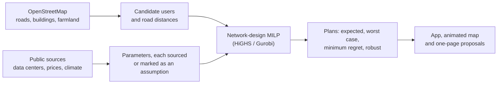

# Team Data Center

**Optimization for data centers in Ishikari, Hokkaido.** Where should their waste heat go? How much new load can the power grid host? Where should the next data center be built?

[日本語版 / Japanese](README.ja.md)


*Model v2 at today's kerosene price (156.8 yen/L [11]), heat pumps included. One shared network carries waste heat from two data centers in the Ishikari Bay New Port to 19 sites: public buildings, pools, schools, hotels, hospitals, a fish farm, a new greenhouse site and road heating. Line width shows the pipe size; brightness and particle speed show each month's flow, and snow falls in the snowy months. The bars show the heat delivered each month. Several sites and data-center positions are assumptions or placeholders ([Data and sources](#data-and-sources)). Map data © OpenStreetMap contributors (ODbL).*

## About

This project started at [Hack × Hokkaido Build Week 2026](https://www.hackhokkaido.com/), an AI build week in Sapporo (23–27 November 2026) [1]. There, international engineers and people from Hokkaido build prototypes for Hokkaido's problems from open data. Entries are public repositories under the MIT license.

We took the idea starter **"Warm Ishikari"**: a matchmaker and calculator for data-center waste heat. It maps heat sources and possible users (greenhouses, aquaculture, snow melting, public baths) and estimates the heat available, the distance and the saving. It then drafts a one-page proposal for each promising pair, with every number either sourced or marked as an assumption. We treat the task as an optimization problem and extend it into three research themes. The team plans to continue the research after the event.

## Why it matters

- **Data centers are arriving.** Ishikari Bay New Port hosts several data centers [6–10]. One of them, Ishikari Renewable Energy Data Center No. 1, started service on 1 August 2026 on 100 % renewable power [2, 4, 5]. Japan's "watt-bit" policy (2025) sets criteria for siting large data-center clusters near power supply [14].
- **Their heat is wasted while fuel is burned next door.** The waste heat of air-cooled servers (about 25–40 °C [16, 17]) is mostly released. Meanwhile, nearby greenhouses, pools, baths and snow melting burn kerosene, which cost 156.8 yen/L in Hokkaido in the government survey of 16 November 2026 [11].
- **Rules elsewhere already require reuse.** In the EU, data centers above 1 MW must use their waste heat unless a cost-benefit analysis shows it is not feasible [13]. We found no such rule in Japan [14].

## Three research themes

| | Question | Method | Status |
|---|---|---|---|
| 1. Waste-heat networks | Which users connect to which data center, along which streets, with which pipes? | Network-design MILP with monthly heat balances; stochastic and robust versions [23–26, 31–36] | Models v1 and v2, app and animated map |
| 2. Grid hosting capacity | How much data-center and heat-pump load can each grid location take? | AC optimal power flow with convex (SDP/SOCP) relaxations: certified upper bounds plus feasible points [37–47, 59–64] | Method and app page; checked on benchmark systems |
| 3. Siting | Where should the next data center go? | Facility location using the results of themes 1 and 2 [48–52] | First screen: heat value by site, distance to the grid, app page |

## Results so far (theme 1)

> **All numbers are model estimates** from public data and stated assumptions, not measured values or quotations. Several sites, demands and data-center positions are assumptions (see [Caveats](#caveats) and [docs/data-sources.md](docs/data-sources.md)).

All figures are annual net benefits in million yen, averaged over four scenarios: IT load low or high, crossed with kerosene at 115 or 156.8 yen/L. The net benefit is the value of the kerosene replaced, minus heat-pump electricity, minus the annualized cost of pipes and heat pumps. Pipe costs follow [15], heat-pump costs [16], kerosene prices [11], and monthly demand follows JMA climate normals [12]. There are 50 candidate sites: 40 from OpenStreetMap facility tags, plus 10 named public buildings, hotels and a factory. Demand per building type is an assumption.

### A shared network beats pair-by-pair matching

Matching each user to a data center on its own (the "five ranked partners" of the idea starter) reaches only **49–72 %** of what an optimized shared network earns at the two large data centers, and 77–86 % at the small ZED.

| Data center | Network temperature | Optimized network | Top-5 pairs | Pairs reach |
|---|---|---|---|---|
| No. 1 | ambient loop | 91.3 (13 sites, 8.7 km) | 65.3 (3 sites, 5.1 km) | 72 % |
| Sakura | ambient loop | 85.7 (13 sites, 8.7 km) | 58.4 (2 sites, 3.4 km) | 68 % |
| ZED | ambient loop | 58.2 (3 sites, 2.8 km) | 50.0 (3 sites, 4.1 km) | 86 % |
| No. 1 | central heat pump | 80.6 (15 sites, 8.2 km) | 40.4 (4 sites, 6.8 km) | 50 % |
| Sakura | central heat pump | 75.4 (13 sites, 7.1 km) | 37.2 (2 sites, 3.4 km) | 49 % |
| ZED | central heat pump | 39.9 (3 sites, 2.8 km) | 30.8 (4 sites, 5.6 km) | 77 % |

Three effects explain the gap:

1. **No duplicated pipes.** At No. 1 (ambient loop) the network serves 13 sites with 8.7 km of pipe; the five best pairs serve 3 sites with 5.1 km.
2. **Users that lose money alone pay off on a branch.** A pool 2.8 km from data center No. 1 loses about 8.5 M yen a year with its own pipe. Its heat is worth about 8.6 M yen a year after heat-pump costs, so it pays off on any branch shorter than about 1.4 km.
3. **Large pipes are cheaper per unit of heat.** Per megawatt carried, a metre of DN250 pipe costs about one seventh of a metre of DN80 (cost line from [15]).

### From ranked partners to a one-page proposal

The app keeps the idea starter's demo flow. Pick a data center, see five partners ranked by what each adds to the regional plan, and open a one-page proposal for any of them (page *Warm Ishikari Proposals*; data from `scripts/export_proposals.py`). The proposal shows:
- the dedicated pipe on the street map, and the shared network around it;
- the heat delivered month by month;
- what the partner adds to the shared network;
- a range of heat prices at which both sides gain.

A calculation sheet follows. It marks every number as a published source, an assumption or a calculation, and a test checks that no number is left unmarked.

- **No. 1's best partner is the fish farm** (an assumed site). A DN150 pipe of 2.5 km delivers 5,000 MWh a year, replaces 606 kL of kerosene and pays back in 6.3 years. In the regional plan the farm adds 82.4 M yen a year.
- **A price that works for both sides.** Suppose the supplier owns the pipe. Then any heat price between 5,280 and 16,483 yen/MWh leaves both sides better off. Splitting the gain equally gives 10,881 yen/MWh, against 19,018 yen/MWh for heat from kerosene at 156.8 yen/L. Such a range exists exactly when the pair pays for itself ([formulas](docs/formulations/heat-model.md#11-a-heat-price-for-a-pair)).
- **Some partners pay only inside the network.** A hospital and a hotel among No. 1's five partners lose 16.6 M and 7.8 M yen a year with a dedicated pipe. In the shared network they add 9.8 M and 8.6 M yen a year.

### Robust planning avoids leaning on uncertain data centers

- **The nominal plan (ambient loop, kerosene 115 yen/L).** With every data center at its nominal IT load, the best plan earns 66.0. It serves five sites from the small ZED and road heating from the planned NTT-ME center.
- **What can go wrong.** At ZED's published average load (0.9 MW, from the city's plan [6]) the plan earns 32.3. If NTT-ME is not built either, it loses money (−0.7).
- **The robust plan** allows at most one data center at its low IT load and is solved by column-and-constraint generation [31, 33]. It serves the same five sites from No. 1 and keeps **59.7 in every case**, giving up 9.7 % of the nominal value.
- **Central heat pump.** The nominal plan hangs twelve sites on ZED and loses money if ZED runs low (−1.4). The robust plan keeps 37.3, at a price of 1.8 %.

### Planning for uncertainty: a positive value that depends on the search

With the ambient loop, the two-stage stochastic plan earns 93.8 in expectation, and this reproduces exactly. What a plan built for the average scenario earns on the same scenarios depends on the candidate links its search uses: 89.4 with the seeded links and 65.1 without them. The value of the stochastic solution is therefore **4.4 to 28.7 per year**. An earlier run reported 79.0 (a value of 14.8); it came from a different search draw ([details](docs/formulations/heat.md)).

### The low-temperature loop wins once heat pumps are paid for

The stochastic plan with an ambient loop earns **93.8** in expectation, against **81.5** for a central heat pump feeding a 60 °C network. The ambient loop runs at about 30 °C with heat pumps at the users, and the fish farm and the road heating take the heat directly. At today's kerosene price, the ambient plan connects 16 sites with 10.7 km of pipe and earns 140.3 per year; this is the plan in the animation above.

### CO₂: the plan pays for itself, and a subsidy moves it more than a carbon price

The stochastic plan above (13 sites, 7.8 km) avoids about **3,900 t of CO₂ a year** when the users' heat pumps run on Hokkaido Electric's standard power (0.526 kg/kWh [54]). It avoids 4,300 t at the national level for FY2030 (0.25 kg/kWh [55]) and 4,600 t on renewable power; kerosene emits 2.50 kg per litre [53]. The plan earns money while it cuts, about 24,000 yen per tonne, so it needs no carbon price.

We then re-optimized the plan under two scenarios: a price on the CO₂ avoided, and a subsidy on the investment.

| Policy (scenario) | Sites | Pipe (km) | CO₂ avoided (t/yr) | Investment (100 M yen) | Net benefit to the project | Net benefit without policy money | Cost of the extra tonnes (yen/t) |
|---|---|---|---|---|---|---|---|
| none | 13 | 7.8 | 3,927 | 23.0 | 93.8 | 93.8 | — |
| carbon price 1,700 yen/t | 13 | 7.8 | 3,927 | 23.0 | 100.5 | 93.8 | — |
| carbon price 4,300 yen/t | 14 | 9.8 | 4,874 | 32.8 | 111.3 | 90.4 | 3,600 |
| carbon price 10,000 yen/t | 16 | 10.7 | 5,198 | 36.6 | 139.6 | 87.6 | 4,800 |
| carbon price 20,000 yen/t | 19 | 11.9 | 5,725 | 43.0 | 195.6 | 81.1 | 7,100 |
| subsidy of 1/3 | 19 | 11.9 | 5,725 | 43.0 | 160.6 | 81.1 | 7,100 |
| subsidy of 1/2 | 30 | 24.2 | 7,922 | 79.0 | 227.4 | 9.8 | 21,000 |
| subsidy of 2/3 | 33 | 27.8 | 8,107 | 84.2 | 301.0 | −7.6 | 24,200 |

- **A carbon price moves the plan slowly.** 1,700 and 4,300 yen per tonne are the lower and upper reference prices of Japan's emissions trading scheme for FY2026 [56]. The lower one changes nothing, and the upper one adds one site. Even 20,000 yen per tonne reaches only 19 sites and 46 % more CO₂ avoided.
- **A subsidy moves it much more.** With half of the investment subsidized, the plan reaches 30 sites on 24 km of pipe and avoids twice the CO₂. One half is the rate of a Ministry of the Environment programme that names waste-heat supply from data centers [57]. Two thirds, the usual rate of the grant for decarbonization-leading areas (Ishikari is one) [58], reaches 33 sites.
- **The extra tonnes cost real resources.** The no-policy plan already holds everything that pays. Each additional tonne costs 3,600 to 7,100 yen under a carbon price and 21,000 to 24,000 yen under the larger subsidies. With two thirds subsidized, the network as a whole no longer covers its cost without the subsidy (−7.6).
- **In the proposals and the app.** Each proposal's calculation sheet lists the CO₂ avoided under the three electricity scenarios, the cost of a tonne, and the payback at subsidy rates of 1/3, 1/2 and 2/3. The *Warm Ishikari* page has both policies as sliders.

Notes on the table:
- CO₂ is with heat pumps on Hokkaido Electric's standard power. *Cost of the extra tonnes* is the net benefit the no-policy plan gives up, divided by the extra CO₂ avoided.
- The carbon prices and subsidy rates are scenarios. They do not state how an actual scheme applies to a project.
- These are the best plans found, with Gurobi (gaps of 4–11 % to its bound after 300 s per policy). HiGHS alone finds plans within 3.4 % of them and the same picture, except that it keeps the 13-site plan at 4,300 yen/t.
- Every policy was given the same candidate links, and every plan found was evaluated under every policy, so the plans differ because of the policy and not because of the search ([method](docs/formulations/heat-model.md#12-co2-and-policy-scenarios), [both tables](docs/formulations/heat.md)).

### Caveats

- **Optimality.** The plans come from an LP-guided kernel search with HiGHS.
  - *Standard candidate links.* Gurobi 14.0, an optional backend, proves the optimum of the expected-value model in 71 s (ambient) and 255 s (central). The kernel-search plans are within 0.2 % and 0.8 % of that optimum. HiGHS alone ends at gaps of 18 % and 26 % after 300 s.
  - *Direct links from every user to every data center.* Gurobi reaches gaps of 1.5 % and 3.9 % within 600 s, and HiGHS 38 % and 36 %.
  - The headline plans also use direct links seeded from each data center's own plan.
  - To rerun the comparison: `uv run python experiments/solver_compare/run.py`.
- **Positions.** Two data-center positions are approximate and one is a placeholder.
- **Model scope.** The model balances energy month by month, and heat losses are a flat percentage. Distance-dependent losses are next.

Details: the full mathematical model, with every coefficient and worked numbers, is in [docs/formulations/heat-model.md](docs/formulations/heat-model.md); results are in [docs/formulations/heat.md](docs/formulations/heat.md).

## Results so far (theme 2)

> **These are results on public benchmark networks, not on the Hokkaido grid.** We found no public network model of Hokkaido. The numbers show what the method does, and how far a simpler screening can be off.

For one bus of a network, the hosting capacity is the largest added load (power factor 0.95) that the AC network can serve within its voltage, branch, angle and generator limits, with all generators free to redispatch. We bracket it from both sides:
- **Upper bound.** A convex relaxation (semidefinite with chordal decomposition, or second-order cone) [39, 40, 59–61]. No operating point can host more.
- **Lower bound.** An AC operating point found by an interior-point method [62], then confirmed by a separate check of every balance and limit.

We ran every bus of six PGLib-OPF systems [45], 558 buses in all.

| System | Buses | Bracket closed within 1 % | DC screening above the upper bound | DC value / AC value, median | Limit that binds: thermal / voltage / generation |
|---|---|---|---|---|---|
| case14_ieee | 14 | 14 | 14 | 3.12 | 0 / 14 / 0 |
| case30_ieee | 30 | 27 | 30 | 2.24 | 26 / 3 / 1 |
| case39_epri | 39 | 6 | 14 | 1.06 | 0 / 0 / 39 |
| case57_ieee | 57 | 1 | 57 | 4.53 | 0 / 57 / 0 |
| case118_ieee | 118 | 50 | 96 | 1.14 | 57 / 53 / 8 |
| case300_ieee | 300 | 223 | 297 | 3.19 | 7 / 291 / 2 |

- **A checked AC operating point exists at every bus** (558 of 558), so every bus has a lower bound.
- **DC screening overstates the hostable load at most buses.** The usual screening model (no losses, no reactive power, no voltage limits) exceeds the certified upper bound at 508 of 558 buses, and by more than 10 % at 458. A 2026 study of a synthetic Texas grid reports the same direction [47].
- **The bracket closes at more than half of the buses.** The two bounds agree within 1 % at 321 of 558 buses, and within 0.1 % at 130. It stays wide where voltage limits bind: on the 57-bus system the median gap is 28 %.
- **Which limit binds depends on the system.** Voltage at 418 buses, thermal ratings at 90, generator limits at 50.
- **A lower existing load leaves several times more room.** On the 30-bus system, bus 5 takes 12 MW at the load of the case as given, 64 MW at 80 % of it and 114 MW at 60 %. A load that can be curtailed in the highest-demand hours could therefore be much larger than a firm one.
- **Outages matter.** With any single branch out, the same bus takes 20 MW at 70 % load, against 89 MW with the network intact.

The app's *Grid hosting capacity* page solves one bus at a time and shows the bracket, the binding limits and the network. Formulation, all tables and the limits of the study: [docs/formulations/grid.md](docs/formulations/grid.md).

**Caveats.** Generators redispatch freely, which is the best case for the network; an operator's own dispatch rules leave less room. One operating condition at a time, no stability limits. The upper bounds are certified up to the conic solver's tolerance. The AC method is local, so a lower bound need not be the best one unless the bracket is closed.

## Results so far (theme 3)

> **A first screen, not a site search.** The candidate sites are grid points. Zoning, land, fibre and hazards are not considered, and the grid enters as a distance, because there is no network model of the Hokkaido grid yet.

For each of 56 candidate sites in Ishikari (a 1.5 km grid, each point moved to the nearest road), the heat-network model of theme 1 is solved again with a new 10 MW data center there. The gain over today's regional plan is the value of that data center's waste heat. The distance to the nearest substation comes from OpenStreetMap.

| Site | Near | Heat value (M yen/yr) | Sites served from it | To a 66 kV substation | To a 187 kV substation |
|---|---|---|---|---|---|
| g07 | 新港西一丁目 | 45.2 | 10 | 1.4 km | 5.2 km |
| g08 | 花川北四条一丁目 | 44.9 | 16 | 1.7 km | 5.5 km |
| g09 | 花川北七条三丁目 | 25.2 | 14 | 1.8 km | 4.8 km |
| g38 | 弁天町 | 19.9 | 2 | 8.2 km | 8.3 km |

- **The heat has value at 19 of the 56 sites.** At the best one it is 45.2 M yen a year, almost half of what the whole regional plan earns today (93.8).
- **What counts is being nearer to the heat users.** The best sites are 1 to 2 km from the existing data centers, on the town side. At the port itself heat is already in surplus: the regional plan uses about 15 % of what the existing data centers could supply, so one more data center there adds nothing.
- **The grid connection decides how much is left.** With a connection line at 100 M yen/km (an assumption), the best site keeps 37.9 of its 45.2 if it connects at the 66 kV substation 1.4 km away, and 18.5 if it has to connect at 187 kV, 5.2 km away.
- **A second new data center is worth about a third of the first:** 16.6 of heat value on top, and 3.3 after its own connection cost.

The app's *Siting* page shows the map and solves the location model for a chosen number of data centers, connection level and cost. The values are lower bounds from a heuristic search, computed one site at a time. They are from the run with Gurobi; HiGHS alone gives the same values at the four best sites and lower ones at 17 others. Formulation, method and limits: [docs/formulations/siting.md](docs/formulations/siting.md).

## How it works



**The model in one paragraph** (related work: [23–26]; robust methods: [31–36]).
- *Network.* Candidate links follow streets between data centers and users. Binary variables open a link with a pipe size, connect a user, and assign it to one data center.
- *Routing.* A strong multi-commodity flow formulation routes each user's heat from its data center.
- *Monthly balances.* Deliveries are limited by each user's demand and by each data center's waste heat.
- *Objective.* Maximize the value of the heat minus annualized costs.
- *Uncertainty.* The stochastic version shares one build across scenarios. The robust versions maximize the worst case, minimize the largest regret, or protect against a budgeted uncertainty set on IT loads.

## Quick start

```bash
uv sync
uv run python scripts/fetch_data.py --area ishikari    # map data from OpenStreetMap into data/cache (not committed)
uv run python scripts/export_heat_story.py             # base map and data for the animated map page
uv run python scripts/export_proposals.py              # ranked partners and proposals per data center (a few minutes)
uv run python scripts/export_siting.py                 # theme 3: heat value of a new data center at every candidate site (15 minutes)
uv run streamlit run app/streamlit_app.py              # the demo app
uv run pytest                                          # tests; those that need map data skip without it
```

**Experiments**
- Model v1 against v2: `uv run python experiments/heat_v2_compare/run.py`
- Robust sweep: `uv run python experiments/heat_ccg/run.py ambient`
- Carbon price and subsidy scenarios: `uv run python experiments/heat_policy/run.py`
- Theme 2, every bus of six benchmark systems (downloads PGLib-OPF): `uv run python experiments/grid_hosting/run.py --workers 8`

**Live simulation (the app's Warm Ishikari page)**
- Type a what-if in either language ("電気料金を2倍にして" / "double the electricity price"); the LLM
  (carbonforge-flash, OpenAI-compatible via `CF_API_KEY`, override endpoint with `CARBONFORGE_BASE_URL`
  and model with `LLM_MODEL`) maps it onto the page's knobs, the deterministic model re-runs, and the
  LLM explains the result. The model never computes numbers; it chooses inputs and explains outputs.

**Redrawing the animation above**
1. `uv run python scripts/export_heat_network_v2.py`
2. `uv run python scripts/render_readme_animation.py --plan current` (add `--lang ja` for the Japanese version; it needs a Japanese font such as Noto Sans CJK JP)

## Repository layout

```
src/dcopt/heat      theme 1: model v1 (v1.py), v2 (network.py), proposals (proposal.py)
src/dcopt/grid      theme 2: networks (cases.py), relaxations (relax.py), AC points (ac.py), brackets (hosting.py)
src/dcopt/siting    theme 3: candidate sites (candidates.py), heat value (heat_value.py), grid distances (gridmap.py), location model (model.py)
src/dcopt/common    shared code: road network, styles
app/                Streamlit app
web/heat_story/     animated map page
scripts/            data download, exports, figures
experiments/        reproducible experiments (outputs go to results/, not committed)
docs/               formulations, data sources, figures
data/curated/       small tables we compiled, each value with its source
tests/              unit tests on synthetic instances and app tests
```

## Data and sources

- **Every number has a source or is marked as an assumption.** The list, with URLs, is in [docs/data-sources.md](docs/data-sources.md). It covers the data centers in Ishikari, prices, pipe and heat-pump costs, climate normals and precedents.
- **Every dataset is registered, pinned and tested.** [docs/data-accountability.md](docs/data-accountability.md) shows where each dataset is stored, under which terms, how it is processed, which tests keep the calculations accurate, and how a result is traced to its code and data.
- **Map data.**
  - Scripts download OpenStreetMap data (© OpenStreetMap contributors, ODbL [18]) into `data/raw/` and `data/cache/`. This data is not committed.
  - The animation is a produced work from OpenStreetMap data and is credited as such.
- **Benchmark power systems.** Theme 2 uses PGLib-OPF [45] (CC BY 4.0). The code downloads the case files into `data/cache/pglib/`; they are not committed. The small built-in systems are our own illustrative data.
- **Weather.** Daily JMA observations for Sapporo, 1976–2025 [12], are committed in `data/jma/` under JMA's terms of use (Public Data Terms of Use 1.0: source credited, processing stated), not under the MIT license; see `data/jma/README.md`.
- **Hokkaido precedents.** Snow melting with data-center heat [19], the snow-cooled data center in Bibai and its eel farm [20, 21], and a bath heated by data-center waste heat [22].
- **Assumed sites.** The fish farm, the new greenhouses and the road-heating areas are assumptions, drawn as hollow markers.
- **Data-center positions.** The positions of No. 1 and ZED are approximate, and NTT-ME's site has not been published.

## Solvers

- **Open source by default.** HiGHS solves the MILPs and LPs. Clarabel [64] solves the conic relaxations of theme 2, and the AC points come from our own interior-point code.
- **Optional commercial solver.** Gurobi can be used when installed (`DCOPT_SOLVER=gurobi`), but no part of the code requires it. On this model it certifies plans that HiGHS cannot within the same time (see Caveats).

## Next research questions

- Certify optimality with a stronger pipe-sizing formulation (cut-set inequalities, Benders cuts) [23, 26].
- Co-optimize the network layout, the temperature level and where heat pumps go, at street scale.
- Model heat losses that depend on pipe length, size, temperature and flow.
- Share the cost of a common trunk fairly: the Shapley value against the least core [27, 28].
- Two-stage robust design when it is uncertain which planned data centers will be built [32–35].
- A network model for Ishikari: HEPCO Network's published data for 187 kV and above, the IEEJ standard models, or OpenStreetMap.
- Tighter relaxations where voltage limits bind [42, 63], and flexible data-center loads as curtailable connections [50, 51].
- Siting with the hosting capacity as a constraint, with candidate data centers chosen inside the heat-network model, and with land, hazard and fibre layers [29, 30, 48–52].

## References

Facts and parameters [1–22], then related literature: waste-heat networks and data-center heat reuse [23–30], robust optimization [31–36], grid hosting capacity [37–47], siting and flexible loads [48–52]. CO₂ factors and policy sources [53–58]. Methods and the solver of theme 2 [59–64].

1. Hack × Hokkaido Build Week 2026, AI build week in Sapporo, 23–27 November 2026. https://www.hackhokkaido.com/ (accessed 2026-11-24).
2. Broadband Tower (2025-11-28). Press release on Ishikari Renewable Energy Data Center No. 1 (in Japanese). https://www.bbtower.co.jp/ir/pr/docs/20251128_ishikari_release.pdf
3. PR TIMES (2026-04-22). Ishikari Renewable Energy Data Center No. 1: site in 石狩市新港中央1丁目 (in Japanese). https://prtimes.jp/main/html/rd/p/000000693.000006953.html
4. Impress Cloud Watch (2026-04-01). Ishikari Renewable Energy Data Center No. 1: 15,000 kVA receiving, at least 10 MW from August 2026, 1,140 racks (in Japanese). https://cloud.watch.impress.co.jp/docs/news/2097920.html
5. TV Tokyo Plus (2026-10-07). Service start on 1 August 2026 on 100 % renewable power (in Japanese). https://www.tv-tokyo.co.jp/plus/external-pr/entry/269543.html
6. 石狩市・東急不動産 (2025). 脱炭素先行地域 計画提案書「再エネの地産地活・脱炭素で地域をリデザイン」, revised 2025-07-04 (Ishikari City and Tokyu Land, decarbonization-leading-area plan). https://www.city.ishikari.hokkaido.jp/_res/projects/default_project/_page_/001/002/422/senko20250704.pdf
7. Sakura Internet. Ishikari Data Center (in Japanese). https://www.sakura.ad.jp/corporate/corp/datacenter/ ; Impress Cloud Watch (2015-09-30). https://cloud.watch.impress.co.jp/docs/news/723209.html
8. 日本建設業連合会 (2012). さくらインターネット石狩データセンター, building case sheet (in Japanese). https://nikkenren.com/kenchiku/sb/pdf/223/12-024.pdf
9. Impress Cloud Watch (2024). KCCS zero-emission data center Ishikari (in Japanese). https://cloud.watch.impress.co.jp/docs/news/1627835.html ; Ministry of the Environment. https://www.env.go.jp/content/900514282.pdf
10. Impress Cloud Watch (2025-10-23). NTT-ME container data centers in Ishikari (in Japanese). https://cloud.watch.impress.co.jp/docs/news/2057156.html
11. 資源エネルギー庁 (2026). 石油製品価格調査, survey of 2026-11-16 (Agency for Natural Resources and Energy, petroleum product prices). https://www.enecho.meti.go.jp/statistics/petroleum_and_lpgas/pl007/xlsx/261118.xlsx
12. 気象庁. 平年値（1991〜2020年）札幌 (Japan Meteorological Agency, climate normals, Sapporo). https://www.data.jma.go.jp/obd/stats/etrn/view/nml_sfc_ym.php?prec_no=14&block_no=47412 ; 同 日別値 (daily observations, same station): https://www.data.jma.go.jp/obd/stats/etrn/view/daily_s1.php?prec_no=14&block_no=47412
13. European Union (2023). Directive (EU) 2023/1791 on energy efficiency, Articles 12 and 26. https://eur-lex.europa.eu/eli/dir/2023/1791/oj
14. 総務省・経済産業省 (2025). ワット・ビット連携官民懇談会 取りまとめ1.0 (MIC and METI, public-private council on watt-bit coordination, summary 1.0). https://www.soumu.go.jp/main_content/001014454.pdf
15. Tachibana, M. (2023). Doctoral thesis, Yokohama National University: cost of small district-heating networks (values read from charts). https://ynu.repo.nii.ac.jp/record/12712/files/tachibana_masaya-thesis.pdf
16. Dansk Fjernvarme (2022). Inspirationskatalog for store varmepumper: Odense data-center heat pumps (COP, cost). https://danskfjernvarme.dk/media/eqbhcqlv/inspirationskatalog-for-store-varmepumper-2022.pdf
17. Berenschot (2020). Analyse restwarmte uit datacenters Hollands Kroon (waste heat from data centers). https://www.berenschot.nl/media/xtmabnee/cases-berenschot_-_analyse_restwarmte_uit_datacenters_hollands_kroon_-_eindrapport_1.pdf
18. OpenStreetMap contributors. Map data under the Open Database License (ODbL 1.0). https://www.openstreetmap.org/copyright
19. 堤拓哉・月館司・下ノ薗慧 (2019). 積雪寒冷条件を踏まえたデータセンターの設計に関する基礎的検討. 北海道立総合研究機構 調査研究報告 No.396 (design of data centers in snowy cold regions). https://www.hro.or.jp/upload/22910/396.pdf
20. 本間弘達 (2020). 雪冷熱エネルギーを利用したデータセンター. 電気設備学会誌 40(5), 296–299 (a data center using snow cold energy, Bibai). https://www.jstage.jst.go.jp/article/ieiej/40/5/40_296/_pdf/-char/ja
21. 北海道新聞 (2024-07-11). 雪うなぎ: eel farming with data-center heat in Bibai (in Japanese). https://www.hokkaido-np.co.jp/movies/detail/6357590939112/
22. 大沢飛智 (2026). データセンターと地域の新たな共生モデル —排熱利用型温浴施設「ビットの湯」—. Hokkaido University GX center poster. https://hu-gxc.eng.hokudai.ac.jp/wp-content/uploads/2026/03/gxc2025_excellence_16-osawa.pdf
23. Ljubić, I., Weiskircher, R., Pferschy, U., Klau, G.W., Mutzel, P., Fischetti, M. (2006). An Algorithmic Framework for the Exact Solution of the Prize-Collecting Steiner Tree Problem. *Mathematical Programming*, 105, 427–449. https://doi.org/10.1007/s10107-005-0660-x
24. Kuper, L., Metzger, M., Stursberg, P., Niessen, S. (2025). Computationally efficient topology design of district heating networks by price-collecting Steiner trees. *Energy*, 333, 137223. https://doi.org/10.1016/j.energy.2025.137223
25. Bordin, C., Gordini, A., Vigo, D. (2016). An optimization approach for district heating strategic network design. *European Journal of Operational Research*, 252(1), 296-307. https://doi.org/10.1016/j.ejor.2015.12.049
26. Lambert, J., Ceruti, A., Spliethoff, H. (2024). Benchmark of mixed-integer linear programming formulations for district heating network design. *Energy*, 308, 132885. https://doi.org/10.1016/j.energy.2024.132885
27. Megiddo, N. (1978). Cost allocation for steiner trees. *Networks*, 8(1), 1-6. https://doi.org/10.1002/net.3230080104
28. Caprara, A., Letchford, A.N. (2010). New techniques for cost sharing in combinatorial optimization games. *Mathematical Programming*, 124(1-2), 93-118. https://doi.org/10.1007/s10107-010-0357-7
29. Huang, P., Copertaro, B., Zhang, X., Shen, J., Löfgren, I., Rönnelid, M., et al. (2020). A review of data centers as prosumers in district energy systems: Renewable energy integration and waste heat reuse for district heating. *Applied Energy*, 258, 114109. https://doi.org/10.1016/j.apenergy.2019.114109
30. Wahlroos, M., Pärssinen, M., Manner, J., Syri, S. (2017). Utilizing data center waste heat in district heating – Impacts on energy efficiency and prospects for low-temperature district heating networks. *Energy*, 140, 1228-1238. https://doi.org/10.1016/j.energy.2017.08.078
31. Bertsimas, D., Sim, M. (2004). The Price of Robustness. *Operations Research*, 52(1), 35-53. https://doi.org/10.1287/opre.1030.0065
32. Ben-Tal, A., Goryashko, A., Guslitzer, E., Nemirovski, A. (2004). Adjustable robust solutions of uncertain linear programs. *Mathematical Programming*, 99(2), 351-376. https://doi.org/10.1007/s10107-003-0454-y
33. Zeng, B., Zhao, L. (2013). Solving two-stage robust optimization problems using a column-and-constraint generation method. *Operations Research Letters*, 41(5), 457-461. https://doi.org/10.1016/j.orl.2013.05.003
34. Atamtürk, A., Zhang, M. (2007). Two-Stage Robust Network Flow and Design Under Demand Uncertainty. *Operations Research*, 55(4), 662-673. https://doi.org/10.1287/opre.1070.0428
35. Majewski, D.E., Lampe, M., Voll, P., Bardow, A. (2017). TRusT: A Two-stage Robustness Trade-off approach for the design of decentralized energy supply systems. *Energy*, 118, 590-599. https://doi.org/10.1016/j.energy.2016.10.065
36. Aissi, H., Bazgan, C., Vanderpooten, D. (2009). Min–max and min–max regret versions of combinatorial optimization problems: A survey. *European Journal of Operational Research*, 197(2), 427-438. https://doi.org/10.1016/j.ejor.2008.09.012
37. Molzahn, D.K., Hiskens, I.A. (2019). A Survey of Relaxations and Approximations of the Power Flow Equations. *Foundations and Trends in Electric Energy Systems*, 4(1-2), 1-221. https://doi.org/10.1561/3100000012
38. Bai, X., Wei, H., Fujisawa, K., Wang, Y. (2008). Semidefinite programming for optimal power flow problems. *International Journal of Electrical Power & Energy Systems*, 30(6-7), 383-392. https://doi.org/10.1016/j.ijepes.2007.12.003
39. Lavaei, J., Low, S.H. (2012). Zero Duality Gap in Optimal Power Flow Problem. *IEEE Transactions on Power Systems*, 27(1), 92-107. https://doi.org/10.1109/TPWRS.2011.2160974
40. Jabr, R. (2006). Radial Distribution Load Flow Using Conic Programming. *IEEE Transactions on Power Systems*, 21(3), 1458-1459. https://doi.org/10.1109/TPWRS.2006.879234
41. Farivar, M., Low, S.H. (2013). Branch Flow Model: Relaxations and Convexification—Part I. *IEEE Transactions on Power Systems*, 28(3), 2554-2564. https://doi.org/10.1109/TPWRS.2013.2255317
42. Coffrin, C., Hijazi, H.L., Van Hentenryck, P. (2016). The QC Relaxation: A Theoretical and Computational Study on Optimal Power Flow. *IEEE Transactions on Power Systems*, 31(4), 3008-3018. https://doi.org/10.1109/TPWRS.2015.2463111
43. Kocuk, B., Dey, S.S., Sun, X.A. (2016). Strong SOCP Relaxations for the Optimal Power Flow Problem. *Operations Research*, 64(6), 1177-1196. https://doi.org/10.1287/opre.2016.1489
44. Molzahn, D. K., Lesieutre, B. C., DeMarco, C. L. (2013). A Sufficient Condition for Power Flow Insolvability With Applications to Voltage Stability Margins. *IEEE Transactions on Power Systems*, 28(3), 2592–2601. https://doi.org/10.1109/TPWRS.2012.2233765
45. Sogol Babaeinejadsarookolaee, Adam Birchfield, Richard D. Christie, Carleton Coffrin, Christopher DeMarco, Ruisheng Diao, et al. (2019). The Power Grid Library for Benchmarking AC Optimal Power Flow Algorithms. arXiv:1908.02788. https://arxiv.org/abs/1908.02788
46. Coffrin, C., Bent, R., Sundar, K., Ng, Y., Lubin, M. (2018). PowerModels. JL: An Open-Source Framework for Exploring Power Flow Formulations. *2018 Power Systems Computation Conference (PSCC)*. https://doi.org/10.23919/PSCC.2018.8442948
47. Haoxiang Wan, Jesus Silva-Rodriguez, Jonghwan Kwon, Xingpeng Li (2026). AC Assessment of DC Power Flow Screening for Data Center Hosting Capacity and Siting. arXiv:2611.19602 (preprint, not peer reviewed). https://arxiv.org/abs/2611.19602
48. Goiri, I., Le, K., Guitart, J., Torres, J., Bianchini, R. (2011). Intelligent Placement of Datacenters for Internet Services. *2011 31st International Conference on Distributed Computing Systems*. https://doi.org/10.1109/ICDCS.2011.19
49. Covas, M.T., Silva, C.A., Dias, L.C. (2013). Multicriteria decision analysis for sustainable data centers location. *International Transactions in Operational Research*, 20(3), 269–299. https://doi.org/10.1111/j.1475-3995.2012.00874.x
50. Kim, K., Yang, F., Zavala, V.M., Chien, A.A. (2017). Data Centers as Dispatchable Loads to Harness Stranded Power. *IEEE Transactions on Sustainable Energy*, 8(1), 208-218. https://doi.org/10.1109/TSTE.2016.2593607
51. Norris, T. H., Profeta, T., Patino-Echeverri, D., Cowie-Haskell, A. (2025). Rethinking Load Growth: Assessing the Potential for Integration of Large Flexible Loads in US Power Systems. Nicholas Institute, Duke University, NI R 25-01. https://nicholasinstitute.duke.edu/publications/rethinking-load-growth (figures as cited in the lead author's testimony of 2025-03-05)
52. Onodera, H., Shiraki, H., Matsuhashi, K. (2026). Strategic data center siting can mitigate trade-offs between decarbonization and digitalization in Japan. *Cell Reports Sustainability*, 3(9), 100823. https://doi.org/10.1016/j.crsus.2026.100823
53. 環境省. 算定・報告・公表制度における算定方法・排出係数一覧 (Ministry of the Environment, list of calculation methods and emission factors): kerosene 2.50 t-CO₂/kL. https://policies.env.go.jp/earth/ghg-santeikohyo/files/calc/ichiran_2025r.pdf (accessed 2026-11-25).
54. 環境省・経済産業省 (2026). 電気事業者別排出係数（特定排出者の温室効果ガス排出量算定用）R6年度実績, published 2026-01-09 (emission factors by electricity retailer, FY2024 results): Hokkaido Electric Power. https://policies.env.go.jp/earth/ghg-santeikohyo/files/calc/r08_denki_coefficient_rev4.pdf
55. 日本政府 (2025). 地球温暖化対策計画 関連資料2, Cabinet decision of 2025-02-18 (Plan for Global Warming Countermeasures, annex 2): 0.25 kg-CO₂/kWh in FY2030. https://www.env.go.jp/content/000290553.pdf
56. 経済産業省 (2026). 告示第27号, 2026-03-30: 令和8年度の参考上限取引価格及び調整基準取引価格 (METI notification No. 27: reference prices of the emissions trading scheme for FY2026). https://www.meti.go.jp/policy/energy_environment/global_warming/torihikikakaku.pdf
57. 環境省 (2026). 地域共生を目指したデータセンター脱炭素化設備導入支援事業 (subsidy for decarbonization equipment at data centers, FY2025 supplementary budget): rate 1/2, waste-heat supply equipment eligible. https://www.env.go.jp/content/000356389.pdf
58. 環境省 (2026). 地域脱炭素推進交付金 事業概要, FY2026 (grant for regional decarbonization): as a rule 2/3 for decarbonization-leading areas. https://policies.env.go.jp/policy/roadmap/assets/grants/chiiki-datsutanso-kofukin-R8.pdf
59. Grone, R., Johnson, C.R., Sá, E.M., Wolkowicz, H. (1984). Positive definite completions of partial Hermitian matrices. *Linear Algebra and its Applications*, 58, 109–124. https://doi.org/10.1016/0024-3795(84)90207-6
60. Jabr, R.A. (2012). Exploiting Sparsity in SDP Relaxations of the OPF Problem. *IEEE Transactions on Power Systems*, 27(2), 1138–1139. https://doi.org/10.1109/TPWRS.2011.2170772
61. Molzahn, D.K., Holzer, J.T., Lesieutre, B.C., DeMarco, C.L. (2013). Implementation of a Large-Scale Optimal Power Flow Solver Based on Semidefinite Programming. *IEEE Transactions on Power Systems*, 28(4), 3987–3998. https://doi.org/10.1109/TPWRS.2013.2258044
62. Wang, H., Murillo-Sánchez, C.E., Zimmerman, R.D., Thomas, R.J. (2007). On Computational Issues of Market-Based Optimal Power Flow. *IEEE Transactions on Power Systems*, 22(3), 1185–1193. https://doi.org/10.1109/TPWRS.2007.901301
63. Coffrin, C., Hijazi, H.L., Van Hentenryck, P. (2017). Strengthening the SDP Relaxation of AC Power Flows With Convex Envelopes, Bound Tightening, and Valid Inequalities. *IEEE Transactions on Power Systems*, 32(5), 3549–3558. https://doi.org/10.1109/TPWRS.2016.2634586
64. Goulart, P.J., Chen, Y. (2026). Clarabel: An interior-point solver for conic programs with quadratic objectives. *Mathematical Programming Computation*, 18(4), 1279–1361. https://doi.org/10.1007/s12532-026-00320-7

## Team

Adam Curnow, Junko, Lia Vergou, Noriyuki Sugita, Paul Binder, Seiko Yamaguchi

## License and citation

The code is under the MIT license ([LICENSE](LICENSE)). Data from other sources keeps its own license. To cite this work, see [CITATION.cff](CITATION.cff).
