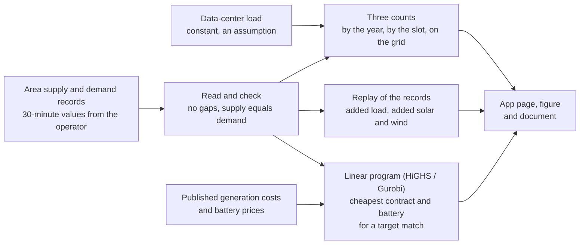
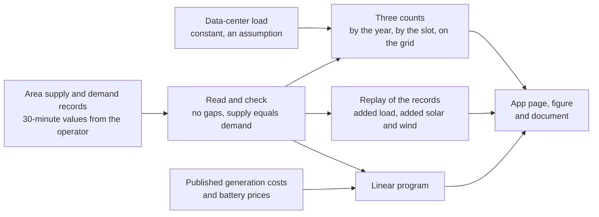

# temporary: mermaid rendering test

## V1 control

## V2 LOAD renamed

## V3 REC renamed

## V4 CNT renamed

## V5 LP renamed

## V6 RPL PRC CHK renamed

## V7 all renamed

## V8 no labels with brackets in LP

