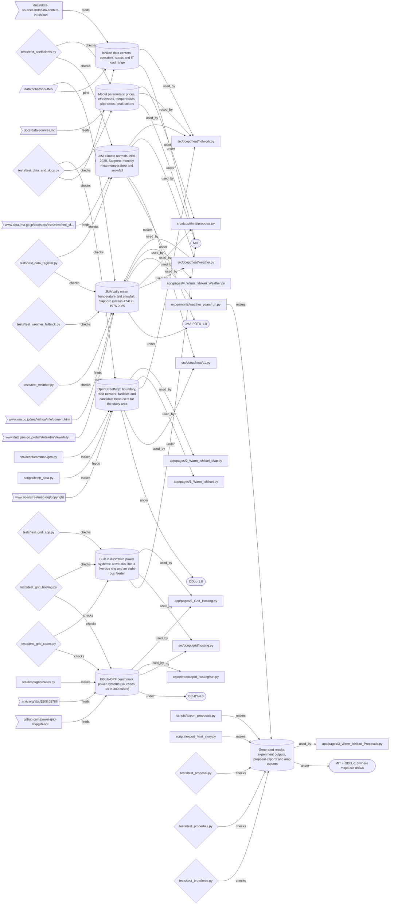

# Data accountability

This page answers five questions about the data behind every result and proposal: where the data is stored, how it is kept, how it is processed, how the calculations are kept accurate, and how to show all of this to someone else. Every answer is checked by a test, so this page cannot quietly go out of date.

| Question | Where the answer lives | What keeps it true |
|---|---|---|
| What data do we use, and where is it? | [`data/register.toml`](../data/register.toml): one entry per dataset | `tests/test_data_register.py` fails if a committed data file is missing from the register, or if a file the register names does not exist |
| Is the committed data the data we think it is? | [`data/SHA256SUMS`](../data/SHA256SUMS): the SHA-256 of every committed data file | The same test fails on any byte change. Anyone can check without our code: `cd data && shasum -a 256 -c SHA256SUMS` |
| Where does each number come from? | [`docs/data-sources.md`](data-sources.md): a URL or "assumption" for every value | `tests/test_data_and_docs.py` and `tests/test_proposal.py` (every number on a proposal is marked as a source, an assumption or a calculation) |
| Are the calculations right? | The checks below, in layers | CI runs them on every push |
| Which code and data produced a result? | The `provenance` block saved with each result | `dcopt.common.provenance.stamp()` |

## Where the data is stored

The register uses three kinds of storage:

- **git**: committed to the repository. Its exact bytes are pinned in `data/SHA256SUMS`.
- **code**: values written in a source file. Each one has its source or assumption in `docs/data-sources.md`.
- **local**: downloaded or generated on each machine into a folder git ignores. It is rebuilt by the command in the register entry's `made_by` field. It is never committed.

| Dataset | Storage | Where | Terms |
|---|---|---|---|
| Ishikari data centers (operators, status, IT load range) | git | `data/curated/ishikari_data_centers.csv` | MIT, our own compilation |
| JMA daily observations, Sapporo 47412, 1976–2025 | git | `data/jma/` (50 CSVs, about 200 KB) | JMA Public Data Terms of Use 1.0: credit 「出典：気象庁ホームページ」 and state the processing (`data/jma/README.md`) |
| JMA climate normals 1991–2020 | code | `src/dcopt/heat/v1.py` (`TEMP`, `SNOW`) | JMA terms, source cited in the code |
| Model parameters (prices, efficiencies, pipe costs, peak factors) | code | `src/dcopt/heat/network.py` (`Params`), `v1.py` | MIT, each value with its source or assumption |
| OpenStreetMap for the study area | local | `data/cache/`, `data/raw/` | ODbL 1.0, © OpenStreetMap contributors. Never committed |
| Results, proposal and map exports | local | `results/`, `out/` | Our numbers are MIT. Anything that draws OSM data credits it |

To see the live version of this table, with the checksum status, run `uv run python -m dcopt.common.provenance --report`.

## How it is kept

- **Pinned, not just committed.** Git records who changed a file. `SHA256SUMS` also makes a change fail CI until someone re-pins it on purpose with `--write`, so every change to the data shows up in a pull request.
- **Licensed data stays local.** OSM data is under ODbL and is never committed. `.gitignore` excludes `data/raw/` and `data/cache/`, and a test checks that nothing in those folders is tracked.
- **Data under other terms says how to credit it.** A committed dataset that isn't MIT must have an `attribution` field in the register, and a test enforces this.
- **No secrets.** Solver licences, API keys and `.env` files are ignored and never committed (CONTRIBUTING).

## How it is processed

Each register entry has a `processing` field in plain words, and a `code` field naming the module that does the processing. In short:

- **JMA daily data.** `dcopt.heat.weather` parses each month's daily table from JMA's site and writes one CSV per year, with the values unchanged. When the CSVs are loaded, a day with no temperature is filled with its month's mean and counted in `WeatherYear.n_missing_t`. The Weather page shows which years have filled-in days.
- **OSM.** `scripts/fetch_data.py` downloads the data through osmnx, clips it to the study area, and computes floor and land areas from the polygons.
- **Curated table.** Compiled by hand. Every row names its URLs and says when its IT load is an assumption.

## How the calculations are kept accurate

The checks come in layers, from the input data up to the printed proposal. All of them run in CI on every push.

| Layer | What is checked | Test |
|---|---|---|
| Input data vs. its own publisher | The committed JMA years, averaged over 1991–2020, reproduce JMA's published monthly normals: within 0.1 °C and 8 cm per month, and the daily constants within 1 %. Every year is complete, with at most 5 filled-in days | `test_data_register.py` |
| Input data integrity | Every committed byte matches `SHA256SUMS` | `test_data_register.py` |
| Parameters vs. documents | Every parameter has a basis; curated IT loads match the model; every user type has its parameters; demand profiles sum to 1 | `test_data_and_docs.py` |
| Formulas vs. the math page | Every worked number in `docs/formulations/heat-model.md` (COP, pipe capacities, costs, CO₂, the worked pairs) is recomputed from the code | `test_coefficients.py` |
| Optimiser vs. brute force | On small instances, the MILP finds the same optimum as trying every possible build | `test_bruteforce.py` |
| Properties any correct plan must have | More waste heat never lowers the optimum; a dearer pipe never raises it; every plan meets every constraint; worst ≤ expected ≤ best | `test_properties.py` |
| Solver vs. solver | HiGHS and Gurobi agree (runs only where Gurobi is installed) | `test_solvers.py` |
| Proposals | Every number shows its source or is marked; the pair numbers add up; prices are consistent with the pair's gain | `test_proposal.py` |

Known gap: the JMA page parser (`parse_month`) has no fixture test yet, so a change in JMA's page layout would only be caught by the normals check after a fresh download.

## Tracing a result to its code and data

`dcopt.common.provenance.stamp()` returns a block that experiments save in their `results.json`:

```json
"provenance": {
  "created_utc": "2026-11-24T09:12:03+00:00",
  "git_commit": "5eedbb7…",
  "uncommitted_changes": false,
  "data_fingerprint": "7aa24e83fe765039",
  "data_problems": [],
  "python": "3.12.8",
  "packages": {"dcopt": "0.1.0", "numpy": "…", "highspy": "…"},
  "solver": "highs (default)"
}
```

The `data_fingerprint` is the SHA-256 of `SHA256SUMS`, which covers all the committed data in one value. If two results have the same commit and fingerprint and `uncommitted_changes` is false, they came from the same code and the same data. `experiments/weather_years/run.py` records this block. The other experiments and the export scripts should adopt it next.

## Showing it to someone in two minutes

```bash
uv run python -m dcopt.common.provenance --report
```

```bash
cd data && shasum -a 256 -c SHA256SUMS
```

```bash
uv run pytest -q tests/test_data_register.py tests/test_data_and_docs.py tests/test_coefficients.py
```

Then open the lineage diagram below.

## Lineage

This diagram is generated from the register. `--write` refreshes it, and a test fails if it is stale. Datasets are drawn as cylinders, sources as flags, tests as diamonds and licences as rounded boxes.

<!-- lineage:start (generated by --write) -->

<!-- lineage:end -->

## Optional: the lineage graph in Neo4j

The same graph can be loaded into Neo4j for questions that are awkward to answer by reading files. Neo4j is optional: no code or test needs it, and the export uses only the standard library.

```bash
uv run python -m dcopt.common.provenance --cypher > lineage.cypher
```

Then paste the file into the Neo4j Browser, or run `cypher-shell -f lineage.cypher`. The script uses `MERGE` throughout, so re-running it updates the graph in place. Neo4j Community Edition (GPLv3) or a free AuraDB instance both work. All the data in the graph is public.

The graph model:

- `(:Source)-[:FEEDS]->(:Dataset)`
- `(:Code)-[:MAKES]->(:Dataset)`
- `(:Dataset)-[:USED_BY]->(:Code|:App|:Experiment)`
- `(:Test)-[:CHECKS]->(:Dataset)`
- `(:Dataset)-[:UNDER]->(:Licence)`
- `(:Dataset)-[:STORED_IN]->(:Location)`
- `(:Checksums)-[:PINS]->(:Dataset)`

Questions it answers:

```cypher
// Impact: if a JMA year is corrected, which code, pages and experiments are affected?
MATCH (d:Dataset {id: "jma-daily-sapporo"})-[:USED_BY]->(x) RETURN labels(x)[0] AS kind, x.path;

// Licence: which pages and experiments use ODbL data, and so must credit OpenStreetMap?
MATCH (:Licence {name: "ODbL-1.0"})<-[:UNDER]-(d)-[:USED_BY]->(x) RETURN d.title, x.path;

// Gaps: datasets that nothing tests, or that are committed but not pinned.
MATCH (d:Dataset) WHERE NOT (d)<-[:CHECKS]-() RETURN d.id AS untested;
MATCH (d:Dataset {storage: "git"}) WHERE NOT (d)<-[:PINS]-() RETURN d.id AS unpinned;

// Audit: everything one test vouches for.
MATCH (t:Test {path: "tests/test_data_register.py"})-[:CHECKS]->(d) RETURN d.title;
```

## Changing or adding data

1. Change the data, or add the dataset with an entry in `data/register.toml` and a row in `docs/data-sources.md`.
2. Run `uv run python -m dcopt.common.provenance --write`. This re-pins the checksums and refreshes the diagram.
3. Say why the data changed in the commit message. The checksum diff in the pull request shows the reviewer exactly which files changed.
